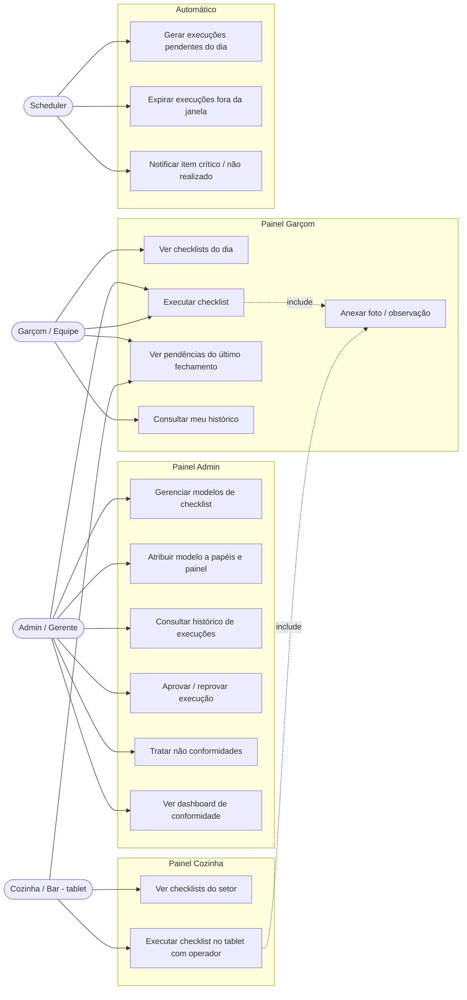
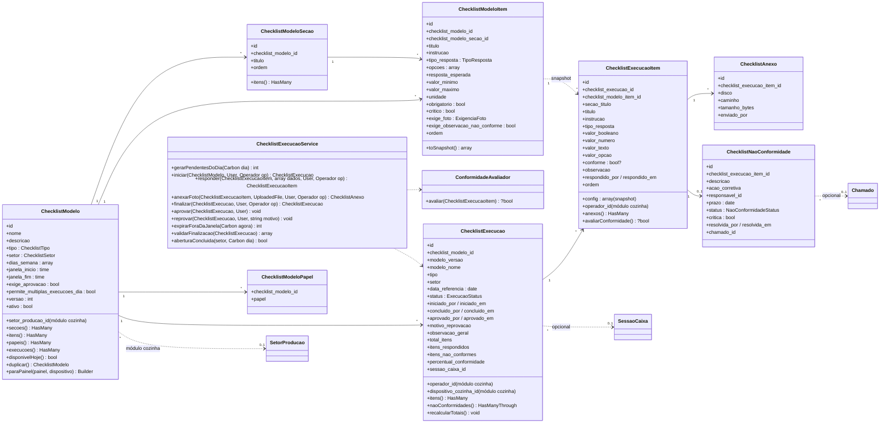
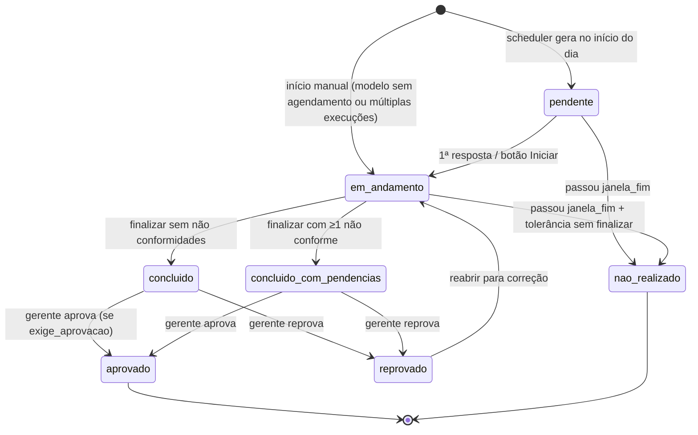
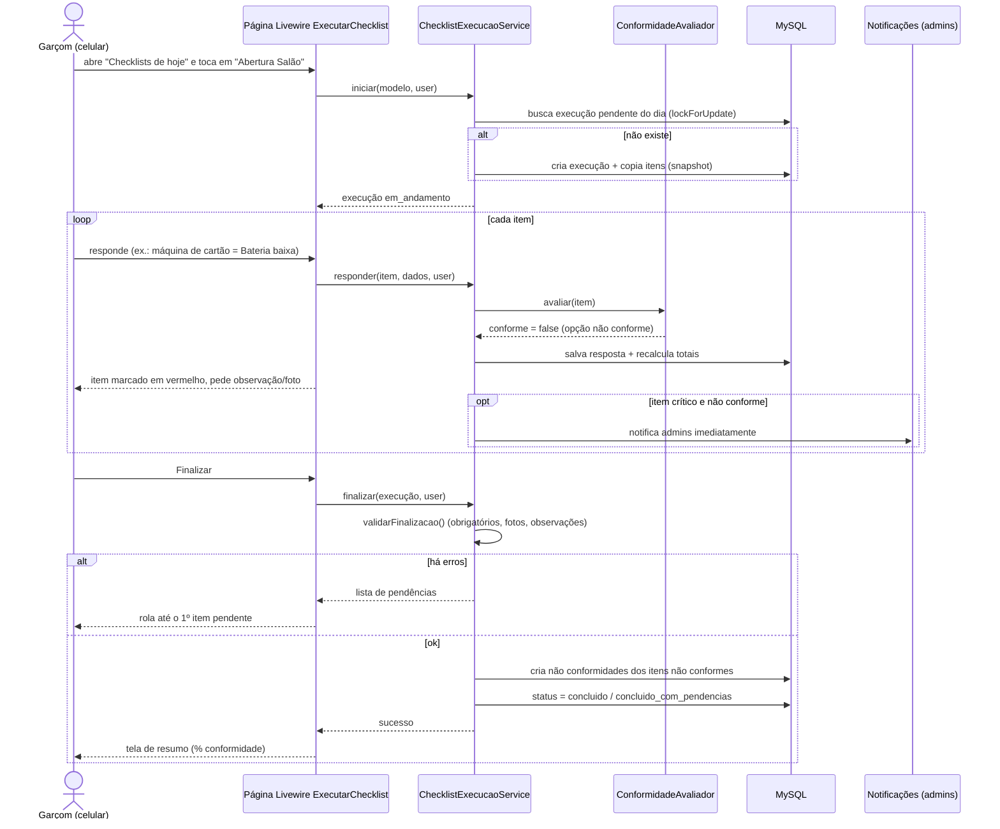
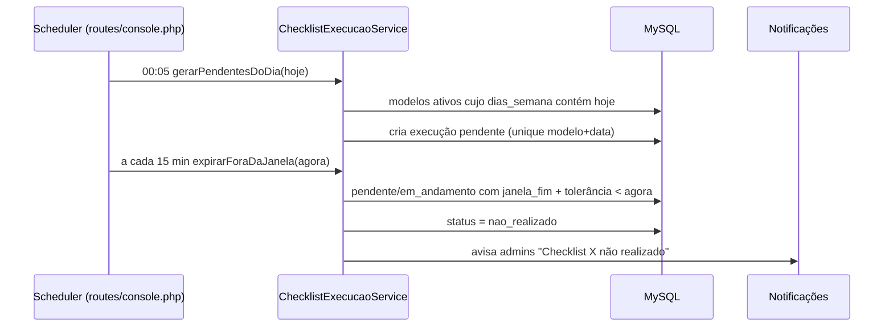

# Módulo de Checklists Dinâmicos — PizzariaAPP

> Especificação + prompt de execução para o Claude Code.
> Stack: Laravel 12 · Filament 4 · Livewire 3 · Alpine 3 · Tailwind v4 · MySQL.
> Painéis afetados: **admin** (gestão, auditoria, aprovação), **garcom** (execução no celular) e **cozinha** (execução no tablet dos checklists da cozinha — ver §10 e `docs/modulo-cozinha.md`).

---

## 0. Como usar este arquivo

1. Salve na raiz do projeto como `docs/modulo-checklists.md`.
2. No Claude Code, rode:

```
Leia docs/modulo-checklists.md inteiro e implemente o módulo seguindo a seção
"9. Plano de execução por fases". Use a skill laravel-dev. Ao fim de cada fase,
pare, mostre o resumo do que foi criado e aguarde meu OK antes de seguir.
Não rode migrate:fresh, db:wipe nem nada destrutivo.
```

---

## 1. Referências de mercado (o que foi incorporado)

Pesquisa feita em sistemas de checklist operacional para food service (Jolt, Xenia, Connecteam, Lumiform, MeazureUp, Checklist Fácil, Makeform). Os padrões recorrentes e o que entra (ou não) no nosso módulo:

| Padrão de mercado | Onde aparece | Decisão no PizzariaAPP |
|---|---|---|
| Modelos (templates) customizáveis, montados pelo gestor | Todos | **Entra** — `checklist_modelos` + seções + itens |
| Checklists agendados / repetíveis (abertura, fechamento, turno) | Jolt, Xenia | **Entra** — dias da semana + janela de horário + geração diária de pendentes |
| Tipos de resposta variados (check, sim/não, número, texto, seleção) | Lumiform, Checklist Fácil | **Entra** — 7 tipos (ver §4.2) |
| Registro de temperatura com faixa aceitável | Jolt (temperature logs) | **Entra** — tipo `temperatura` com mín/máx → conformidade automática |
| Foto como evidência do item | Shiftly, MeazureUp | **Entra** — `exige_foto`: nunca / sempre / só se não conforme |
| Checklist por setor/papel | Shiftly, Makeform | **Entra** — setor + atribuição por papel |
| Não conformidade → plano de ação com responsável e prazo | Checklist Fácil, MeazureUp | **Entra** — `checklist_nao_conformidades` (com vínculo opcional a `chamados`) |
| Assinatura / aprovação do gerente | Makeform, Connecteam | **Entra** — flag `exige_aprovacao` por modelo |
| Notificação em tempo real ao gestor | Connecteam, Jolt | **Entra** — notificação Filament (database) em item crítico e em não realização |
| Passagem de turno (fechamento informa a abertura) | Makeform | **Entra** — pendências do fechamento aparecem na abertura do dia seguinte |
| Perguntas condicionais (dependentes) | Connecteam, Checklist Fácil | **Fase 2 (futuro)** — deixar coluna `condicao` nullable reservada |
| Pontuação/score e ranking entre lojas | MeazureUp, Checklist Fácil | **Parcial** — % de conformidade por execução; ranking multi-loja fica para versão SaaS |
| QR Code no equipamento para abrir o item | Checklist Fácil | **Futuro** |

**Princípio central adotado (unânime nos sistemas auditáveis):** a execução guarda uma **cópia (snapshot) dos itens** no momento em que começa. Editar o modelo depois nunca altera o histórico.

---

## 2. Requisitos

### 2.1 Funcionais

| # | Requisito | Painel |
|---|---|---|
| RF01 | Criar, editar, duplicar, ativar/desativar modelos de checklist com seções e itens ordenáveis | admin |
| RF02 | Definir tipo (abertura, fechamento, turno, limpeza, outro), setor, dias da semana e janela de horário | admin |
| RF03 | Atribuir o modelo a um ou mais papéis (ex.: garçom, cozinha, caixa, gerente) | admin |
| RF04 | Listar os checklists do dia disponíveis para o usuário logado, com status | garcom / cozinha |
| RF05 | Executar o checklist no celular (garçom) ou no tablet (cozinha): responder item a item, anexar foto, observação; salvamento automático a cada resposta | garcom / cozinha |
| RF06 | Calcular conformidade de cada item automaticamente (faixas, resposta esperada, opção conforme) | sistema |
| RF07 | Bloquear finalização com item obrigatório sem resposta, foto exigida ausente ou observação de não conformidade ausente | sistema |
| RF08 | Gerar não conformidade automaticamente para item não conforme; item crítico notifica admins | sistema |
| RF09 | Aprovar/reprovar execuções (quando o modelo exigir) | admin |
| RF10 | Gerar diariamente as execuções `pendente` dos modelos ativos e marcar como `nao_realizado` as que passarem da janela | sistema (scheduler) |
| RF11 | Histórico de execuções com filtros (data, modelo, setor, status, usuário) e visualização completa | admin (tudo) / garcom (só as próprias) / cozinha (concluídos do dia) |
| RF12 | Tratar não conformidades: responsável, prazo, ação corretiva, resolução; opcionalmente abrir chamado de manutenção | admin |
| RF13 | Dashboard: checklists de hoje, % conformidade 30 dias, itens que mais falham | admin |
| RF14 | Na abertura, exibir as pendências deixadas pelo último fechamento | garcom / cozinha |
| RF15 | Direcionar o modelo a um painel: checklists do setor `cozinha` (ou com setor de produção definido) são executados nos tablets da cozinha | admin |

### 2.2 Não funcionais

- Mobile-first no painel garçom (uso com uma mão, botões grandes, câmera nativa via `<input capture>`); layout tablet (paisagem) no painel cozinha.
- Execução colaborativa: mais de uma pessoa pode responder itens da mesma execução; cada resposta registra quem respondeu.
- No tablet compartilhado da cozinha, cada resposta registra o **operador** (a pessoa) além do usuário logado (a conta da estação).
- A execução é um **componente Livewire compartilhado** entre os painéis garçom e cozinha — uma única implementação.
- SoftDeletes em todas as tabelas (padrão do codebase).
- Trilha de auditoria via **Model Observer** (reaproveitar o mecanismo já usado em `chamados` / `FechamentoCaixa`).
- Strings de UI em pt-BR; nomes de tabelas/colunas em português (padrão do projeto).
- Fotos em disco configurável (`config('checklists.disco')`, padrão `public`), comprimidas no client antes do upload (máx. ~1600px).

---

## 3. UML

### 3.1 Casos de uso



### 3.2 Diagrama de classes



`Operador` é o value object do módulo de cozinha (`user_id`, `colaborador_id`, `nome`); no painel garçom é sempre o próprio usuário logado, então o parâmetro é opcional.

### 3.3 Máquina de estados da execução



Execução `em_andamento` que expira **mantém as respostas já dadas** — vira `nao_realizado` com o registro parcial preservado.

### 3.4 Sequência — execução pelo garçom



A execução no tablet da cozinha segue o mesmo fluxo, com operador — ver a sequência 3.9 de `docs/modulo-cozinha.md`.

### 3.5 Sequência — scheduler



---

## 4. Modelagem de dados

### 4.1 Diagrama ER

```mermaid
erDiagram
    users ||--o{ checklist_modelos : "criado_por"
    checklist_modelos ||--o{ checklist_modelo_secoes : tem
    checklist_modelos ||--o{ checklist_modelo_itens : tem
    checklist_modelo_secoes ||--o{ checklist_modelo_itens : agrupa
    checklist_modelos ||--o{ checklist_modelo_papeis : "atribuído a"
    checklist_modelos ||--o{ checklist_execucoes : gera
    checklist_execucoes ||--o{ checklist_execucao_itens : contem
    checklist_modelo_itens |o--o{ checklist_execucao_itens : "origem (snapshot)"
    checklist_execucao_itens ||--o{ checklist_anexos : tem
    checklist_execucao_itens ||--o| checklist_nao_conformidades : gera
    checklist_nao_conformidades }o--o| chamados : "abre (opcional)"
    checklist_execucoes }o--o| sessoes_caixa : "vincula (opcional)"
    users ||--o{ checklist_execucoes : "inicia / conclui / aprova"
    users ||--o{ checklist_execucao_itens : responde
    users ||--o{ checklist_nao_conformidades : "responsável"
    setores_producao |o--o{ checklist_modelos : "tablet (módulo cozinha)"
    dispositivos_cozinha |o--o{ checklist_execucoes : "executado em (módulo cozinha)"

    checklist_modelos {
        bigint id PK
        varchar nome
        text descricao
        varchar tipo
        varchar setor
        json dias_semana
        time janela_inicio
        time janela_fim
        smallint tolerancia_minutos
        bool exige_aprovacao
        bool permite_multiplas_execucoes_dia
        int versao
        bool ativo
        bigint criado_por FK
        bigint setor_producao_id FK "módulo cozinha"
    }
    checklist_modelo_secoes {
        bigint id PK
        bigint checklist_modelo_id FK
        varchar titulo
        smallint ordem
    }
    checklist_modelo_itens {
        bigint id PK
        bigint checklist_modelo_id FK
        bigint checklist_modelo_secao_id FK
        varchar titulo
        text instrucao
        varchar tipo_resposta
        json opcoes
        varchar resposta_esperada
        decimal valor_minimo
        decimal valor_maximo
        varchar unidade
        bool obrigatorio
        bool critico
        varchar exige_foto
        bool exige_observacao_nao_conforme
        json condicao
        smallint ordem
    }
    checklist_modelo_papeis {
        bigint id PK
        bigint checklist_modelo_id FK
        varchar papel
    }
    checklist_execucoes {
        bigint id PK
        bigint checklist_modelo_id FK
        int modelo_versao
        varchar modelo_nome
        varchar tipo
        varchar setor
        date data_referencia
        varchar status
        bigint iniciado_por FK
        datetime iniciado_em
        bigint concluido_por FK
        datetime concluido_em
        bigint aprovado_por FK
        datetime aprovado_em
        text motivo_reprovacao
        text observacao_geral
        smallint total_itens
        smallint itens_respondidos
        smallint itens_nao_conformes
        decimal percentual_conformidade
        bigint sessao_caixa_id FK
        bigint operador_id FK "módulo cozinha"
        varchar operador_nome "módulo cozinha"
        bigint dispositivo_cozinha_id FK "módulo cozinha"
    }
    checklist_execucao_itens {
        bigint id PK
        bigint checklist_execucao_id FK
        bigint checklist_modelo_item_id FK
        varchar secao_titulo
        varchar titulo
        text instrucao
        varchar tipo_resposta
        json config
        bool valor_booleano
        decimal valor_numero
        text valor_texto
        varchar valor_opcao
        bool conforme
        text observacao
        bigint respondido_por FK
        datetime respondido_em
        bigint operador_id FK "módulo cozinha"
        varchar operador_nome "módulo cozinha"
        smallint ordem
    }
    checklist_anexos {
        bigint id PK
        bigint checklist_execucao_item_id FK
        varchar disco
        varchar caminho
        int tamanho_bytes
        bigint enviado_por FK
        bigint operador_id FK "módulo cozinha"
    }
    checklist_nao_conformidades {
        bigint id PK
        bigint checklist_execucao_item_id FK
        text descricao
        text acao_corretiva
        bigint responsavel_id FK
        date prazo
        varchar status
        bool critica
        bigint resolvida_por FK
        datetime resolvida_em
        text observacao_resolucao
        bigint chamado_id FK
    }
```



Todas as tabelas: `timestamps()` + `softDeletes()`. Colunas marcadas "módulo cozinha" são criadas pela migration do módulo de cozinha (§10).

### 4.2 Enums (PHP backed enums em `app/Enums/Checklist/`, com `HasLabel`, `HasColor`, `HasIcon` do Filament)

| Enum | Valores |
|---|---|
| `ChecklistTipo` | `abertura`, `fechamento`, `turno`, `limpeza`, `outro` |
| `ChecklistSetor` | `salao`, `cozinha`, `caixa`, `delivery`, `geral` (confirmar setores reais do projeto) |
| `TipoResposta` | `check` (feito/não feito), `sim_nao`, `numero`, `temperatura`, `texto`, `selecao`, `foto` |
| `ExigenciaFoto` | `nunca`, `sempre`, `se_nao_conforme` |
| `ExecucaoStatus` | `pendente`, `em_andamento`, `concluido`, `concluido_com_pendencias`, `aprovado`, `reprovado`, `nao_realizado` |
| `NaoConformidadeStatus` | `aberta`, `em_andamento`, `resolvida`, `cancelada` |

Colunas de enum gravadas como `string(30)` (não `enum` do MySQL), com cast para o enum PHP.

### 4.3 Detalhes de migration

**`checklist_modelos`**
- `nome` string(120), `descricao` text nullable
- `tipo` string(30) index, `setor` string(30) index
- `dias_semana` json nullable — array de ints ISO (1=seg … 7=dom); `null` = sem agendamento (sob demanda)
- `janela_inicio`, `janela_fim` time nullable; `tolerancia_minutos` unsignedSmallInteger default 30
- `exige_aprovacao` bool default false; `permite_multiplas_execucoes_dia` bool default false
- `versao` unsignedInteger default 1; `ativo` bool default true index
- `criado_por` foreignId → users nullOnDelete

**`checklist_modelo_secoes`** — FK modelo cascadeOnDelete; `ordem` unsignedSmallInteger; index (`checklist_modelo_id`, `ordem`).

**`checklist_modelo_itens`**
- FK modelo cascadeOnDelete; FK seção nullable nullOnDelete
- `titulo` string(200), `instrucao` text nullable
- `tipo_resposta` string(30)
- `opcoes` json nullable — para `selecao`: `[{"valor":"ok","rotulo":"OK","conforme":true}, …]`
- `resposta_esperada` string(10) nullable — para `sim_nao`: `sim` ou `nao`
- `valor_minimo`, `valor_maximo` decimal(10,2) nullable; `unidade` string(10) nullable (`°C`, `kg`, `un`, `%`)
- `obrigatorio` bool default true; `critico` bool default false
- `exige_foto` string(20) default `nunca`; `exige_observacao_nao_conforme` bool default true
- `condicao` json nullable (reservado para perguntas condicionais — **não implementar agora**)
- `ordem` unsignedSmallInteger; index (`checklist_modelo_id`, `ordem`)

**`checklist_modelo_papeis`** — FK modelo cascadeOnDelete; `papel` string(50); unique (`checklist_modelo_id`, `papel`).
> ⚠️ Antes de criar, verificar como o projeto controla papéis (Spatie Permission? coluna `role`/`perfil` em `users`? guard por painel?). Se for Spatie, trocar por FK para `roles.id`.

**`checklist_execucoes`**
- FK modelo restrictOnDelete (modelo com execução não é apagado fisicamente — só soft delete/desativação)
- `modelo_versao`, `modelo_nome`, `tipo`, `setor` (snapshot do cabeçalho)
- `data_referencia` date index — o "dia operacional" (fechamento após meia-noite pertence ao dia anterior: usar `config('checklists.virada_dia', '05:00')`)
- `status` string(30) index
- `iniciado_por`, `concluido_por`, `aprovado_por` foreignId users nullable nullOnDelete + datetimes
- `motivo_reprovacao`, `observacao_geral` text nullable
- contadores unsignedSmallInteger default 0; `percentual_conformidade` decimal(5,2) nullable
- `sessao_caixa_id` nullable (FK só se a tabela existir — confirmar nome real)
- index (`checklist_modelo_id`, `data_referencia`), index (`data_referencia`, `status`)
- **Unicidade**: quando `permite_multiplas_execucoes_dia = false`, garantir uma execução por modelo+dia no Service com `lockForUpdate` (unique parcial não existe no MySQL; alternativa: coluna gerada `chave_unica` = `CONCAT(modelo_id,'-',data_referencia)` nullable + unique — escolher uma e documentar).

**`checklist_execucao_itens`**
- FK execução cascadeOnDelete; FK item do modelo nullable nullOnDelete (histórico sobrevive à exclusão do item)
- snapshot: `secao_titulo`, `titulo`, `instrucao`, `tipo_resposta`, `config` json (`opcoes`, `resposta_esperada`, `valor_minimo`, `valor_maximo`, `unidade`, `obrigatorio`, `critico`, `exige_foto`, `exige_observacao_nao_conforme`)
- respostas: `valor_booleano` bool nullable, `valor_numero` decimal(10,2) nullable, `valor_texto` text nullable, `valor_opcao` string(50) nullable
- `conforme` bool nullable (null = não respondido / não avaliável)
- `observacao` text nullable; `respondido_por` FK users nullable; `respondido_em` datetime nullable
- `ordem`; index (`checklist_execucao_id`, `ordem`), index (`checklist_modelo_item_id`, `conforme`) — para o relatório "itens que mais falham"

**`checklist_anexos`** — FK item execução cascadeOnDelete; `disco` string(30), `caminho` string(255), `tamanho_bytes` unsignedInteger, `enviado_por` FK users.
> Se o projeto já usa `spatie/laravel-medialibrary`, usar coleção `fotos` no `ChecklistExecucaoItem` e dispensar esta tabela.

**`checklist_nao_conformidades`**
- FK item execução cascadeOnDelete, unique (uma NC por item)
- `descricao` text, `acao_corretiva` text nullable
- `responsavel_id` FK users nullable, `prazo` date nullable
- `status` string(20) index default `aberta`, `critica` bool
- `resolvida_por`, `resolvida_em`, `observacao_resolucao`
- `chamado_id` nullable → FK para `chamados` (confirmar nome da tabela do módulo de manutenção)

**Colunas acrescentadas pelo módulo de cozinha** (migration lá, por dependerem de `setores_producao` e `dispositivos_cozinha`): `checklist_modelos.setor_producao_id`; `checklist_execucoes.operador_id`, `operador_nome`, `dispositivo_cozinha_id`; `checklist_execucao_itens.operador_id`, `operador_nome`; `checklist_anexos.operador_id`. Todas nullable — o módulo de checklists funciona sem elas.

---

## 5. Regras de negócio

### 5.1 Avaliação de conformidade (`ConformidadeAvaliador`)

| Tipo | Valor gravado em | Conforme quando |
|---|---|---|
| `check` | `valor_booleano` | `true` |
| `sim_nao` | `valor_booleano` | igual a `resposta_esperada` (se nula → sempre conforme) |
| `numero` | `valor_numero` | dentro de [`valor_minimo`, `valor_maximo`] (limites nulos = abertos) |
| `temperatura` | `valor_numero` | idem `numero`; UI mostra `°C` e teclado numérico com sinal negativo |
| `selecao` | `valor_opcao` | opção escolhida tem `conforme: true` |
| `texto` | `valor_texto` | preenchido → `true` (não avalia conteúdo) |
| `foto` | anexo | ≥1 anexo → `true` |

Sem resposta → `conforme = null`.

### 5.2 Validação ao finalizar (`validarFinalizacao`)
Retorna lista de erros por item; bloqueia se:
1. item `obrigatorio` sem resposta;
2. `exige_foto = sempre` sem anexo, ou `se_nao_conforme` + `conforme = false` sem anexo;
3. `conforme = false` + `exige_observacao_nao_conforme` sem `observacao`.

### 5.3 Ao finalizar (dentro de `DB::transaction` + `lockForUpdate` na execução)
- Recalcula contadores e `percentual_conformidade = conformes / avaliados × 100`.
- Para cada item `conforme = false`: cria `ChecklistNaoConformidade` (`descricao` = título + valor + observação; `critica` = config.critico).
- Status: `concluido` se 0 não conformes, senão `concluido_com_pendencias`.
- Se modelo `exige_aprovacao`: notifica gerentes/admins.

### 5.4 Item crítico
Notificação imediata (Filament database notification + broadcast se o projeto já usar Reverb/Pusher) **no momento da resposta**, não só na finalização — ex.: freezer fora da faixa às 18h não pode esperar o fim do checklist.

### 5.5 Versionamento do modelo
- Ao salvar um modelo que já tem execuções, incrementar `versao` (Observer `updating`/evento após salvar repeater).
- Execuções `pendente` ainda **sem respostas** são regeneradas com o novo snapshot; `em_andamento` mantêm o snapshot original.

### 5.6 Dia operacional
`data_referencia` = data atual se hora ≥ `virada_dia`, senão dia anterior. Pizzaria fecha depois da meia-noite: o fechamento de sábado feito à 00:40 de domingo pertence a sábado.

### 5.7 Passagem de turno (RF14)
Ao abrir um checklist do tipo `abertura`, mostrar no topo as NCs `aberta` geradas pelo último `fechamento` do mesmo setor.

### 5.8 Permissões (Policies)
| Ação | admin | gerente | garçom/equipe |
|---|---|---|---|
| CRUD de modelos | ✅ | ✅ | ❌ |
| Ver todas as execuções | ✅ | ✅ | ❌ (só as que iniciou/respondeu) |
| Executar checklist | ✅ | ✅ | ✅ se o papel está em `checklist_modelo_papeis` |
| Responder após finalizado | ❌ | ❌ | ❌ (só reabrindo via reprovação) |
| Aprovar/reprovar | ✅ | ✅ | ❌ |
| Tratar NC | ✅ | ✅ | ❌ (só vê as próprias) |

No tablet da cozinha, a verificação de papel usa o papel do **operador** ativo, não o da conta da estação (§10).

Auditoria: Observer em `ChecklistModelo`, `ChecklistExecucao`, `ChecklistExecucaoItem` e `ChecklistNaoConformidade`, usando o mesmo mecanismo de audit trail dos `chamados`.

---

## 6. Painel **admin** (Filament 4)

Grupo de navegação: **Operação → Checklists**.

### 6.1 `ChecklistModeloResource`
Estrutura v4: `app/Filament/Admin/Resources/ChecklistModelos/{Pages,Schemas,Tables}` (ajustar ao namespace real do painel).

**Form (`ChecklistModeloForm`)**
- `Section` "Identificação" (`columns(2)`): nome, tipo (Select enum), setor, descrição, ativo (Toggle).
- `Section` "Agendamento": `CheckboxList` dias_semana (Seg…Dom, `columns(7)`), janela_inicio/janela_fim (`TimePicker`), tolerancia_minutos, permite_multiplas_execucoes_dia.
- `Section` "Atribuição e controle": papéis (`Select` multiple ou `CheckboxList` ligado à relação `papeis`), exige_aprovacao; e, quando o módulo de cozinha estiver instalado, **Tablet / setor de produção** (`Select` nullable de `setores_producao`, dica "vazio = todos os tablets da cozinha").
- `Section` "Itens":
  - `Repeater::make('secoes')->relationship()->orderColumn('ordem')->reorderable()->collapsible()->itemLabel(fn ($state) => $state['titulo'] ?? null)`
  - dentro dele `Repeater::make('itens')->relationship()->orderColumn('ordem')->reorderable()->collapsed()` com:
    - titulo, instrucao, `tipo_resposta` (`->live()`)
    - `valor_minimo`/`valor_maximo`/`unidade` → `->visible(fn (Get $get) => in_array($get('tipo_resposta'), ['numero','temperatura']))`
    - `resposta_esperada` (Radio sim/não) → visível só em `sim_nao`
    - `opcoes` (Repeater simples: valor, rótulo, conforme) → visível só em `selecao`
    - obrigatorio, critico, exige_foto (Select), exige_observacao_nao_conforme
  - Itens do repeater interno devem receber também o `checklist_modelo_id` ao salvar (`mutateRelationshipDataBeforeCreateUsing`).
- Usar `Filament\Schemas\Components\Section` e `Filament\Schemas\Components\Utilities\Get`.

**Table**: nome, tipo (badge), setor (badge), **painel** (Garçom / Cozinha / Cozinha — Bar), dias (texto curto "Seg–Sáb"), janela, nº de itens (`counts('itens')`), papéis, ativo (ToggleColumn), versão. Filtros: tipo, setor, painel, ativo, TrashedFilter.
`recordActions`: Edit, **Duplicar** (copia modelo+seções+itens, nome "(cópia)", inativo), **Pré-visualizar** (modal com o checklist renderizado em leitura), Delete. `toolbarActions`: DeleteBulk, RestoreBulk.

### 6.2 `ChecklistExecucaoResource` (somente leitura + ações)
- Sem Create/Edit. Páginas: List + View.
- **Table**: data_referencia, modelo_nome, tipo, setor, status (badge com cor do enum), iniciado_por (ou operador, quando houver), concluido_em, `percentual_conformidade` (com cor: ≥95 verde, ≥80 amarelo, <80 vermelho), itens_nao_conformes. `modifyQueryUsing` com `with(['iniciadoPor','concluidoPor'])`.
  Filtros: período (DatePicker de/até), modelo, tipo, setor, status, usuário. Padrão: últimos 7 dias.
- **Infolist (View)**: cabeçalho com status/responsáveis/tempos (e tablet, quando houver); `RepeatableEntry` por seção listando título, resposta formatada, ícone conforme/não conforme, observação, miniaturas das fotos (`ImageEntry` com lightbox), quem respondeu (operador, se houver) e quando.
- `recordActions` / header actions: **Aprovar**, **Reprovar** (modal com motivo; volta para `em_andamento`), **Exportar PDF** (opcional, fase final).

### 6.3 `ChecklistNaoConformidadeResource`
- Table: criada em, checklist/item, valor registrado, crítica (ícone), responsável, prazo (vermelho se vencido), status. Filtros: status (padrão: aberta + em_andamento), crítica, vencidas.
- Edit: responsável, prazo, ação corretiva, status, observação de resolução.
- Action **Abrir chamado**: cria registro no módulo `chamados` pré-preenchido e grava `chamado_id` (somente se o módulo existir).
- Badge de navegação com o nº de NCs abertas (`getNavigationBadge`).

### 6.4 Widgets do dashboard
- `ChecklistsHojeWidget` (tabela/cards): cada modelo esperado hoje × status atual, com filtro por painel.
- `ConformidadeStatsWidget`: % conformidade médio 7/30 dias, nº de não realizados no mês, NCs abertas.
- `ItensMaisFalhamWidget`: top 10 `titulo` com mais `conforme = false` nos últimos 30 dias.

---

## 7. Painel **garçom** (mobile-first)

Não usar Resource com form padrão para executar — usar **páginas customizadas Filament com Livewire** para controle total da UX.

**Componentes compartilhados com o painel cozinha:** a execução fica no componente Livewire `App\Livewire\Checklists\ExecucaoChecklist` (props: execução `#[Locked]`, operador opcional, `layout` = `celular` | `tablet`) e a lista no `App\Livewire\Checklists\ChecklistsDoDia` (props: painel e dispositivo). As páginas abaixo só hospedam esses componentes com `layout = celular`; o painel cozinha os hospeda com `layout = tablet`.

### 7.1 `Pages\ChecklistsDoDia` (item de navegação "Checklists", ícone `Heroicon::OutlinedClipboardDocumentCheck`)
- Cards grandes por checklist disponível hoje para os papéis do usuário, no escopo `ChecklistModelo::paraPainel('garcom')` (por padrão exclui os da cozinha): nome, tipo, janela de horário, barra de progresso (`itens_respondidos/total_itens`), status com cor.
- Ordem: em andamento → pendentes dentro da janela → pendentes futuros → concluídos.
- Botão "Iniciar" / "Continuar"; concluídos abrem em leitura.
- Modelos sob demanda (sem `dias_semana`) aparecem numa seção "Outros checklists".
- Badge na navegação com nº de pendentes da janela atual.

### 7.2 `Pages\ExecutarChecklist` (rota com `{execucao}`, oculta da navegação)
- Topo fixo: nome, barra de progresso, % conformidade parcial.
- Bloco "Pendências do último fechamento" quando tipo = abertura (RF14).
- Itens agrupados por seção, um card por item:
  - `check`/`sim_nao`: dois botões grandes (✓ / ✗ ou Sim / Não).
  - `numero`/`temperatura`: `<input type="number" inputmode="decimal" step="0.1">` + unidade + faixa esperada como dica.
  - `selecao`: botões/chips.
  - `texto`: textarea.
  - foto: `<input type="file" accept="image/*" capture="environment">` com `WithFileUploads`; compressão no client via canvas (Alpine) antes do envio.
- **Autosave**: cada resposta chama `responder()` no Service (`wire:model.blur` / `wire:click`), feedback visual imediato (verde/vermelho) e campos de observação/foto aparecem quando o item fica não conforme.
- Botão "Finalizar" fixo no rodapé; ao falhar validação, destacar itens e fazer scroll ao primeiro (Alpine `$el.scrollIntoView`).
- Tela de resumo pós-finalização.
- Toda a lógica no `ChecklistExecucaoService` — o componente só orquestra.
- Funcionar offline está **fora do escopo**; mostrar aviso se a requisição falhar e manter o valor local para reenviar.

### 7.3 `ChecklistExecucaoResource` (garçom) — histórico
- Somente List + View, escopo `whereHas`: execuções que o usuário iniciou ou em que respondeu itens, últimos 30 dias.

---

## 8. Infraestrutura

- `config/checklists.php`: `disco`, `virada_dia` (`05:00`), `tolerancia_padrao`, `max_foto_kb`.
- `app/Services/Checklist/ChecklistExecucaoService.php`, `app/Services/Checklist/ConformidadeAvaliador.php`.
- Commands: `checklists:gerar-pendentes {--data=}` e `checklists:expirar`.
- Agendamento em `routes/console.php` (Laravel 12):
  ```php
  Schedule::command('checklists:gerar-pendentes')->dailyAt('05:05');
  Schedule::command('checklists:expirar')->everyFifteenMinutes();
  ```
  (gerar após a `virada_dia`, não à meia-noite.)
- Notifications: `ChecklistItemCriticoNotification`, `ChecklistNaoRealizadoNotification`, `ChecklistAguardandoAprovacaoNotification` (canal `database` → sino do Filament).
- Factories para todos os models; Seeder `ChecklistModelosExemploSeeder`.

### 8.1 Seeder de exemplo (pizzaria)

**Abertura — Cozinha** (seg–dom, 16:00–18:30, papéis: cozinha, gerente — executado no tablet da cozinha)
- Seção Equipamentos: Forno ligado e pré-aquecido (check, crítico) · Temperatura câmara fria (temperatura, 0 a 5 °C, crítico, foto se não conforme) · Temperatura freezer (temperatura, −25 a −18 °C, crítico) · Gás aberto e sem vazamento (sim_nao, esperado sim, crítico)
- Seção Pré-preparo: Massas porcionadas para o dia (numero, mín 40, un) · Molho de tomate pronto (check) · Insumos com etiqueta de validade (sim_nao)
- Seção Higiene: Bancadas higienizadas (check, foto sempre) · Uniforme e touca da equipe (check)

**Abertura — Salão** (seg–dom, 17:00–18:45, papéis: garcom, gerente)
- Mesas e cadeiras limpas e alinhadas · Banheiros abastecidos (papel, sabão) · Cardápios/QR Codes nas mesas · Máquinas de cartão carregadas (selecao: OK / Bateria baixa ✗ / Sem sinal ✗) · Iluminação e som ligados · Bebidas geladas repostas

**Fechamento — Cozinha** (seg–dom, 22:30–01:30, papéis: cozinha, gerente, exige aprovação — executado no tablet da cozinha)
- Forno desligado (check, crítico) · Gás fechado (sim_nao, crítico, foto sempre) · Temperatura câmara fria/freezer no fechamento · Sobras armazenadas e etiquetadas · Lixo retirado · Piso e coifa limpos (foto sempre) · Observações para a abertura (texto, opcional)

**Fechamento — Salão** (seg–dom, 22:30–01:30, papéis: garcom, gerente)
- Mesas limpas · Ar-condicionado e luzes desligados · Portas e janelas trancadas (crítico) · Máquinas de cartão no carregador

---

## 9. Plano de execução por fases (para o Claude Code)

> Pare ao fim de cada fase, liste arquivos criados/alterados e aguarde OK.

**Fase 0 — Reconhecimento (não escrever código)**
1. Confirmar versões em `composer.json`/`package.json` e IDs/namespaces dos painéis `admin`, `garcom` e (se já existir) `cozinha` em `app/Providers/Filament/`.
2. Descobrir como papéis/perfis são controlados (Spatie? coluna em `users`? guard por painel?).
3. Localizar o mecanismo de auditoria via Observer usado em `chamados`/`FechamentoCaixa` e o padrão de enums existente.
4. Confirmar nomes das tabelas `sessoes_caixa`/`sessao_caixa` e `chamados`, e se `spatie/laravel-medialibrary` está instalado.
5. Apresentar um resumo e as adaptações que fará nesta especificação.

**Fase 1 — Banco e domínio**
Enums → migrations (na ordem do ER) → models (`$fillable`, `casts()`, relações, SoftDeletes, scopes `ativos()`, `disponiveisPara(User)`, `doDia()`, `paraPainel()`) → factories → `config/checklists.php`.

**Fase 2 — Regras**
`ConformidadeAvaliador`, `ChecklistExecucaoService` (todos os métodos do diagrama de classes, com `Operador` opcional), Observers de auditoria e versionamento, Policies, Notifications, Commands + agendamento.
Testes Pest: avaliação por tipo; finalização bloqueada; NC gerada; unicidade modelo+dia com concorrência; dia operacional pós-meia-noite; expiração; snapshot preservado após editar modelo.

**Fase 3 — Painel admin**
`ChecklistModeloResource` (com Duplicar e Pré-visualizar), `ChecklistExecucaoResource` (View + Aprovar/Reprovar), `ChecklistNaoConformidadeResource` (+ Abrir chamado), widgets.

**Fase 4 — Painel garçom**
Componentes compartilhados `ExecucaoChecklist` e `ChecklistsDoDia` (Livewire + Alpine, compressão de foto, autosave, layouts `celular` e `tablet`), páginas `ChecklistsDoDia` e `ExecutarChecklist`, histórico. Testar em viewport 390px. As páginas do painel cozinha são feitas no módulo de cozinha (§6.8 de `docs/modulo-cozinha.md`).

**Fase 5 — Seeder e acabamento**
`ChecklistModelosExemploSeeder`, revisão de N+1 (Debugbar), traduções, lista final de comandos:
`php artisan migrate`, `php artisan db:seed --class=ChecklistModelosExemploSeeder`, `php artisan storage:link`, `php artisan optimize:clear`, `npm run build`, e conferir se o `schedule:run` está no cron do servidor.

### Regras para o Claude Code
- Filament 4: `Schema` (não `Form`), `recordActions`/`toolbarActions`, actions em `Filament\Actions\`, layout em `Filament\Schemas\Components\`, `Get`/`Set` em `Filament\Schemas\Components\Utilities\`, ícones com enum `Heroicon`, `->columns(n)` explícito em Section/Grid.
- Livewire 3: atributos `#[Locked]` no ID da execução, `#[Computed]` para itens agrupados, `WithFileUploads`.
- Nada de lógica de negócio em componentes/Resources — tudo passa pelo Service.
- `decimal` para números; nunca `float`.
- Toda escrita concorrente na execução dentro de `DB::transaction` com `lockForUpdate`.
- UI em pt-BR. Não executar comandos destrutivos.

---

## 10. Execução no painel da cozinha

Os checklists da cozinha são executados nos **tablets do painel cozinha**, não no celular do garçom. Especificação completa em `docs/modulo-cozinha.md` (§4.3, §5.10, §6.8); resumo do que muda aqui:

- **Destino do modelo** — `ChecklistModelo::paraPainel($painel, $dispositivo)`:
  - `cozinha`: modelos com `setor_producao_id` entre os setores do tablet, ou com `setor_producao_id` nulo e `setor` em `config('cozinha.checklists.setores_checklist')` (padrão `['cozinha']`);
  - `garcom`: todos os demais; os da cozinha só se `config('cozinha.checklists.exibir_tambem_no_garcom')`;
  - admin vê todos.
- **Operador** — no tablet a conta logada é a da estação; `ChecklistExecucaoService` recebe o `Operador` (pessoa) e grava `operador_id`/`operador_nome` na execução, em cada resposta e em cada foto. A autorização por papel usa o papel do operador. Sem operador ativo, o checklist abre só para leitura.
- **Convivência com a produção** — pedido novo nunca espera checklist: o tablet avisa e oferece voltar à fila, e o autosave guarda o progresso.
- **Bloqueio opcional** — com `cozinha.checklists.bloquear_producao_sem_abertura`, o módulo de cozinha consulta `ChecklistExecucaoService::aberturaConcluida($setor, $dia)` antes de deixar iniciar a produção (padrão desligado; gerente pode liberar com justificativa).
- **Sem duplicação de motor** — snapshot, conformidade, validação, NCs, item crítico, aprovação, scheduler e dia operacional são os deste módulo.

---

## 11. Fora do escopo desta versão (backlog)
- Perguntas condicionais (coluna `condicao` já reservada).
- Modo offline (PWA com fila local).
- QR Code no equipamento abrindo o item específico.
- Integração do sensor IoT de freezer (ESP32) preenchendo automaticamente o item de temperatura.
- Ranking e comparativo entre unidades (versão SaaS multi-tenant via Razel Tec).
- Assinatura desenhada na tela.
