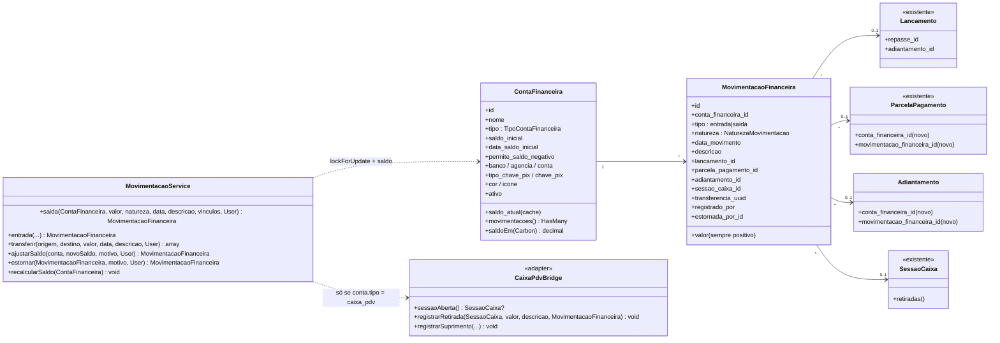
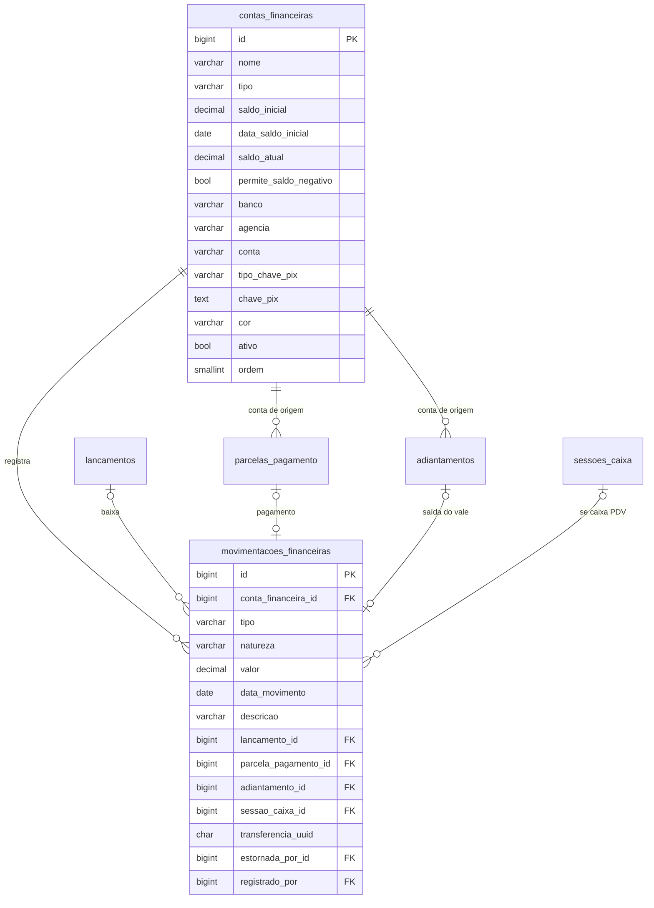
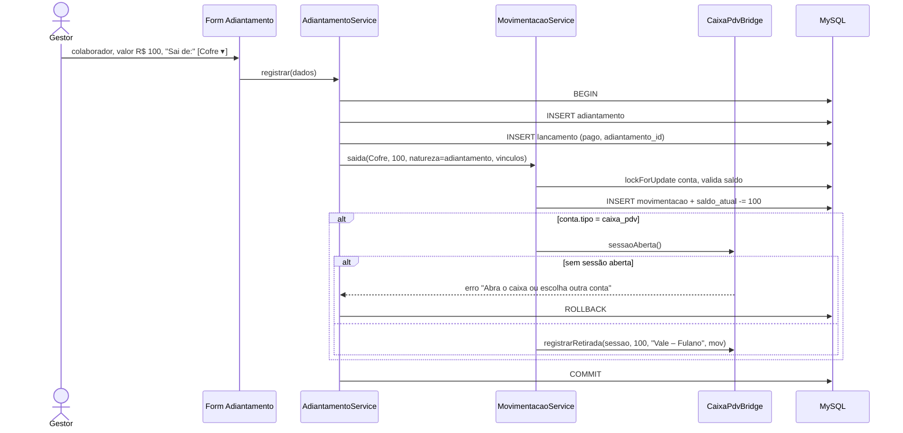
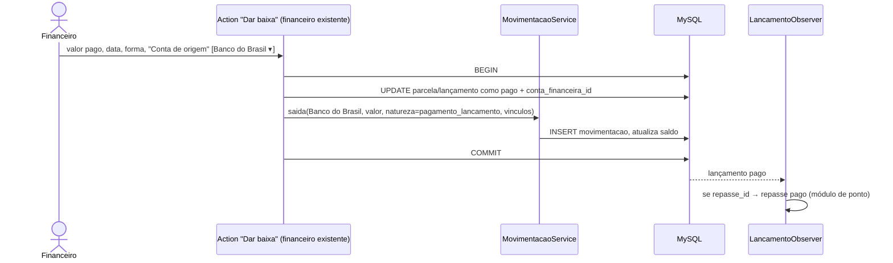

# Módulo Contas Financeiras (Banco / Caixa) — PizzariaAPP

> Pré-requisito dos adiantamentos e da baixa de repasses do módulo Folha de Ponto.
> Objetivo: todo pagamento informa **de onde o dinheiro saiu** (caixa do PDV, cofre, conta bancária, conta digital), e cada conta tem saldo e extrato.
> Stack: Laravel 12 · Filament 4 · Livewire 3 · MySQL. Mesmas regras de código da spec de ponto.

---

## 1. Conceitos

| Conceito | O que é | Exemplo |
|---|---|---|
| **Conta financeira** | Qualquer lugar onde a empresa guarda dinheiro | "Caixa PDV", "Cofre", "Banco do Brasil", "Conta Stone", "Nubank PJ" |
| **Movimentação** | Entrada ou saída de dinheiro **real** numa conta, numa data | Pagamento do vale de R$ 100 saindo do Cofre |
| **Lançamento** (existente) | O compromisso financeiro: despesa ou receita, com vencimento e categoria | Conta a pagar "Repasse 01–15/10 – Fulano" |
| **Transferência** | Dinheiro trocando de conta (não é despesa nem receita) | Sangria do Caixa PDV para o Cofre; depósito do Cofre no banco |

Regra central: **lançamento** diz *o quê* e *quando vence*; **movimentação** diz *de onde saiu e quando saiu*. A baixa de um lançamento gera uma movimentação na conta escolhida.

---

## 2. Requisitos

| # | Requisito |
|---|---|
| RF01 | Cadastrar contas financeiras: nome, tipo, saldo inicial com data, dados bancários/PIX opcionais, ativo |
| RF02 | Ao dar baixa num lançamento (qualquer um, inclusive repasse), o usuário **escolhe a conta de origem** (obrigatório daqui pra frente) |
| RF03 | Ao registrar adiantamento/vale, o usuário escolhe a conta de origem; a saída é registrada nela |
| RF04 | Se a conta escolhida for do tipo **caixa PDV**, exige sessão de caixa aberta e registra a retirada também na sessão (para o fechamento bater) |
| RF05 | Para qualquer outra conta, a sessão de caixa **não é tocada** |
| RF06 | Transferência entre contas (sangria para cofre, depósito no banco, saque) |
| RF07 | Saldo atual por conta e extrato com filtro de período |
| RF08 | Ajuste de saldo (correção de diferença) com motivo, só admin |
| RF09 | Bloquear saída que deixe saldo negativo, exceto contas marcadas `permite_saldo_negativo` (ex.: banco com cheque especial) |

---

## 3. UML

### 3.1 Classes

### 3.2 ER

### 3.3 Sequência — vale pago com escolha da conta

### 3.4 Sequência — baixa de lançamento (repasse ou qualquer conta a pagar)

---

## 4. Enums (`app/Enums/Financeiro/`)

| Enum | Valores |
|---|---|
| `TipoContaFinanceira` | `caixa_pdv` (só pode existir 1 ativa — é a gaveta das sessões de caixa), `caixa_interno` (cofre, fundo de troco), `banco`, `conta_digital` (Stone, Mercado Pago, Nubank), `outro` |
| `NaturezaMovimentacao` | `pagamento_lancamento`, `recebimento_lancamento`, `adiantamento`, `transferencia`, `ajuste_saldo`, `estorno`, `saldo_inicial` |

---

## 5. Migrations

**`contas_financeiras`** — `nome` string(80) unique; `tipo` string(30) index; `saldo_inicial`/`saldo_atual` decimal(12,2) default 0; `data_saldo_inicial` date; `permite_saldo_negativo` bool default false; dados bancários nullable; `chave_pix` text `encrypted`; `cor` string(20) nullable; `ativo`, `ordem`; timestamps + softDeletes.

**`movimentacoes_financeiras`** — FK conta restrictOnDelete; `tipo` string(10); `natureza` string(30); `valor` decimal(12,2) (>0, sinal pelo `tipo`); `data_movimento` date index; `descricao` string(255); FKs nullable para `lancamentos`, `parcelas_pagamento`, `adiantamentos`, `sessoes_caixa` (nomes reais a confirmar), todas `nullOnDelete` exceto lancamento (`restrictOnDelete`); `transferencia_uuid` char(36) nullable index; `estornada_por_id` self-FK nullable; `registrado_por` FK users. **Sem update/delete** — correção é por estorno (movimentação inversa), igual ao ponto. Sem softDeletes.
Índices: (`conta_financeira_id`, `data_movimento`).

**Alterações em tabelas existentes** (somente colunas nullable novas):
- `parcelas_pagamento` (ou onde a baixa é registrada): `conta_financeira_id` FK nullable, `movimentacao_financeira_id` FK nullable.
- `adiantamentos` (módulo de ponto): `conta_financeira_id` FK **not null**, `movimentacao_financeira_id` FK nullable.

**Seeder** `ContasFinanceirasSeeder`: cria "Caixa PDV" (`caixa_pdv`) e "Cofre" (`caixa_interno`) com saldo 0; contas bancárias o usuário cadastra.

---

## 6. Regras de negócio

1. Toda saída/entrada passa pelo `MovimentacaoService`, em `DB::transaction` com `lockForUpdate` na conta. `saldo_atual` é cache; `recalcularSaldo()` reconstrói a partir de `saldo_inicial` + movimentações após `data_saldo_inicial` (comando `financeiro:recalcular-saldos` para conferência).
2. **Saldo negativo** bloqueado, salvo `permite_saldo_negativo`.
3. **Conta `caixa_pdv`**: exige sessão de caixa aberta; a retirada é gravada na sessão pelo `CaixaPdvBridge` com referência à movimentação. Outras contas nunca tocam a sessão.
4. **Sem duplicidade com a importação de sessões**: a retirada criada pelo bridge fica marcada como vinculada (`movimentacao_financeira_id` ou flag equivalente na tabela de retiradas da sessão). A importação de sessão → financeiro deve **ignorar retiradas vinculadas**, porque o lançamento já existe (adiantamento ou baixa). Verificar o comportamento atual da importação antes de implementar.
5. **Transferência**: duas movimentações (saída na origem, entrada no destino) com o mesmo `transferencia_uuid`, natureza `transferencia`; não gera lançamento, não afeta DRE. Se uma das pontas for o caixa PDV, o bridge registra retirada (sangria) ou suprimento na sessão.
6. **Estorno**: cria movimentação inversa ligada por `estornada_por_id`; estornar a movimentação de uma baixa reabre a parcela/lançamento (e, se for repasse, o repasse volta a `aprovado`).
7. **Baixa sem conta**: a partir da implantação, o campo é obrigatório no form de baixa. Lançamentos pagos antes ficam com `conta_financeira_id` null (histórico preservado, não entram no saldo).
8. Forma de pagamento e conta são coisas diferentes: forma (PIX, dinheiro, cartão) continua existindo; ao escolher a conta, sugerir forma coerente (caixa → dinheiro; banco → PIX/TED), sem travar.

### Permissões
| Ação | admin | gerente | demais |
|---|---|---|---|
| Cadastrar/editar contas | ✅ | ❌ | ❌ |
| Ver saldos e extrato | ✅ | ✅ (configurável por conta) | ❌ |
| Escolher conta ao pagar/dar vale | ✅ | ✅ | ❌ |
| Transferência | ✅ | ✅ | ❌ |
| Ajuste de saldo / estorno | ✅ | ❌ | ❌ |

---

## 7. Filament (painel admin, grupo **Financeiro**)

| Recurso / Página | Conteúdo |
|---|---|
| `ContaFinanceiraResource` | Form: identificação, tipo, saldo inicial + data, dados bancários/PIX (visíveis só para `banco`/`conta_digital` via `Get`), permite negativo, cor. Table: nome, tipo (badge), saldo atual (cor verde/vermelho), ativo. Actions: "Extrato", "Transferir", "Ajustar saldo" (admin). Header action "Recalcular saldos". |
| `MovimentacaoFinanceiraResource` (somente leitura) | Extrato geral filtrável por conta, período, natureza; colunas com link para o lançamento/adiantamento de origem; action "Estornar" (admin). |
| Widget `SaldosContasWidget` | Card por conta ativa com saldo atual, no dashboard financeiro. |
| **Alteração no financeiro existente** | Action de baixa (e Repeater de `parcelas_pagamento`): novo `Select` "Conta de origem" obrigatório, opções `ContaFinanceira::ativas()` com saldo no rótulo ("Cofre — R$ 1.250,00"); se `caixa_pdv` sem sessão aberta, mensagem de validação. A action chama o `MovimentacaoService`. |
| **Form de Adiantamento (ponto)** | `Select` "Sai de" obrigatório, mesmo componente reutilizável `ContaFinanceiraSelect::make()`. |

---

## 8. Testes (Pest)
- Vale saindo do Cofre: cria adiantamento + lançamento pago + 1 movimentação; sessão de caixa intocada.
- Vale saindo do Caixa PDV com sessão aberta: retirada registrada na sessão e vinculada; fechamento da sessão bate.
- Vale do Caixa PDV sem sessão aberta: erro e rollback completo.
- Saldo insuficiente bloqueia; conta com negativo permitido aceita.
- Baixa de repasse escolhendo banco: movimentação criada, repasse vira pago.
- Transferência Caixa PDV → Cofre: 2 movimentações, sangria na sessão, nenhum lançamento.
- Estorno de baixa reabre o lançamento e devolve o saldo.
- Importação de sessão não duplica retirada vinculada.
- `recalcularSaldo()` bate com `saldo_atual` após operações concorrentes.

---

## 9. Ordem de implementação
Este módulo entra **antes** dos adiantamentos e da integração de repasses:
1. Fase 0 complementar (leitura): onde e como a baixa é gravada hoje (lançamento vs `parcelas_pagamento`), estrutura de retiradas/sangrias da sessão de caixa, se a importação de sessão gera lançamentos de retirada, se já existe alguma tabela de bancos/contas.
2. Migrations + enums + models + seeder (junto da Fase 1 do ponto, antes da migration de `adiantamentos`).
3. `MovimentacaoService` + `CaixaPdvBridge` + testes.
4. Filament: resource de contas, extrato, widget, `ContaFinanceiraSelect`, alteração da baixa no financeiro.
5. Só então: adiantamentos e baixa de repasses usando a conta.
