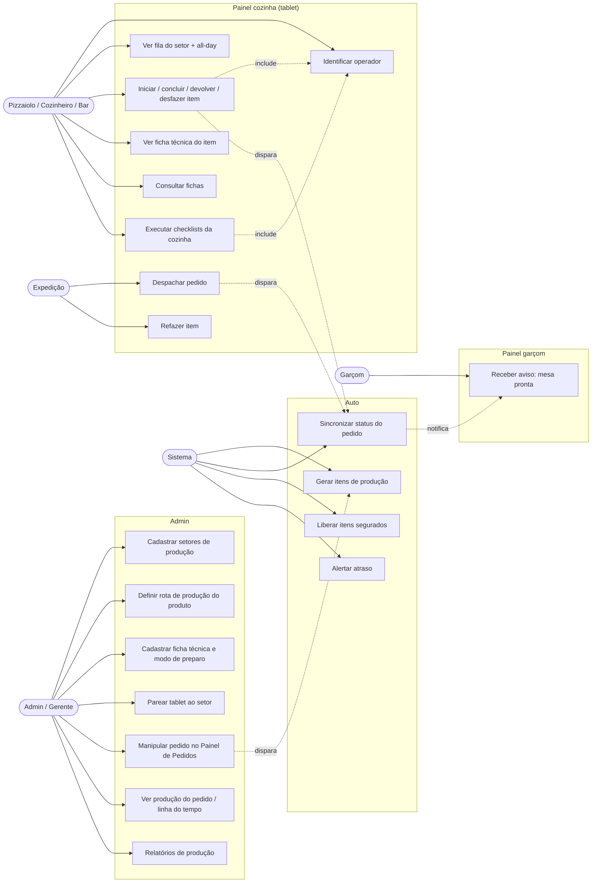
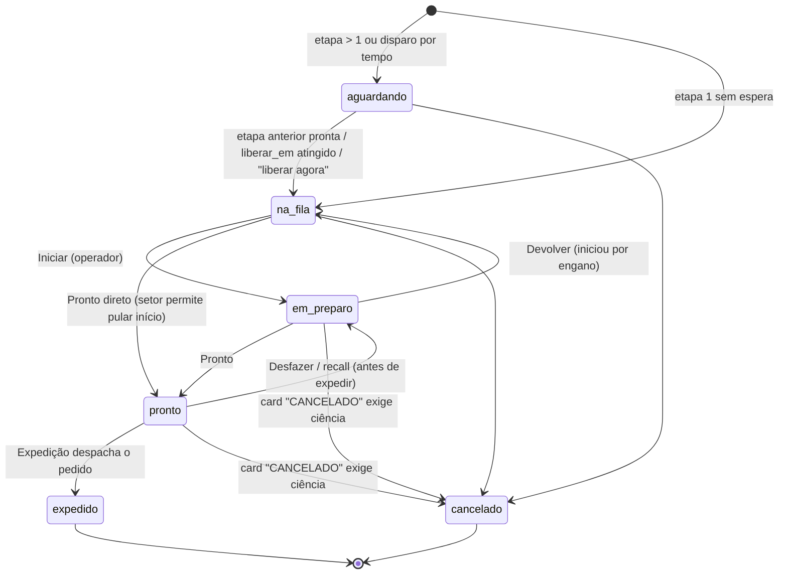
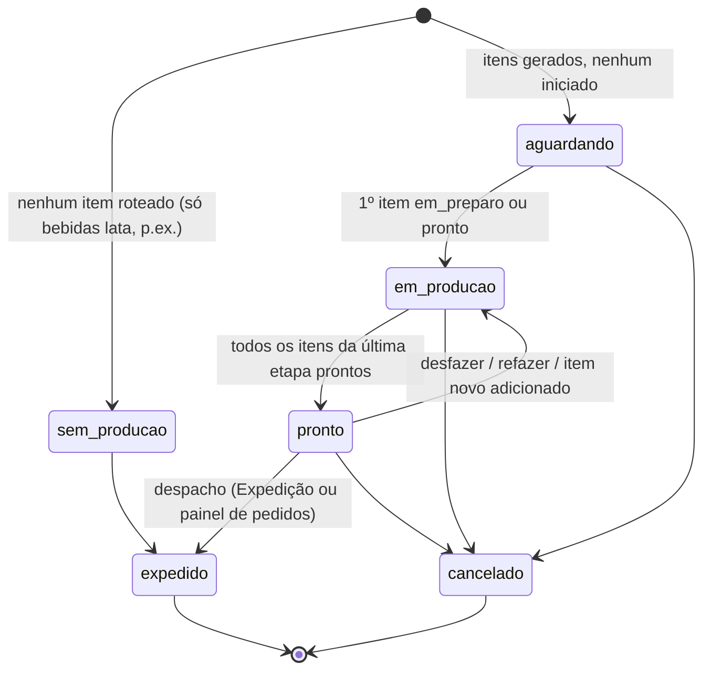
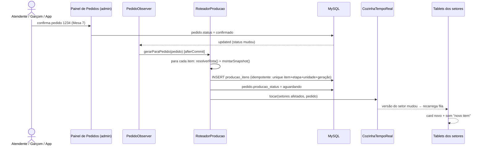
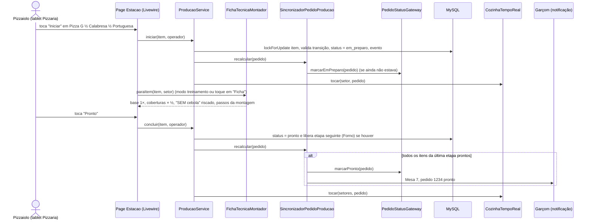
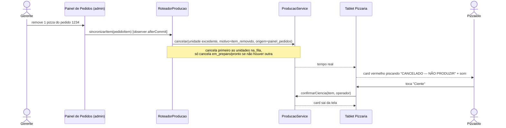
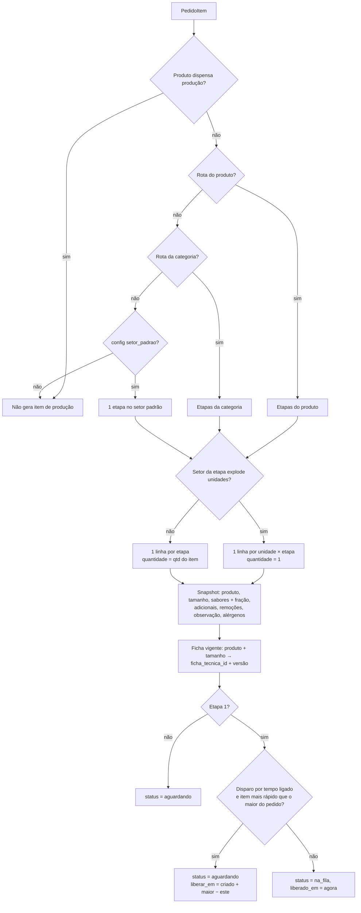
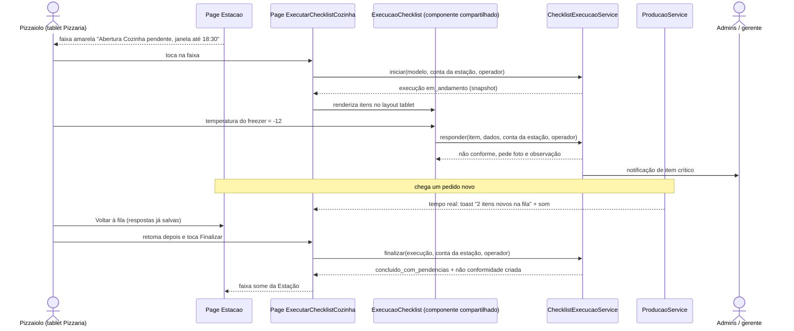
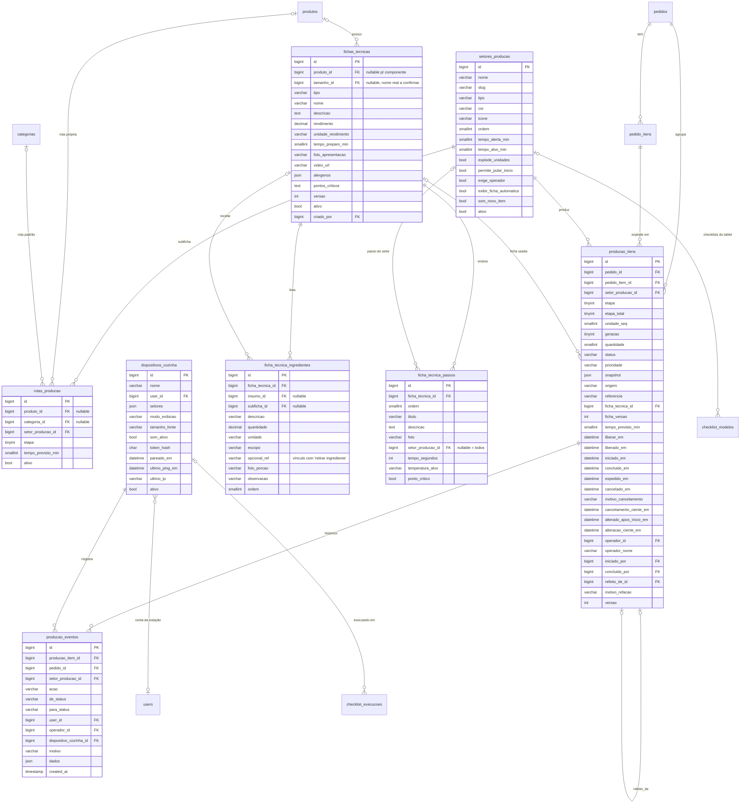

# Módulo Painel da Cozinha (KDS) — PizzariaAPP

> Especificação + prompt de execução para o Claude Code.
> Stack: Laravel 12 · Filament 4 · Livewire 3 · Alpine 3 · Tailwind v4 · MySQL.
> Painéis afetados: **cozinha** (novo — tablets dos setores de produção: itens dos pedidos **e checklists da cozinha**), **admin** (cadastros, fichas técnicas, painel de pedidos, relatórios) e **garcom** (aviso de pedido pronto).
> Integração: **módulo de checklists** (`docs/modulo-checklists.md`) — os checklists da cozinha são executados neste painel (§5.10, §6.8).
> Unidade de trabalho: o **item do pedido**. O painel de pedidos do admin continua manipulando o **pedido inteiro**; os dois se atualizam mutuamente.

---

## 0. Como usar este arquivo

1. Salve como `docs/modulo-cozinha.md`.
2. No Claude Code:

```
Leia docs/modulo-cozinha.md inteiro e implemente seguindo a seção
"11. Plano de execução por fases". Use a skill laravel-dev. A Fase 0 é
obrigatória e só de leitura: me mostre como pedidos, itens, sabores (meio a
meio), adicionais e o "Painel de Pedidos" do admin estão implementados, e as
adaptações que vai fazer nesta spec, antes de escrever qualquer código.
Os checklists da cozinha (seções 5.10 e 6.8) usam o módulo de
docs/modulo-checklists.md: confirme se ele já está implementado.
Pare ao fim de cada fase e aguarde meu OK. Nada destrutivo.
```

---

## 1. Referências de mercado (o que foi incorporado)

Pesquisa em KDS (Kitchen Display Systems) internacionais e nacionais: Toast KDS, Fresh KDS, Rezku, Oracle Symphony/MCR, LS Central, Epson TrueOrder, HungerRush (pizza), Andromeda (pizza), iPizza, Saipos, Suitable, Alterdata Spice, Cplug, Linear.

| Padrão de mercado | Onde aparece | Decisão no PizzariaAPP |
|---|---|---|
| Roteamento por estação: cada tela vê só os itens do seu setor; a expedição vê o pedido inteiro | Toast, Rezku, Alterdata, Cplug | **Entra** — `setores_producao` + rotas por produto/categoria |
| Tela de **expedição** (expo/passe): pedido fica verde quando todos os setores concluem, e só então é despachado | Toast, Cplug, Symphony | **Entra** — página `Expedicao` (opcional por config) |
| **Receita / modo de preparo na tela** (ícone no item abre ingredientes, passos, foto de montagem) | Toast Recipe View, LS Central, Symphony, Epson, Petpooja, Suitable (BR, a partir da ficha técnica) | **Entra e vai além** — ver §1.1 |
| Timer de idade com cor (verde → amarelo → vermelho) visível de longe | Toast, Fresh, Menusifu, Ecosire | **Entra** — limites por setor |
| Toque para marcar item pronto + **desfazer/recall** | Rezku, Menusifu, Toast | **Entra** — desfazer em 10 s e coluna "Prontos" recentes |
| **All-day count** (total de cada produto nas comandas abertas, para produzir em lote) | Toast, Rezku, HungerRush | **Entra** — barra lateral por setor |
| Visão por item **ou** por pedido (cards / colunas) | Alterdata, Menusifu, Suitable | **Entra** — dois modos, escolhidos por tablet |
| Iniciar / pausar / pronto por produto, com o pedido inteiro mudando de status automaticamente | Suitable, Saipos | **Entra** — é o coração da sincronização (§5.5) |
| Disparo por tempo de preparo (item rápido espera o demorado para tudo ficar pronto junto) | Toast "fire by prep time" | **Entra opcional** — padrão desligado |
| Meio a meio com divisória clara e molho/base destacados | Andromeda, iPizza, Rezku | **Entra** — card e ficha tratam frações |
| Alertas sonoros de novo item e de atraso | ZS Monitor, Toast | **Entra** |
| Relatórios de tempo médio por estação/produto | Toast | **Entra** (admin) |
| Divisão de carga entre telas do mesmo setor | Toast | **Fora** — 1 tablet por setor |
| Ritmo pela capacidade do forno | Andromeda | **Backlog** |
| Bump bar física (teclado USB/Bluetooth) | Ecosire, Fresh | **Backlog** (atalhos de teclado) |
| Aviso ao cliente (SMS) | Fresh KDS | **Backlog** — via WhatsApp/Evolution API |

### 1.1 O diferencial: ficha técnica viva na tela

A maioria dos KDS mostra uma **imagem ou texto fixo** da receita. Aqui a ficha é **montada para aquele item específico**:

- **Gramagem calculada** para o tamanho pedido (P/M/G/GG) e para a **fração** (meio a meio, 1/3): base (massa, molho, queijo) aparece uma vez; coberturas aparecem multiplicadas pela fração de cada sabor.
- **Personalização aplicada**: "SEM cebola" risca a linha da cebola; adicional "+ bacon" aparece com a porção padrão.
- **Passos filtrados pelo setor**: o tablet da montagem mostra os passos de montagem; o do forno mostra temperatura, tempo e giro.
- **Modo passo a passo** em tela cheia, com **timer** nos passos cronometrados e destaque nos **pontos críticos**.
- **Foto do prato montado** (padrão de apresentação) e foto de porção por ingrediente.
- **Modo treinamento**: para quem está aprendendo, a ficha abre sozinha ao tocar em "Iniciar".

A mesma ficha alimenta, no futuro, CMV teórico e baixa de estoque (backlog).

---

## 2. Requisitos

### 2.1 Funcionais

| # | Requisito | Painel |
|---|---|---|
| RF01 | Cadastrar setores de produção (ex.: Pizzaria, Forno, Cozinha, Bar) e o setor de Expedição, com cor, ícone, ordem e tempos-alvo | admin |
| RF02 | Definir a **rota de produção** de cada produto (ou da categoria, como padrão): um ou mais setores em etapas sequenciais, com tempo previsto | admin |
| RF03 | Marcar produtos que **dispensam produção** (refrigerante lata, água) — não bloqueiam o pedido pronto | admin |
| RF04 | Cadastrar **fichas técnicas**: por produto e tamanho, ingredientes (com escopo base/cobertura), subfichas (massa, molho), passos com foto, timer, setor e ponto crítico, alérgenos, foto de apresentação | admin |
| RF05 | Pré-visualizar a ficha "como aparece no tablet" | admin |
| RF06 | Parear tablets (dispositivos) a setores via QR Code | admin |
| RF07 | Gerar automaticamente os **itens de produção** quando o pedido entra no status que libera a cozinha, explodindo unidades e etapas | sistema |
| RF08 | Tela da estação: itens do(s) setor(es) do tablet em colunas **Fila → Em preparo → Prontos**, com timer colorido, origem (mesa/delivery/balcão/app), sabores, adicionais, remoções e observações destacadas | cozinha |
| RF09 | Identificar o **operador** que está produzindo (colaborador com ponto aberto, PIN opcional) | cozinha |
| RF10 | Ações por item: **Iniciar**, **Pronto**, **Devolver para a fila**, **Desfazer** (10 s), **Ver ficha**; ação em lote "Iniciar pedido" | cozinha |
| RF11 | **Ficha técnica viva** do item (§1.1), com modo passo a passo e timer | cozinha |
| RF12 | **All-day count** do setor | cozinha |
| RF13 | Alerta visual e sonoro: novo item, item alterado após início, item cancelado, atraso | cozinha |
| RF14 | Tela de **Expedição**: pedidos com progresso por setor; despachar quando tudo pronto; **refazer** item com motivo | cozinha |
| RF15 | **Produção → Pedido**: 1º item iniciado → pedido "em preparo"; todos prontos → pedido "pronto"; despacho → próximo status conforme tipo (mesa/delivery/balcão) | sistema |
| RF16 | **Pedido → Produção**: item adicionado, removido, alterado, priorizado ou pedido cancelado no painel de pedidos refletem na hora nos tablets | sistema |
| RF17 | Painel de pedidos (admin) mostra o progresso de produção por item e a linha do tempo de cada item | admin |
| RF18 | Garçom é notificado quando os itens da mesa ficam prontos; vê o status de cada item | garcom |
| RF19 | Consulta livre de fichas técnicas no tablet (busca), para treinamento e dúvidas fora do pedido | cozinha |
| RF20 | Relatórios: tempo de fila e de preparo por setor/produto/operador, % no prazo, refações por motivo | admin |
| RF21 | Disparo por tempo de preparo (opcional): itens rápidos aguardam para ficarem prontos junto com o mais demorado | sistema |
| RF22 | Cozinha com tema escuro, tela sempre ligada e funcionamento em tela cheia (PWA) | cozinha |
| RF23 | Executar no tablet os **checklists da cozinha** (abertura, fechamento, limpeza, temperaturas) com o mesmo motor do módulo de checklists: snapshot, conformidade, fotos, não conformidades, aprovação | cozinha |
| RF24 | Direcionar cada modelo de checklist a um **setor de produção** (ex.: só o tablet do Bar) ou a todos os tablets da cozinha | admin |
| RF25 | Faixa de aviso na Estação quando há checklist pendente na janela; opcionalmente bloquear o início da produção até a abertura do setor ser concluída | cozinha |
| RF26 | Registrar o **operador** que respondeu cada item do checklist no tablet compartilhado | cozinha |
| RF27 | Item de produção que chega durante um checklist gera alerta e atalho de volta à fila, sem perder respostas (autosave) | cozinha |

### 2.2 Não funcionais

- **Tablet first**: 10" em paisagem (1280×800) como referência; funcionar em retrato (800×1280). Alvos de toque ≥ 56 px, fonte do produto ≥ 20 px, nada que dependa de hover. Uso com luva/mão suja: um toque, botão grande, sem gestos finos.
- **Tempo real**: mudança visível nos outros painéis em ≤ 3 s (Reverb se existir; senão polling com checagem de versão — §8.3).
- **Concorrência**: dois tablets tocando o mesmo item → só uma transição vence (`lockForUpdate` + máquina de estados).
- **Snapshot**: o item de produção guarda a descrição do que deve ser feito (sabores, adicionais, observação) no momento em que entra na fila. Alteração posterior no pedido gera alerta, nunca troca silenciosa de um item já iniciado.
- `producao_eventos` é **append-only** (linha do tempo e métricas). Demais tabelas com SoftDeletes.
- Auditoria via Model Observer (mesmo mecanismo de `chamados`/`FechamentoCaixa`).
- Tempos em segundos/minutos inteiros; quantidades de ficha em `decimal(10,3)`.
- Rede instável: banner "sem conexão", botões desabilitados até reconectar, reenvio automático da última ação (idempotente por `versao`).
- UI em pt-BR; tabelas/colunas em português.

---

## 3. UML

### 3.1 Casos de uso



### 3.2 Diagrama de classes

```mermaid
classDiagram
    direction LR

    class SetorProducao {
        +id
        +nome
        +tipo : TipoSetorProducao
        +cor
        +icone
        +ordem
        +tempo_alerta_min
        +tempo_alvo_min
        +explode_unidades : bool
        +permite_pular_inicio : bool
        +exige_operador : bool
        +exibir_ficha_automatica : bool
        +ativo
        +itens() HasMany
    }

    class RotaProducao {
        +produto_id
        +categoria_id
        +setor_producao_id
        +etapa
        +tempo_previsto_min
    }

    class ProducaoItem {
        +id
        +pedido_id
        +pedido_item_id
        +setor_producao_id
        +etapa
        +etapa_total
        +unidade_seq
        +geracao
        +quantidade
        +status : StatusItemProducao
        +prioridade : PrioridadeProducao
        +snapshot : array
        +origem
        +referencia
        +ficha_tecnica_id
        +ficha_versao
        +tempo_previsto_min
        +liberar_em
        +liberado_em
        +iniciado_em
        +concluido_em
        +expedido_em
        +cancelado_em
        +operador_id
        +operador_nome
        +alterado_apos_inicio_em
        +cancelamento_ciente_em
        +refeito_de_id
        +versao
        +idadeSegundos() int
        +corTimer() string
        +podeTransitarPara(status) bool
    }

    class ProducaoEvento {
        <<append-only>>
        +producao_item_id
        +acao
        +de_status
        +para_status
        +user_id
        +operador_id
        +dispositivo_cozinha_id
        +motivo
        +dados : array
        +created_at
    }

    class FichaTecnica {
        +id
        +produto_id
        +tamanho_id
        +tipo : TipoFichaTecnica
        +nome
        +rendimento
        +tempo_preparo_min
        +foto_apresentacao
        +video_url
        +alergenos : array
        +pontos_criticos
        +versao
        +ativo
        +ingredientes() HasMany
        +passos() HasMany
    }

    class FichaTecnicaIngrediente {
        +insumo_id
        +subficha_id
        +descricao
        +quantidade
        +unidade
        +escopo : EscopoIngrediente
        +opcional_ref
        +foto_porcao
        +ordem
    }

    class FichaTecnicaPasso {
        +ordem
        +titulo
        +descricao
        +foto
        +setor_producao_id
        +tempo_segundos
        +temperatura_alvo
        +ponto_critico : bool
    }

    class DispositivoCozinha {
        +nome
        +user_id
        +setores : array
        +modo_exibicao
        +som_ativo
        +token_hash
        +ultimo_ping_em
        +ativo
    }

    class Pedido {
        <<existente>>
        +status
        +producao_status (novo)
        +prioridade_producao (novo)
    }

    class PedidoItem {
        <<existente>>
        +producao_status (novo)
    }

    class ChecklistModelo {
        <<modulo checklists>>
        +setor
        +setor_producao_id (novo)
        +paraPainel(painel, dispositivo) Builder
    }

    class ChecklistExecucao {
        <<modulo checklists>>
        +status
        +operador_id (novo)
        +dispositivo_cozinha_id (novo)
    }

    class ChecklistExecucaoService {
        <<modulo checklists>>
        +iniciar(ChecklistModelo, User, Operador) ChecklistExecucao
        +responder(item, dados, User, Operador) ChecklistExecucaoItem
        +finalizar(ChecklistExecucao, User, Operador) ChecklistExecucao
    }

    class Operador {
        <<value object>>
        +user_id
        +colaborador_id
        +nome
    }

    class RoteadorProducao {
        +gerarParaPedido(Pedido) Collection
        +sincronizarItem(PedidoItem) void
        +resolverRota(PedidoItem) array
        +montarSnapshot(PedidoItem) array
    }

    class ProducaoService {
        +iniciar(ProducaoItem, Operador) ProducaoItem
        +concluir(ProducaoItem, Operador) ProducaoItem
        +devolverParaFila(ProducaoItem, Operador, motivo) ProducaoItem
        +desfazer(ProducaoItem, Operador) ProducaoItem
        +iniciarPedidoNoSetor(Pedido, SetorProducao, Operador) Collection
        +liberar(ProducaoItem) void
        +liberarVencidos(Carbon) int
        +cancelar(ProducaoItem, motivo, origem) void
        +confirmarCiencia(ProducaoItem, Operador) void
        +priorizar(Pedido, PrioridadeProducao) void
        +refazer(ProducaoItem, motivo, User) ProducaoItem
        +expedirPedido(Pedido, User) void
    }

    class SincronizadorPedidoProducao {
        +recalcular(Pedido) StatusProducaoPedido
        +aplicarNoPedido(Pedido, string evento) void
    }

    class PedidoStatusGateway {
        <<adapter>>
        +liberaProducao(Pedido) bool
        +estaCancelado(Pedido) bool
        +marcarEmPreparo(Pedido) void
        +marcarPronto(Pedido) void
        +marcarExpedido(Pedido) void
    }

    class FichaTecnicaMontador {
        +paraItem(ProducaoItem, SetorProducao) FichaTecnicaView
        +paraProduto(Produto, tamanho) FichaTecnicaView
    }

    class CozinhaTempoReal {
        <<adapter>>
        +tocar(array setorIds, int pedidoId) void
        +versaoSetor(int) int
    }

    SetorProducao "1" --> "*" RotaProducao
    SetorProducao "1" --> "*" ProducaoItem
    Pedido "1" --> "*" PedidoItem
    PedidoItem "1" --> "*" ProducaoItem
    ProducaoItem "1" --> "*" ProducaoEvento
    ProducaoItem "0..1" --> "0..1" ProducaoItem : refeito_de
    ProducaoItem "*" --> "0..1" FichaTecnica
    FichaTecnica "1" --> "*" FichaTecnicaIngrediente
    FichaTecnica "1" --> "*" FichaTecnicaPasso
    FichaTecnicaIngrediente "*" ..> "0..1" FichaTecnica : subficha
    FichaTecnicaPasso "*" ..> "0..1" SetorProducao
    RoteadorProducao ..> RotaProducao
    RoteadorProducao ..> ProducaoItem
    ProducaoService ..> ProducaoItem
    ProducaoService ..> SincronizadorPedidoProducao
    SincronizadorPedidoProducao ..> PedidoStatusGateway
    PedidoStatusGateway ..> Pedido
    ProducaoService ..> CozinhaTempoReal
    FichaTecnicaMontador ..> FichaTecnica
    SetorProducao "1" --> "*" ChecklistModelo : checklists do tablet
    DispositivoCozinha "1" --> "*" ChecklistExecucao : executado em
    ChecklistExecucaoService ..> ChecklistExecucao
    ChecklistExecucaoService ..> Operador
    ProducaoService ..> ChecklistExecucao : bloqueio opcional
```



### 3.3 Máquina de estados — item de produção



- Em rota com várias etapas (ex.: Montagem → Forno), cada etapa é uma linha. `pronto` numa etapa intermediária é terminal para aquela linha e libera a linha da etapa seguinte (`aguardando → na_fila`). Só a **última etapa** passa por `expedido`.
- **Refazer** não volta o status: cria uma nova linha (`geracao + 1`, `refeito_de_id`, prioridade `urgente`) e a antiga fica `cancelado` com motivo `refeito`.

### 3.4 Status de produção do pedido (derivado)



`producao_status` é calculado pelo `SincronizadorPedidoProducao` a cada transição e gravado em `pedidos` como cache (listagens rápidas). Quem traduz para o `status` real do pedido é o `PedidoStatusGateway` (§5.5).

### 3.5 Sequência — pedido confirmado gera produção



### 3.6 Sequência — pizzaiolo produz e o pedido avança



### 3.7 Sequência — item cancelado no painel de pedidos durante o preparo



### 3.8 Atividade — roteamento de um item do pedido



### 3.9 Sequência — checklist de abertura no tablet da cozinha



---

## 4. Modelagem de dados

### 4.1 Diagrama ER



Todas as tabelas novas: `timestamps()` + `softDeletes()`, **exceto** `producao_eventos` (append-only: só `created_at`).

### 4.2 Enums (`app/Enums/Cozinha/`, com `HasLabel`, `HasColor`, `HasIcon`)

| Enum | Valores |
|---|---|
| `TipoSetorProducao` | `producao`, `expedicao` |
| `StatusItemProducao` | `aguardando`, `na_fila`, `em_preparo`, `pronto`, `expedido`, `cancelado` |
| `StatusProducaoPedido` | `sem_producao`, `aguardando`, `em_producao`, `pronto`, `expedido`, `cancelado` |
| `PrioridadeProducao` | `normal`, `alta`, `urgente` |
| `TipoFichaTecnica` | `produto` (vendável, por tamanho), `componente` (subficha: massa, molho, pré-preparo) |
| `EscopoIngrediente` | `base` (não se divide no meio a meio: massa, molho, mussarela base), `cobertura` (multiplica pela fração do sabor), `finalizacao` (após o forno: azeite, manjericão — também por fração) |
| `AcaoProducao` | `gerado`, `liberado`, `iniciado`, `devolvido`, `concluido`, `desfeito`, `expedido`, `cancelado`, `ciencia_cancelamento`, `alterado`, `ciencia_alteracao`, `priorizado`, `refeito`, `forcado_pelo_painel` |
| `MotivoRefacao` | `erro_preparo`, `queimou`, `caiu`, `sabor_errado`, `reclamacao_cliente`, `outro` |
| `MotivoCancelamentoProducao` | `pedido_cancelado`, `item_removido`, `quantidade_reduzida`, `refeito`, `outro` |

Colunas de enum como `string(30)` + cast (padrão do projeto).

### 4.3 Detalhes de migration

**`setores_producao`** — `nome` string(60) unique; `slug` string(60) unique; `tipo` string(20) default `producao`; `cor` string(20); `icone` string(60) nullable; `ordem` unsignedSmallInteger; `tempo_alerta_min` default 10 (amarelo); `tempo_alvo_min` default 15 (vermelho); `explode_unidades` default true (pizza: 1 card por pizza) — o Bar costuma usar false (6 latas = 1 card "6×"); `permite_pular_inicio` default false; `exige_operador` default true; `exibir_ficha_automatica` default false; `som_novo_item` default true; `ativo`. No máximo **um** setor `expedicao` ativo (validar no Service).

**`rotas_producao`** — exatamente um entre `produto_id` e `categoria_id` (validar no model; `CHECK` opcional no MySQL 8); FK setor `restrictOnDelete`; `etapa` unsignedTinyInteger (1..n); unique (`produto_id`, `etapa`) e unique (`categoria_id`, `etapa`). Nomes reais de `produtos`/`categorias` a confirmar na Fase 0.

**`producao_itens`**
- FK `pedido_id` e `pedido_item_id` `cascadeOnDelete` (pedido apagado fisicamente é raro — soft delete do pedido é tratado como cancelamento pelo observer).
- FK `setor_producao_id` `restrictOnDelete`; `ficha_tecnica_id` `nullOnDelete`; `operador_id` → `colaboradores` (módulo de ponto) **ou** `users` — decidir na Fase 0 (ver §6.2); `iniciado_por`/`concluido_por` → `users` `nullOnDelete`; `refeito_de_id` self-FK `nullOnDelete`.
- **Idempotência**: unique (`pedido_item_id`, `etapa`, `unidade_seq`, `geracao`). O roteador pode rodar 2× sem duplicar.
- `snapshot` json, formato:
  ```json
  {
    "produto": "Pizza Grande", "tamanho": "G", "categoria": "Pizzas",
    "sabores": [
      {"nome": "Calabresa", "fracao": "1/2", "produto_id": 12, "ficha_tecnica_id": 40},
      {"nome": "Portuguesa", "fracao": "1/2", "produto_id": 15, "ficha_tecnica_id": 44}
    ],
    "borda": "Catupiry",
    "adicionais": [{"nome": "Bacon", "qtd": 1, "aplica_em": "1/2 Calabresa"}],
    "remocoes": [{"nome": "Cebola", "opcional_ref": "cebola", "aplica_em": "inteira"}],
    "observacao": "bem passada",
    "alergenos": ["lactose", "glúten"]
  }
  ```
- `origem` string(20) (`mesa`, `delivery`, `balcao`, `app`, `ifood` — mapear da origem real do pedido); `referencia` string(80) (ex.: `Mesa 7`, `Delivery #1234 — João`, `Balcão #88`).
- `versao` unsignedInteger default 0, incrementada a cada transição (o tablet envia a versão que viu; se mudou, a ação é recusada com "item atualizado, toque de novo").
- Índices: (`setor_producao_id`, `status`, `liberado_em`), (`pedido_id`, `etapa`), (`status`, `liberar_em`), (`operador_id`, `concluido_em`).

**`producao_eventos`** — sem `updated_at`/`deleted_at`; model lança exceção em `updating`/`deleting` (mesma abordagem das marcações de ponto). Índices: (`producao_item_id`), (`setor_producao_id`, `created_at`), (`operador_id`, `created_at`).

**`fichas_tecnicas`** — `produto_id` nullable (componente não tem produto); `tamanho_id` nullable (ficha única para todos os tamanhos ou uma por tamanho — o montador procura `produto+tamanho`, depois `produto+null`); `rendimento` decimal(10,3); `alergenos` json; `versao` incrementa ao salvar se a ficha já foi usada em produção (Observer); uma única ficha **ativa** por (`produto_id`, `tamanho_id`) — validar no Service.
> ⚠️ Fase 0: verificar se já existe ficha técnica / insumos / CMV no projeto. Se existir, **estender** (adicionar passos, escopo, fotos) em vez de duplicar.

**`ficha_tecnica_ingredientes`** — `insumo_id` FK nullable (se houver cadastro de insumos); `subficha_id` FK → `fichas_tecnicas` (tipo componente) nullable; `descricao` string(120) (exibição; obrigatória se não houver insumo); `quantidade` decimal(10,3); `unidade` string(10) (`g`, `ml`, `un`, `fatia`, `colher`); `escopo` string(20) default `cobertura`; `opcional_ref` string(60) nullable — chave que casa com o "retirar ingrediente" do cardápio (formato real na Fase 0; se o pedido só tiver observação em texto, o montador não risca linhas, apenas destaca a observação); `foto_porcao` nullable; `ordem`.

**`ficha_tecnica_passos`** — `setor_producao_id` nullable (null = aparece em todos os setores); `tempo_segundos` nullable (gera botão de timer); `temperatura_alvo` string(20) nullable (ex.: `300 °C`); `ponto_critico` bool; `foto` nullable; `ordem`.

**`dispositivos_cozinha`** — `user_id` → conta técnica da estação (role `estacao_cozinha`); `setores` json (ids); `modo_exibicao` string(20) (`itens` | `pedidos`); `tamanho_fonte` string(10) (`normal` | `grande`); `token_hash` char(64) unique nullable (token de pareamento de uso único, guardado como sha256); `ultimo_ping_em` atualizado no polling (mostra no admin se o tablet está online).

**Alterações em tabelas existentes** (somente colunas nullable novas):
- `pedidos`: `producao_status` string(20) nullable index, `prioridade_producao` string(10) nullable, `producao_iniciada_em`, `producao_concluida_em` datetime nullable.
- `pedido_itens` (nome real a confirmar): `producao_status` string(20) nullable (cache para o card do painel de pedidos).
- `produtos`: `dispensa_producao` bool default false.
- `adicionais` (ou equivalente): `quantidade_porcao` decimal(10,3) nullable, `unidade_porcao` string(10) nullable, `instrucao_preparo` string(255) nullable, `insumo_id` FK nullable.
- `checklist_modelos` (módulo de checklists): `setor_producao_id` FK nullable → `setores_producao` `nullOnDelete` (null = vale para todos os tablets da cozinha, ver §5.10).
- `checklist_execucoes`: `operador_id` FK nullable, `operador_nome` string(120) nullable, `dispositivo_cozinha_id` FK nullable `nullOnDelete`.
- `checklist_execucao_itens` e `checklist_anexos`: `operador_id` FK nullable, `operador_nome` string(120) nullable.
> Essas colunas ficam numa migration **deste** módulo (dependem de `setores_producao`/`dispositivos_cozinha`). Se o módulo de checklists ainda não existir, implementá-lo antes (Fase 0).

**Config** `config/cozinha.php`:
```php
return [
    // Mapeamento para o enum REAL de status do pedido (preencher na Fase 0)
    'pedido_status' => [
        'libera_producao' => ['confirmado', 'aceito'],
        'cancelado'       => ['cancelado'],
        'ao_iniciar'      => 'em_preparo',
        'ao_concluir'     => 'pronto',
        'ao_expedir'      => ['mesa' => 'entregue', 'delivery' => 'aguardando_entregador', 'balcao' => 'pronto_retirada'],
        'nao_retroceder'  => ['saiu_para_entrega', 'entregue', 'finalizado'],
    ],
    'usa_expedicao'            => true,   // false: todos prontos já despacham
    'setor_padrao'             => null,   // slug; null = item sem rota não vai à cozinha
    'janela_prontos_min'       => 10,
    'desfazer_segundos'        => 10,
    'disparo_por_tempo_preparo'=> false,
    'operador' => [
        'fonte'       => 'ponto',  // 'ponto' (colaboradores com ponto aberto) | 'usuarios'
        'exigir_pin'  => false,
        'expira_min'  => 240,
    ],
    'tempo_real' => [
        'driver'          => 'polling', // 'reverb' | 'polling'
        'polling_segundos'=> 4,
    ],
    'alerta_atraso_multiplicador' => 2, // notifica gerente quando idade ≥ 2 × tempo_alvo
    'disco_fotos' => 'public',
    'checklists' => [
        'setores_checklist'              => ['cozinha'], // valores do ChecklistSetor exibidos nos tablets
        'exibir_tambem_no_garcom'        => false,       // false: checklist da cozinha só no tablet (e no admin)
        'bloquear_producao_sem_abertura' => false,       // true: "Iniciar" só após a abertura do setor concluída
        'aviso_minutos_antes_fim'        => 30,          // faixa fica vermelha faltando X min para fechar a janela
    ],
];
```

---

## 5. Regras de negócio

### 5.1 Geração e roteamento
1. Disparo: `PedidoObserver::updated` (e `created`, para pedidos que já nascem confirmados — app/QR/iFood) chama `RoteadorProducao::gerarParaPedido()` **depois do commit** (`DB::afterCommit` ou observer com `$afterCommit = true`), quando `PedidoStatusGateway::liberaProducao()` for verdadeiro.
2. Resolução da rota (§3.8): produto `dispensa_producao` → nada; rota do produto → rota da categoria → `setor_padrao` → nada.
3. **Pizza com vários sabores**: a rota vem do produto "pizza" (tamanho), não de cada sabor. Se os sabores tiverem rotas diferentes (ex.: pizza doce vai para outro forno), usa a do **primeiro sabor** e registra aviso no log — caso raro, tratado no backlog.
4. Explosão de unidades conforme `explode_unidades` do setor da etapa.
5. Snapshot montado uma única vez; `ficha_tecnica_id` + `ficha_versao` = ficha ativa do produto/tamanho naquele momento (para meio a meio, cada sabor guarda a sua ficha no snapshot).

### 5.2 Transições (todas no `ProducaoService`, em `DB::transaction` + `lockForUpdate` no item)
- Validar `podeTransitarPara()` (§3.3) e a `versao` enviada pelo tablet.
- `iniciar` exige operador quando `setor.exige_operador`; grava `operador_id`, `operador_nome`, `iniciado_em`.
- `concluir` grava `concluido_em`; se houver etapa seguinte, libera a linha correspondente (mesma `unidade_seq`/`geracao`).
- `desfazer` só até `desfazer_segundos` após a ação (no tablet) — depois disso, recall pela coluna "Prontos" (até expedir); desfazer de etapa intermediária só se a etapa seguinte ainda não iniciou.
- Toda transição grava `ProducaoEvento`, chama `SincronizadorPedidoProducao::recalcular()` e `CozinhaTempoReal::tocar()`.

### 5.3 Tempos e cores
- **Idade** do card = agora − `liberado_em` (o relógio corre no client a partir do horário do servidor, com offset calculado no carregamento).
- Verde < `tempo_alerta_min`; amarelo ≥ alerta; vermelho ≥ `tempo_alvo_min`; vermelho piscando ≥ alvo × `alerta_atraso_multiplicador` (e notifica o gerente uma vez).
- Ordenação da fila: prioridade (`urgente` > `alta` > `normal`) → `liberado_em` mais antigo. **Nada se move sob o dedo**: um card novo entra no fim; reordenação só quando muda prioridade.
- Tempos para relatório: fila = `iniciado_em − liberado_em`; preparo = `concluido_em − iniciado_em`; total = `expedido_em − liberado_em` (etapa 1).

### 5.4 All-day count
Por setor, soma de `quantidade` dos itens `na_fila` + `em_preparo`, agrupada por "chave de produção":
- itens comuns: produto + tamanho (ex.: `3× Batata G`);
- pizzas: por **sabor + tamanho com fração** somada (ex.: `Calabresa G: 2½` = duas inteiras + uma meia), mais linha de "massas G: 3" (base). Ajuda a abrir massas e porcionar em lote.

### 5.5 Sincronização Pedido ↔ Produção

| Gatilho | Origem | Efeito |
|---|---|---|
| Pedido entra em status de `libera_producao` | Painel de pedidos / app / garçom | Gera itens de produção (idempotente) |
| Item adicionado ao pedido (mesa pede mais) | Painel de pedidos / garçom | Gera itens novos; card com selo "ADICIONAL"; pedido em `pronto` volta para `em_producao` |
| Item removido / quantidade reduzida | Painel de pedidos | Cancela unidades excedentes, **primeiro** as `aguardando`/`na_fila`; se precisar cancelar `em_preparo`/`pronto`, card "CANCELADO" exige ciência |
| Item editado (sabor, observação, adicional) | Painel de pedidos | Antes de iniciar: snapshot atualizado em silêncio. Depois de iniciado: snapshot atualizado + `alterado_apos_inicio_em` → card amarelo piscando "ALTERADO", com antes/depois, exige ciência |
| Pedido cancelado | Painel de pedidos | Cancela todos os itens; os já iniciados exigem ciência |
| Prioridade alterada ("urgente") | Painel de pedidos / Expedição | Todos os itens do pedido sobem na fila |
| Pedido marcado "pronto"/"saiu" manualmente | Painel de pedidos | Modal de confirmação no admin ("há 2 itens em produção"); itens não concluídos vão a `pronto` com ação `forcado_pelo_painel` |
| 1º item iniciado ou concluído | Cozinha | Pedido → status `ao_iniciar` (se estiver antes dele) |
| Todos os itens da última etapa prontos | Cozinha | `producao_status = pronto`; se `usa_expedicao = false`, já aplica `ao_concluir`; senão o pedido aparece verde na Expedição. Garçom notificado (mesa) |
| Despacho na Expedição | Cozinha | Itens → `expedido`; pedido → `ao_expedir[tipo]` |
| Refazer item | Expedição / admin | Novo item urgente; pedido volta para `em_producao`; se já estava expedido, não retrocede o status do pedido (`nao_retroceder`), só sinaliza |

**Prevenção de laço** (produção muda pedido → observer do pedido tenta mudar produção): toda mudança feita pelo módulo passa pelo `PedidoStatusGateway`, que executa dentro de `SincronizacaoContexto::executando(fn () => ...)`; o `PedidoObserver` ignora eventos enquanto o contexto está ativo. Testar explicitamente.

**Nunca retroceder** o pedido para um status anterior ao atual por causa da cozinha (ex.: pedido já `saiu_para_entrega` não volta para `em_preparo`).

### 5.6 Ficha técnica viva (`FichaTecnicaMontador`)
1. Ficha do item: snapshot → ficha de cada sabor (versão gravada) + ficha "base" do tamanho, se existir.
2. Ingredientes:
   - `base`: uma vez, da ficha do tamanho (ou do primeiro sabor, se não houver ficha de tamanho);
   - `cobertura` e `finalizacao`: `quantidade × fração` de cada sabor, agrupados por sabor com o rótulo "½ Calabresa";
   - subfichas aparecem como linha clicável ("Massa G — 450 g ▸ ver preparo");
   - remoções do snapshot riscam a linha correspondente (`opcional_ref`) e destacam "SEM";
   - adicionais entram com `quantidade_porcao` e `instrucao_preparo`;
   - quantidades exibidas com no máximo 1 casa (`75 g`, `0,5 un`→`½ un`).
3. Passos: só os do setor do tablet + os gerais (`setor_producao_id` null), em ordem; passos com `tempo_segundos` ganham botão de timer (Alpine, com bip ao fim); `ponto_critico` em destaque.
4. Sem ficha cadastrada: mostra o snapshot + aviso discreto "ficha não cadastrada" e registra no relatório de cobertura de fichas (admin).
5. O montador devolve um DTO (`FichaTecnicaView`) usado igual no tablet, na pré-visualização do admin e no PDF da ficha (backlog).

### 5.7 Refazer e cancelamento
- Refazer exige motivo (`MotivoRefacao`); gera evento e entra no relatório de refações (base para desperdício/CMV).
- Card de cancelado/alterado permanece até alguém tocar "Ciente" (grava `cancelamento_ciente_em`/`alteracao_ciente_em` + evento com operador).

### 5.8 Operador
- `fonte = ponto`: lista de colaboradores com ponto **aberto** (última marcação é entrada) e papel compatível com o setor. Integra com o módulo de Folha de Ponto (PIN do quiosque reaproveitado se `exigir_pin`).
- `fonte = usuarios`: usuários com papel de cozinha (enquanto o módulo de ponto não estiver no ar).
- O operador escolhido fica ativo no tablet até trocar ou expirar (`expira_min`); avatar e nome sempre visíveis no topo.
- Usuário que entra com login próprio (celular do gerente, p.ex.) é o próprio operador.

### 5.9 Permissões (Policies)

| Ação | admin | gerente | cozinha / bar | expedição | garçom |
|---|---|---|---|---|---|
| Cadastro de setores, rotas, dispositivos | ✅ | ✅ | ❌ | ❌ | ❌ |
| Cadastro/edição de fichas técnicas | ✅ | ✅ | ❌ (só consulta) | ❌ | ❌ |
| Acessar painel cozinha | ✅ | ✅ | ✅ | ✅ | ❌ |
| Iniciar / concluir / devolver / desfazer | ✅ | ✅ | ✅ (setores permitidos) | ✅ | ❌ |
| Despachar pedido | ✅ | ✅ | config | ✅ | ❌ |
| Refazer item | ✅ | ✅ | ❌ | ✅ | ❌ |
| Priorizar / forçar pronto pelo painel de pedidos | ✅ | ✅ | ❌ | ❌ | ❌ |
| Relatórios de produção | ✅ | ✅ | ❌ | ❌ | ❌ |
| Ver status dos itens da mesa | ✅ | ✅ | — | — | ✅ |
| Executar checklists da cozinha | ✅ | ✅ | ✅ (papel atribuído ao modelo) | ✅ (idem) | ❌ (salvo `exibir_tambem_no_garcom`) |
| Liberar produção sem checklist de abertura (bloqueio ligado) | ✅ | ✅ | ❌ | ❌ | ❌ |

> Fase 0: confirmar como papéis são controlados no projeto (Spatie? coluna em `users`?) e criar os papéis `cozinha`, `bar`, `expedicao`, `estacao_cozinha`.

### 5.10 Checklists da cozinha
1. **Mesmo motor, outra tela.** Tudo passa pelo `ChecklistExecucaoService` do módulo de checklists: snapshot, conformidade, validação ao finalizar, não conformidades, item crítico, aprovação, geração de pendentes, expiração e dia operacional. Este módulo **não** cria tabelas de checklist; só acrescenta colunas (§4.3) e a interface do tablet (§6.8).
2. **O que aparece em cada tablet** — escopo `ChecklistModelo::paraPainel('cozinha', $dispositivo)`:
   - modelos com `setor_producao_id` entre os setores do dispositivo (ex.: "Fechamento — Bar" só no tablet do Bar);
   - modelos com `setor_producao_id` nulo e `setor` em `cozinha.checklists.setores_checklist` (aparecem em todos os tablets da cozinha);
   - em ambos, só os disponíveis hoje e com papel compatível com o operador; modelos sob demanda (limpeza profunda, recebimento de mercadoria) ficam em "Outros checklists".
3. **Onde mais aparecem.** No admin, sempre (gestão, auditoria, aprovação). No garçom, só se `exibir_tambem_no_garcom = true` — por padrão um checklist tem um único lugar de execução. O escopo `paraPainel('garcom')` passa a excluir os modelos da cozinha.
4. **Quem respondeu.** No tablet, a conta logada é a da estação. `iniciado_por`/`respondido_por`/`concluido_por`/`enviado_por` continuam com o usuário da estação; `operador_id`/`operador_nome` registram a pessoa (§5.8). A autorização por papel (`checklist_modelo_papeis`) usa o papel do **operador**, não o da conta da estação. Sem operador ativo, o checklist abre só para leitura.
5. **Execução colaborativa.** Trocar de operador no meio é permitido; cada resposta fica com quem estava ativo naquele momento (o módulo de checklists já prevê várias pessoas na mesma execução).
6. **Convivência com a produção.** Checklist nunca segura pedido: durante a execução, item novo no setor gera toast + som e o rodapé mostra "Voltar à fila (N novos)"; o autosave garante a retomada exatamente de onde parou.
7. **Aviso de pendência.** Faixa no topo da Estação quando há execução `pendente`/`em_andamento` dentro da janela: amarela; vermelha faltando `aviso_minutos_antes_fim`. Badge no item de navegação "Checklists". Item crítico não conforme respondido no tablet também aparece como faixa vermelha até a não conformidade sair de `aberta` ou acabar o dia operacional.
8. **Bloqueio opcional (padrão desligado).** Com `bloquear_producao_sem_abertura = true`, o `ProducaoService::iniciar()` recusa itens do setor enquanto a execução do tipo `abertura` daquele setor no dia não estiver `concluido`, `concluido_com_pendencias` ou `aprovado`. Gerente/admin pode **liberar** com justificativa (vale até o fim do dia operacional, registrada na auditoria por Observer). Itens já em preparo não são afetados. Se o setor não tiver modelo de abertura ativo hoje, não bloqueia.
9. **Passagem de turno.** As pendências do último fechamento do setor (RF14 do módulo de checklists) aparecem no topo da abertura também no tablet.

---

## 6. Painel **cozinha** (novo, Filament 4)

### 6.1 `CozinhaPanelProvider`
```php
$panel->id('cozinha')
    ->path('cozinha')
    ->login()
    ->colors(['primary' => Color::Orange])
    ->darkMode(isForced: true)          // conferir assinatura na v4
    ->topNavigation()
    ->maxContentWidth(Width::Full)
    ->spa()
    ->databaseNotifications()
    ->renderHook(PanelsRenderHook::HEAD_END, fn () => view('cozinha.partials.pwa-head'))
    ->authMiddleware([Authenticate::class, IdentificaDispositivoCozinha::class])
    ->discoverPages(in: app_path('Filament/Cozinha/Pages'), for: 'App\\Filament\\Cozinha\\Pages');
```
- `User::canAccessPanel()` libera `cozinha` para os papéis da tabela §5.9.
- `pwa-head`: `manifest.webmanifest` (display `fullscreen`, orientação `landscape`), ícone, cor de tema; script Alpine com **Screen Wake Lock API** (re-adquirir ao voltar o foco) e destravamento de áudio no primeiro toque (overlay "Toque para iniciar o turno").
- Navegação mínima no topo: **Estação**, **Expedição**, **Fichas**; à direita, operador ativo e indicador de conexão.

### 6.2 Pareamento do tablet e operador
1. Admin cria o dispositivo (nome + setores) → gera QR Code com URL de uso único `/cozinha/parear/{token}` (válida 10 min).
2. O tablet abre a URL: autentica na conta técnica da estação (`Auth::login($user, remember: true)`), grava cookie criptografado `dispositivo_cozinha` (1 ano) e invalida o token.
3. Middleware `IdentificaDispositivoCozinha` carrega o dispositivo e seus setores na requisição; atualiza `ultimo_ping_em`.
4. Na estação, o operador toca no próprio avatar (+ PIN se configurado). Sem operador, os botões de ação ficam bloqueados nos setores com `exige_operador`.

### 6.3 Reaproveitamento do "Painel de Pedidos"
Antes de construir, extrair do painel de pedidos do admin o que for comum para componentes compartilhados:
- Blade components `x-pedido.cabecalho` (número, origem com ícone, mesa/cliente, tempo), `x-pedido.origem-badge`, `x-pedido.timer`;
- trait Livewire `InteractsWithTempoRealPedidos` (polling com versão / listeners Echo);
- formatação de sabores/adicionais (`PedidoItemFormatter`) — usada no card do admin, no card da cozinha e no snapshot.

O painel de pedidos passa a usar os mesmos componentes, garantindo que o que o atendente vê e o que a cozinha vê sejam idênticos.

### 6.4 `Pages\Estacao` (página inicial)
- **Topo fixo**: nome do(s) setor(es) (chips para alternar quando o tablet atende mais de um), contadores (fila / em preparo / atrasados), toggle **modo treinamento**, troca de operador, relógio.
- **Modo "itens"** (padrão) — três colunas:
  - **Fila**: cards por item, em ordem de prioridade/idade;
  - **Em preparo**: cards com o nome do operador;
  - **Prontos (últimos 10 min)**: compactos, com "Voltar ao preparo" (recall).
- **Modo "pedidos"**: um ticket por pedido, itens do setor dentro, botão "Iniciar pedido" (inicia todos os itens do setor) e toque por item para concluir.
- **Card do item**:
  - faixa superior colorida pelo timer, `#1234 · Mesa 7` (ou `Delivery — João`), ícone da origem, idade `08:42`;
  - produto + tamanho em fonte grande;
  - **meio a meio**: duas (ou três) colunas lado a lado separadas por divisória grossa, cada uma com o sabor e seus adicionais/remoções;
  - borda recheada em destaque; **SEM …** em vermelho; **+ …** em verde; observação em caixa amarela; alérgenos com ícone;
  - selos: `URGENTE`, `ADICIONAL`, `ALTERADO`, `CANCELADO`, `REFAZER`;
  - botões: **INICIAR** / **PRONTO** (largura total, ≥ 64 px de altura) e **📖 Ficha**; menu "⋯" com Devolver para a fila.
- **Barra lateral recolhível**: all-day count (§5.4).
- Toast "Desfazer" por 10 s após cada ação.
- Sons: novo item (curto), alterado/cancelado (alerta), atraso (opcional).
- Livewire: `#[Locked]` nos ids de setores; `#[Computed]` `itensFila`, `itensEmPreparo`, `itensProntos`, `allDay`; ações chamam o `ProducaoService` passando `versao`; nenhuma regra no componente.

### 6.5 Ficha técnica no tablet (modal tela cheia)
- Abas: **Ingredientes** (com fotos de porção, base / ½ sabor A / ½ sabor B, riscados e adicionais), **Modo de preparo** (passos do setor), **Apresentação** (foto do prato pronto, vídeo se houver).
- Botão **Passo a passo**: um passo por tela, fonte enorme, setas grandes, timer no passo cronometrado, alerta visual em ponto crítico.
- No modo treinamento, abre sozinha ao tocar "Iniciar" e o botão "Pronto" fica no rodapé do modal.
- Implementação: Filament Action com `->modalWidth(Width::Screen)` e `->modalContent(view('cozinha.ficha', ['ficha' => $dto]))`; navegação interna em Alpine (sem round-trip).

### 6.6 `Pages\Expedicao`
- Um card por pedido com produção ativa, ordenado por idade: barra de progresso por setor (🍕 2/3 · 🍟 1/1 · 🥤 —), itens com status, origem e tempo.
- Card fica **verde** quando tudo pronto → botão **DESPACHAR** (mesa: "Levar à mesa"; delivery: "Pronto para entrega"; balcão: "Chamar cliente").
- Ações: **Refazer item** (motivo), **Priorizar**, ver observações do pedido, itens sem produção listados para separação ("+ 2 Coca lata").
- Aba "Despachados (30 min)" para conferência.
- Se `usa_expedicao = false`, a página fica oculta e o despacho acontece no painel de pedidos.

### 6.7 `Pages\ConsultaFichas`
Busca por produto/sabor, filtro por categoria e tamanho, abre o mesmo modal da §6.5 (montado por `paraProduto()`), sem pedido associado. Útil para treinamento e para tirar dúvida fora do rush.

### 6.8 Checklists da cozinha (`Pages\ChecklistsCozinha` e `Pages\ExecutarChecklistCozinha`)
- **Componentes compartilhados com o garçom.** Extrair a execução da página `ExecutarChecklist` do painel garçom para o componente Livewire `App\Livewire\Checklists\ExecucaoChecklist` (props: execução `#[Locked]`, operador opcional, `layout` = `celular` | `tablet`), e a lista para `App\Livewire\Checklists\ChecklistsDoDia` (props: painel e dispositivo). As páginas dos dois painéis só hospedam esses componentes — uma correção vale para ambos.
- Navegação do painel: **Estação · Expedição · Checklists** (badge de pendentes da janela) **· Fichas**.
- `ChecklistsCozinha`: cards grandes por checklist do dia (nome, tipo, setor, janela, barra de progresso, status, quem está respondendo), na mesma ordem do garçom (em andamento → pendentes na janela → futuros → concluídos); seção "Outros checklists" (sob demanda) e "Concluídos hoje" em leitura.
- `ExecutarChecklistCozinha` — layout `tablet`:
  - paisagem: coluna esquerda com as seções e o progresso de cada uma (toque rola até a seção); à direita, cards de item em duas colunas;
  - mesmos tipos de resposta do módulo, com alvos ≥ 56 px; temperatura com teclado numérico aceitando sinal negativo e a faixa esperada visível; foto pela câmera traseira (`capture="environment"`), comprimida no client;
  - operador ativo no topo com "Trocar"; cada item respondido mostra quem respondeu e quando;
  - rodapé fixo: **Finalizar** e **Voltar à fila (N novos)**; ao falhar a validação, rola até o primeiro item pendente;
  - tela de resumo com % de conformidade e as não conformidades geradas.
- A faixa de pendência da `Estacao` (§5.10.7) leva direto à execução.
- Tema escuro do painel aplicado aos componentes (cores de conforme/não conforme com contraste suficiente em fundo escuro).

---

## 7. Alterações no painel **admin** e **garçom**

### 7.1 Admin — grupo de navegação **Cozinha**

| Recurso / Página | Conteúdo |
|---|---|
| `SetorProducaoResource` | Form: identificação, tipo, cor (`ColorPicker`), ícone, tempos de alerta/alvo, flags. Table com ordem arrastável (`->reorderable('ordem')`), nº de produtos roteados, nº de itens na fila agora. |
| Produto (resource existente) | Nova aba/seção **Produção**: `dispensa_producao`; Repeater `rotasProducao` (setor + etapa + tempo previsto, `->orderColumn('etapa')`); link para a ficha técnica. Na categoria: Repeater de rota padrão. |
| `FichaTecnicaResource` | Form em seções: Identificação (tipo, produto, tamanho, rendimento, tempo, alérgenos via `TagsInput`, pontos críticos); **Ingredientes** (Repeater: insumo ou descrição, subficha, quantidade, unidade, escopo, opcional_ref, foto da porção); **Modo de preparo** (Repeater de passos: título, descrição, foto, setor, timer, temperatura, ponto crítico, `->reorderable()`); **Apresentação** (foto, vídeo). Actions: **Pré-visualizar no tablet** (mesmo modal da §6.5, com seletor de tamanho e meio a meio de exemplo), **Duplicar para outro tamanho** (escala quantidades por fator informado), **Nova versão**. Table: produto, tamanho, versão, nº de passos, "usada X vezes nos últimos 30 dias", ativo. Filtro "produtos sem ficha". |
| `DispositivoCozinhaResource` | Nome, setores, modo de exibição, fonte, som. Action **Parear** (modal com QR). Coluna online/offline pelo `ultimo_ping_em`. Action **Revogar**. |
| `ChecklistModeloResource` (módulo de checklists) | Novo campo **Tablet / setor de produção** (`Select` de `setores_producao`, nullable, com dica "vazio = todos os tablets da cozinha") e coluna **Painel** na tabela (Garçom / Cozinha / Cozinha — Bar). `ChecklistsHojeWidget` ganha filtro por painel. Action **Liberar produção sem abertura** no `ChecklistExecucaoResource` quando o bloqueio estiver ligado. |
| **Painel de Pedidos (existente)** | Em cada card de pedido: chip de `producao_status`, barra "3/5 prontos", tempo em produção, item a item com status (componente compartilhado). Novas actions: **Ver produção** (modal com linha do tempo por item, a partir de `producao_eventos`), **Priorizar**, **Liberar agora** (itens segurados). Ao mudar o status para pronto/saiu com itens pendentes: modal de confirmação (§5.5). Atualização em tempo real pelo mesmo mecanismo da cozinha. |
| `Pages\RelatorioProducao` | Filtros: período, setor, produto, operador. Cards: tempo médio de fila/preparo/total, % no prazo, itens/hora. Tabelas: produtos mais lentos, operadores (itens, tempo médio), refações por motivo, **cobertura de fichas** (vendas sem ficha). Export CSV. |
| Widgets | `CozinhaAgoraWidget` (por setor: fila, em preparo, atrasados, tablet online), `TempoMedioProducaoWidget` (hoje × média 30 dias). |

### 7.2 Garçom
- `ProducaoProntaNotification` (database + som no painel do garçom) quando os itens de uma mesa ficam prontos (ou são despachados, se houver expedição).
- Na tela da mesa/comanda: chip de status por item (na fila, preparando, pronto, entregue).

---

## 8. Infraestrutura

### 8.1 Services e classes
- `app/Services/Cozinha/RoteadorProducao.php`
- `app/Services/Cozinha/ProducaoService.php`
- `app/Services/Cozinha/SincronizadorPedidoProducao.php`
- `app/Services/Cozinha/PedidoStatusGateway.php` — **único** ponto que conhece o enum de status do pedido (como o `LancamentoGateway` do ponto)
- `app/Services/Cozinha/FichaTecnicaMontador.php` + `app/Data/Cozinha/FichaTecnicaView.php`
- `app/Services/Cozinha/CozinhaTempoReal.php`
- `app/Support/Cozinha/SincronizacaoContexto.php`
- `app/Support/Cozinha/Operador.php` (value object)
- Observers: `PedidoObserver` (estender o existente), `PedidoItemObserver`, `ProducaoItemObserver` (auditoria), `FichaTecnicaObserver` (versão).

### 8.2 Commands e agendamento (`routes/console.php`)
```php
Schedule::command('cozinha:liberar-itens')->everyMinute();      // só age se disparo_por_tempo_preparo
Schedule::command('cozinha:alertar-atrasos')->everyFiveMinutes();
```
- `cozinha:reconstruir {pedido}` — regera itens faltantes de um pedido (idempotente), para suporte.
- `cozinha:recalcular-status {--desde=}` — recalcula `producao_status` dos pedidos (conferência).

### 8.3 Tempo real
`CozinhaTempoReal` com dois drivers:
- **reverb** (se o projeto já usa broadcasting): evento `ProducaoAtualizada` em canais privados `cozinha.setor.{id}` e `pedidos`; componentes ouvem com `#[On('echo-private:cozinha.setor.{id},ProducaoAtualizada')]`.
- **polling** (padrão seguro): `tocar()` faz `Cache::increment("cozinha:v:setor:{id}")` e `cozinha:v:pedidos`. O componente roda `wire:poll.4s="verificarVersao"` com `#[Renderless]`; só quando a versão mudou chama `$this->js('$wire.$refresh()')`. Custo por poll: uma leitura de cache, sem query.

O mesmo trait é aplicado ao Painel de Pedidos do admin e à tela da mesa do garçom.

### 8.4 Notifications (canal `database`)
`ProducaoProntaNotification` (garçom), `ProducaoAtrasadaNotification` (gerente), `ItemCanceladoEmPreparoNotification` (gerente, opcional).

### 8.5 Seeders
- `SetoresProducaoSeeder`: **Pizzaria** (montagem + forno numa etapa, explode unidades, alvo 15 min), **Cozinha** (porções/massas, alvo 15 min), **Bar** (não explode, permite pular início, alvo 5 min), **Expedição** (tipo `expedicao`).
- `FichasTecnicasExemploSeeder` (exemplo — **ajustar à receita da casa**):
  - Componente **Massa G** (rendimento 1 un, 450 g) e **Molho de tomate** (por 100 g).
  - **Pizza Calabresa G** — base: Massa G 1 un, molho 120 g, mussarela 250 g; cobertura: calabresa fatiada 150 g, cebola 60 g (`opcional_ref = cebola`), azeitona 8 un; finalização: orégano 1 g. Passos (Pizzaria): abrir a massa em 35 cm; molho em espiral deixando 2 cm de borda; mussarela uniforme; calabresa em círculos; cebola e azeitonas. Passos (forno): forno a 300 °C, 4 min (timer), girar 180° (ponto crítico), mais 3–4 min (timer), cortar em 8 e conferir borda.
  - **Pizza Margherita G** e **Pizza Portuguesa G**, para testar meio a meio.
- Rotas: categoria Pizzas → Pizzaria; Porções → Cozinha; Bebidas preparadas → Bar; Bebidas lata/garrafa → `dispensa_producao`.

---

## 9. Testes (Pest) obrigatórios
- Roteamento: produto com rota própria, herdada da categoria, `setor_padrao`, `dispensa_producao`.
- Explosão: pizza ×3 gera 3 linhas; 6 latas no Bar geram 1 linha `quantidade = 6`; rota de 2 etapas gera 2 linhas por unidade, a 2ª `aguardando`.
- Idempotência: rodar `gerarParaPedido()` duas vezes não duplica.
- Concorrência: dois `iniciar()` simultâneos no mesmo item → um sucesso, um recusado; `versao` desatualizada é recusada.
- Transições inválidas lançam exceção (ex.: `aguardando → pronto`).
- Concluir a etapa 1 libera a etapa 2 da mesma unidade.
- Produção → pedido: 1º iniciado muda o pedido para `ao_iniciar`; último pronto aplica `pronto`/expedição; despacho aplica `ao_expedir[tipo]`.
- Pedido nunca retrocede de `nao_retroceder`.
- Pedido → produção: item adicionado gera card e volta o pedido para `em_producao`; quantidade reduzida cancela primeiro os da fila; pedido cancelado cancela tudo; edição após início marca `ALTERADO`.
- **Sem laço**: mudança do pedido feita pela cozinha não regera nem cancela itens.
- Forçar pronto pelo painel conclui pendentes com evento `forcado_pelo_painel`.
- Refazer cria geração 2 urgente e cancela a anterior com motivo `refeito`.
- Ficha: meio a meio G → base 1× e cobertura ½ de cada sabor; "SEM cebola" risca a linha; adicional entra com porção; passos filtrados por setor; ficha ausente não quebra o card.
- Disparo por tempo: item de 5 min num pedido com item de 15 min nasce `aguardando` com `liberar_em` = +10 min; `cozinha:liberar-itens` libera.
- `producao_eventos` não pode ser alterado nem apagado.
- Permissões: garçom não acessa o painel cozinha; tablet só vê os setores pareados; cozinha não edita ficha.
- Pareamento: token de uso único expira e não pode ser reutilizado.
- Checklists: modelo com `setor = cozinha` aparece em todos os tablets da cozinha e não no garçom (padrão); com `setor_producao_id = Bar`, só no tablet do Bar; `exibir_tambem_no_garcom = true` mostra nos dois.
- Resposta no tablet grava a conta da estação e o operador; operador sem papel atribuído ao modelo é recusado; sem operador, só leitura.
- Item de produção que chega durante a execução não altera nem perde respostas.
- `bloquear_producao_sem_abertura`: `iniciar()` recusado até a abertura concluir; liberação do gerente registrada; setor sem modelo de abertura não bloqueia.
- Regressão: a execução no painel garçom (390 px) continua funcionando com o componente compartilhado.

---

## 10. Recomendações de implantação (Empório da Pizza)
- **Tablets**: 1 na bancada da pizzaria (montagem e forno no mesmo setor no início — dividir em 2 etapas só se houver pizzaiolo e forneiro separados), 1 na cozinha/porções se houver volume, e a Expedição no monitor do caixa/balcão de saída.
- Suporte de parede ou braço articulado, capa à prova de respingos, carregador fixo; desativar bloqueio de tela e notificações do sistema; instalar como PWA em tela cheia.
- Começar com `disparo_por_tempo_preparo = false` e `fonte = usuarios`; ligar o operador via ponto quando o módulo de Folha de Ponto estiver no ar.
- Cadastrar fichas primeiro das **10 pizzas mais vendidas**; o relatório de cobertura de fichas mostra o que falta.
- Rodar 1 semana em paralelo com a impressora de comanda antes de desligá-la.
- Checklists: apontar **Abertura — Cozinha** e **Fechamento — Cozinha** (seeder do módulo de checklists) para o tablet da Pizzaria; manter o bloqueio desligado nas primeiras semanas e ligar quando a equipe estiver habituada.

---

## 11. Plano de execução por fases (para o Claude Code)

> Pare ao fim de cada fase, liste arquivos criados/alterados e aguarde OK.

**Fase 0 — Reconhecimento (somente leitura)**
1. Versões em `composer.json`/`package.json`; providers dos painéis em `app/Providers/Filament/` (padrão de `admin` e `garcom` para replicar no `cozinha`).
2. Schema de `pedidos` e itens (nome real da tabela), enum/valores de `status`, origem/tipo do pedido (mesa, delivery, balcão, app, iFood), como é registrada a mudança de status (observer? service? update direto?).
3. Como pizza meio a meio / vários sabores, borda, adicionais e "retirar ingrediente" são gravados no item; existência de tamanhos/variações.
4. Código do **Painel de Pedidos** do admin: página/componente, cards, polling, filtros — o que extrair para componentes compartilhados (§6.3).
5. Se já existem ficha técnica, insumos, estoque ou CMV.
6. Broadcasting (Reverb/Pusher) configurado? Driver de fila e cache em produção?
7. Sistema de papéis; status do módulo de Folha de Ponto (`colaboradores`, PIN).
8. Mecanismo de auditoria via Observer existente.
9. Estado do módulo de checklists: se a página `ExecutarChecklist` do garçom já existe e como extraí-la para os componentes compartilhados (§6.8). Se o módulo ainda não foi implementado, executar as fases 1 e 2 dele antes da Fase 1 deste, já construindo a execução como componente compartilhado.
10. Apresentar: mapeamento de status para `config/cozinha.php`, formato real do snapshot, desenho do `PedidoStatusGateway` e as adaptações nesta spec.

**Fase 1 — Banco e domínio**
Enums → `config/cozinha.php` → migrations na ordem do ER (+ colunas nullable em `pedidos`, itens, `produtos`, `adicionais` e nas tabelas de checklist — §4.3) → models (`$fillable`, `casts()`, relações, SoftDeletes, scopes `doSetor()`, `ativos()`, `naFila()`, `emPreparo()`, `prontosRecentes()`), proteção append-only em `ProducaoEvento` → factories.

**Fase 2 — Regras**
`RoteadorProducao`, `ProducaoService`, `SincronizadorPedidoProducao`, `PedidoStatusGateway`, `SincronizacaoContexto`, `FichaTecnicaMontador` + DTO, `CozinhaTempoReal` (polling e reverb), observers, policies, notifications, commands e agendamento. No módulo de checklists: `ChecklistExecucaoService` passa a receber `?Operador`, escopo `paraPainel()` e o bloqueio opcional consultado pelo `ProducaoService::iniciar()`. Todos os testes da §9 (exceto UI).

**Fase 3 — Painel admin**
`SetorProducaoResource`, aba Produção em Produto/Categoria, `FichaTecnicaResource` (com pré-visualização e duplicar por tamanho), `DispositivoCozinhaResource` (pareamento QR), alterações no Painel de Pedidos (componentes compartilhados, progresso, linha do tempo, priorizar, confirmação de forçar pronto), `RelatorioProducao`, widgets, campo de setor de produção e coluna Painel no `ChecklistModeloResource`.

**Fase 4 — Painel cozinha**
`CozinhaPanelProvider`, PWA + wake lock + áudio, pareamento e middleware, seleção de operador, `Estacao` (modos itens/pedidos, all-day, desfazer, alertas), modal da ficha (abas + passo a passo + timer), `Expedicao`, `ConsultaFichas`, checklists da cozinha (§6.8: componentes compartilhados, `ChecklistsCozinha`, `ExecutarChecklistCozinha`, faixa de pendência na Estação; regressão do garçom em 390 px). Testar em 1280×800 e 800×1280, com dois tablets simultâneos e com a rede caindo.

**Fase 5 — Garçom, seeders e acabamento**
Notificação e chips de status no painel garçom; seeders de setores, rotas e fichas de exemplo; revisão de N+1 (Debugbar) nas três telas com 50 itens abertos; traduções; lista final de comandos:
`php artisan migrate`, `php artisan db:seed --class=SetoresProducaoSeeder`, `php artisan db:seed --class=FichasTecnicasExemploSeeder`, `php artisan storage:link`, `php artisan optimize:clear`, `npm run build`, conferir `schedule:run` no cron e o worker de fila (se o tempo real usar fila).

### Regras para o Claude Code
- Filament 4: `Schema` (não `Form`), `recordActions`/`toolbarActions`, actions em `Filament\Actions\`, layout em `Filament\Schemas\Components\`, `Get`/`Set` em `Filament\Schemas\Components\Utilities\`, ícones com enum `Heroicon`, `Width` em `Filament\Support\Enums\`, `->columns(n)` explícito.
- Livewire 3: `#[Locked]`, `#[Computed]`, `#[Renderless]` no polling de versão; timers e navegação da ficha em Alpine, sem round-trip.
- Nada de regra em componentes/Resources — tudo passa pelos Services.
- Toda transição de item em `DB::transaction` com `lockForUpdate`; geração de itens idempotente.
- Única classe que conhece o status do pedido: `PedidoStatusGateway`.
- Nunca alterar colunas existentes de `pedidos`/itens além das nullable novas desta spec.
- UI em pt-BR. Nada destrutivo (sem `migrate:fresh`, `db:wipe`).

---

## 12. Fora do escopo desta versão (backlog)
- Ritmo pela **capacidade do forno** (fila de forno com N slots).
- Baixa automática de estoque e **CMV teórico** a partir da ficha técnica ao concluir o item; desperdício a partir das refações.
- Aviso ao cliente "sua pizza está no forno / saiu" via WhatsApp (Evolution API) e no app/QR da mesa.
- Bump bar física / atalhos de teclado Bluetooth.
- Divisão de carga entre dois tablets do mesmo setor.
- Rotas diferentes por sabor dentro da mesma pizza (pizza doce em outro forno).
- Sensor IoT de temperatura (ESP32) preenchendo sozinho os itens de temperatura do checklist no tablet.
- PDF da ficha técnica para impressão e plastificação.
- Vídeo curto gravado pelo próprio pizzaiolo no tablet anexado ao passo.
- Modo offline com fila local.
