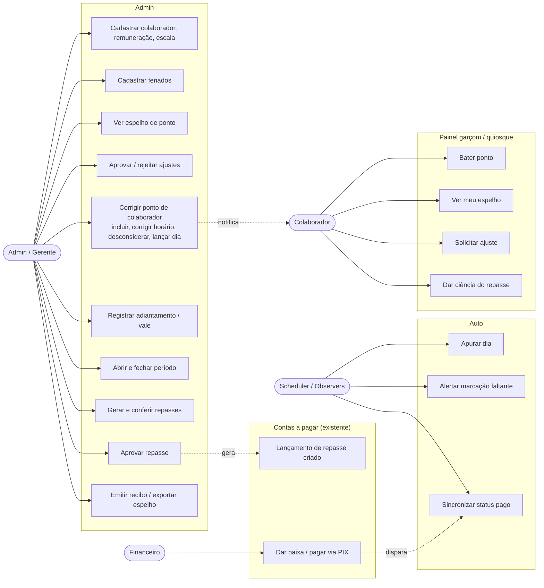
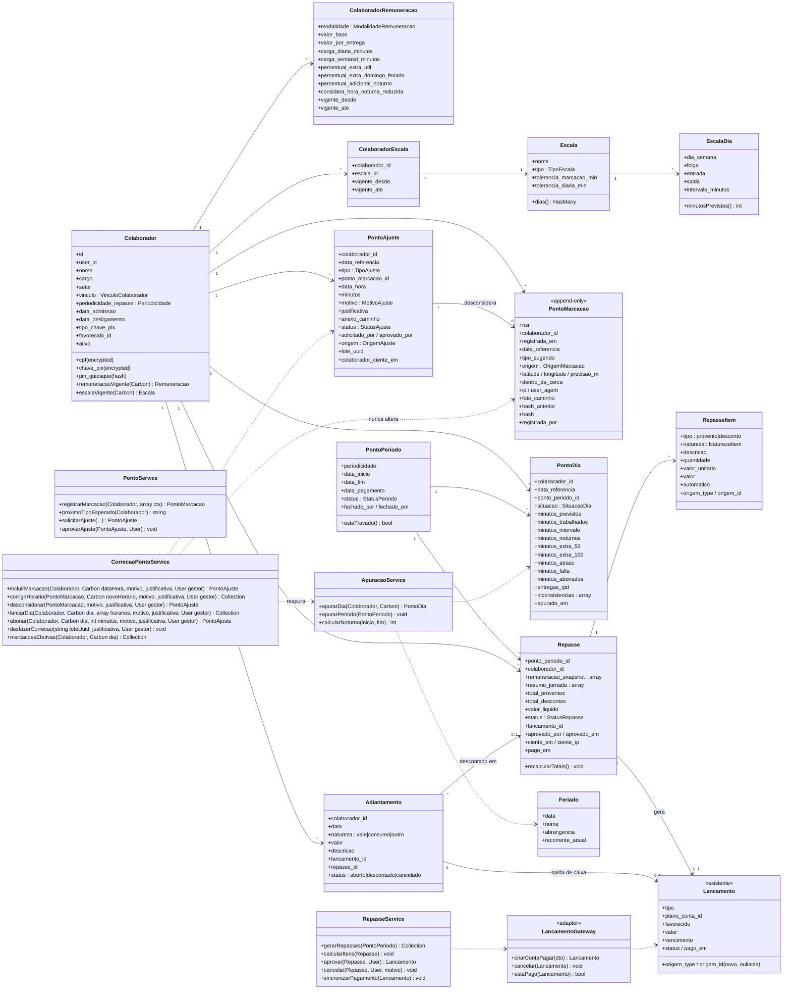
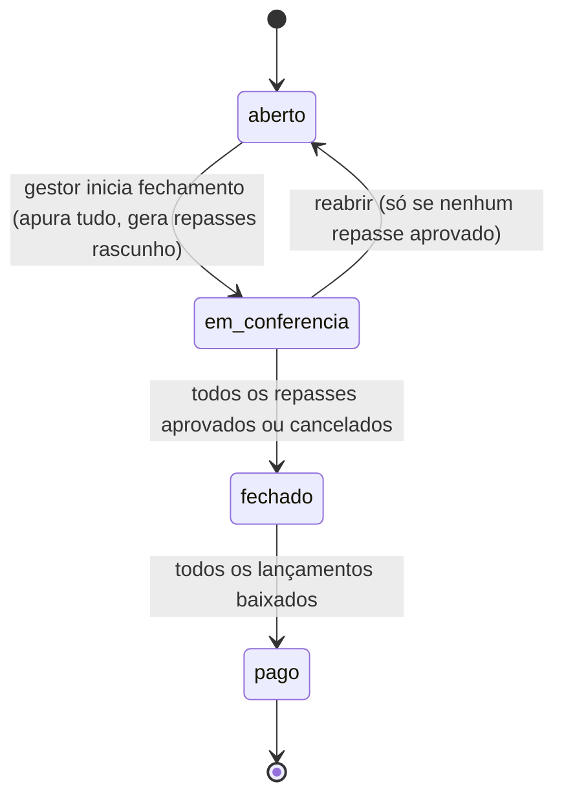
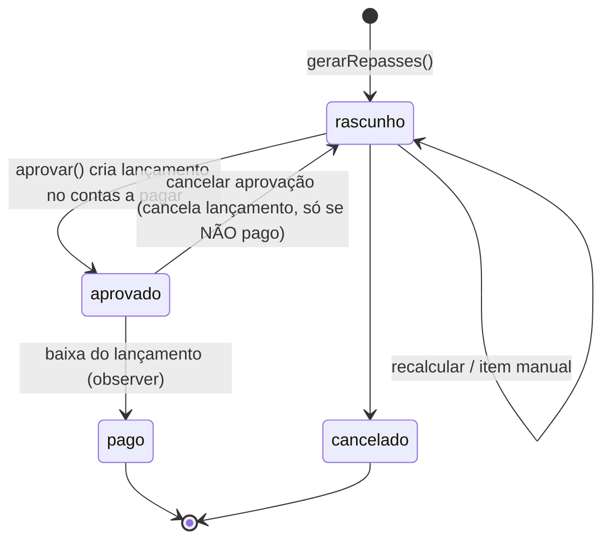
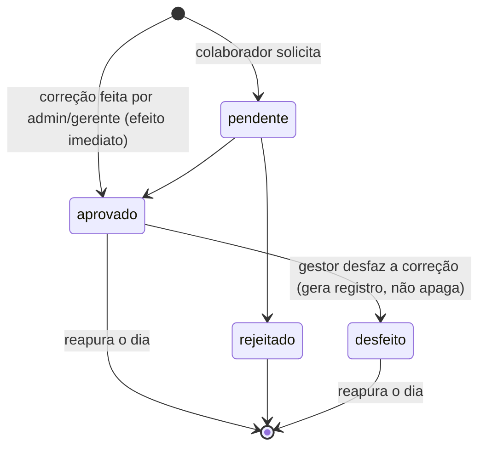
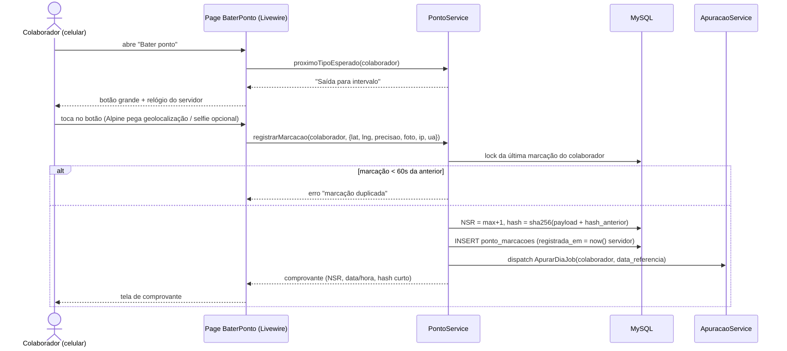
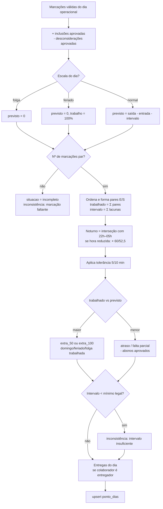
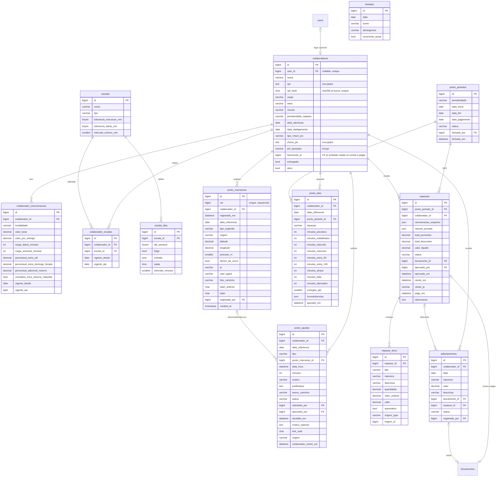

# Módulo Folha de Ponto + Repasses — PizzariaAPP

> Especificação + prompt de execução para o Claude Code.
> Stack: Laravel 12 · Filament 4 · Livewire 3 · Alpine 3 · Tailwind v4 · MySQL.
> Painéis: **admin** (gestão, espelho, fechamento, repasses) e **garcom** (bater ponto, espelho próprio, ajustes, ciência do repasse).
> Integração: **contas a pagar** (`lancamentos` / `parcelas_pagamento` / plano de despesas).

---

## 0. Como usar este arquivo

1. Salve como `docs/modulo-folha-ponto.md`.
2. No Claude Code:

```
Leia docs/modulo-folha-ponto.md inteiro e implemente seguindo a seção
"10. Plano de execução por fases". Use a skill laravel-dev. A Fase 0 é
obrigatória e só de leitura: me mostre como o contas a pagar (lancamentos)
está modelado e as adaptações que vai fazer antes de escrever qualquer código.
Pare ao fim de cada fase e aguarde meu OK. Nada destrutivo.
```

---

## 1. Enquadramento legal (define o escopo)

| Ponto | Situação | Impacto no módulo |
|---|---|---|
| Obrigatoriedade do ponto (CLT art. 74, red. Lei 13.874/2019) | Obrigatório só em estabelecimento com **mais de 20** empregados; contagem por estabelecimento | Para a pizzaria hoje, o módulo é **controle interno de jornada + base de pagamento**, não obrigação legal |
| Ponto eletrônico "oficial" via software (REP-P, Portaria MTP 671/2021) | Exige software **certificado no INPI**, comprovante com assinatura digital ICP-Brasil, sincronia com a Hora Legal (±30s), geração de **AFD** e registros inalteráveis | O módulo **não** será certificado agora, mas será construído **"REP-P ready"**: marcações imutáveis, NSR sequencial, hash encadeado, ajustes separados das marcações. Facilita certificar na versão SaaS (Razel Tec) |
| Ponto por exceção | Permitido com acordo individual escrito ou coletivo | Suportado: colaborador pode ter escala "por exceção" (só ocorrências) |
| Jornada noturna (CLT art. 73) | 22h–05h, hora reduzida de 52'30", adicional mínimo 20% | **Essencial na pizzaria** — apuração calcula minutos noturnos e hora reduzida |
| Tolerância (CLT art. 58 §1º) | Variações de até 5 min por marcação, máx. 10 min/dia, não contam | Configurável |
| Horas extras | Mínimo 50%; domingos/feriados não compensados normalmente 100% | Percentuais **configuráveis por remuneração** — conferir a convenção coletiva do sindicato de bares e restaurantes |
| Encargos de CLT (INSS, IRRF, FGTS, férias, 13º) | Responsabilidade da contabilidade | **Fora do escopo de cálculo.** Para CLT o sistema gera o espelho para o contador e recebe os valores do holerite |

> ⚠️ Não é parecer jurídico. Validar regras de extras/noturno/DSR com a contabilidade e a convenção coletiva antes de usar para pagamento.

---

## 2. Requisitos

### 2.1 Funcionais

| # | Requisito | Painel |
|---|---|---|
| RF01 | Cadastrar colaboradores com vínculo (CLT, diarista, freelancer, MEI/PJ, estágio), dados de pagamento (PIX) e usuário opcional | admin |
| RF02 | Histórico de remuneração com vigência (mensal, por hora, por diária, por turno, + valor por entrega) | admin |
| RF03 | Escalas de trabalho (dias, horários, intervalo, folgas) com vigência por colaborador | admin |
| RF04 | Bater ponto pelo celular (painel garçom) com hora do **servidor**, geolocalização e selfie opcional | garcom |
| RF05 | Modo quiosque: tablet da loja, colaborador identifica-se por PIN (para quem não tem login) | quiosque (rota própria) |
| RF06 | Marcações **imutáveis**: nunca editadas nem apagadas; correções só por ajuste aprovado | sistema |
| RF07 | Colaborador solicita ajuste (esquecimento, saída antecipada, abono); gestor aprova/rejeita | garcom → admin |
| RF07b | **Admin e gerente corrigem o ponto de qualquer colaborador** direto no espelho: incluir marcação esquecida, corrigir horário errado, desconsiderar marcação indevida, lançar o dia inteiro, abonar — com motivo obrigatório, efeito imediato (sem fila de aprovação) e histórico preservado (ver §5.2.1) | admin |
| RF08 | Apuração diária automática: horas trabalhadas, intervalo, extras 50/100, noturno, atrasos, faltas, inconsistências | sistema |
| RF09 | Espelho de ponto do período (grade colaborador × dia) com destaque de inconsistências | admin / garcom (próprio) |
| RF10 | Períodos de apuração (semanal, quinzenal, mensal) com fechamento que **trava** marcações e ajustes do período | admin |
| RF11 | Adiantamentos/vales e consumo interno, descontados automaticamente no repasse | admin |
| RF12 | Gerar repasses por colaborador ao fechar o período, com itens de proventos e descontos (automáticos + manuais) | admin |
| RF13 | Aprovar repasse → criar **lançamento em contas a pagar** (favorecido, plano de despesa, vencimento, valor líquido, origem) | admin → financeiro |
| RF14 | Baixa do lançamento no financeiro → repasse muda para `pago` automaticamente | sistema |
| RF15 | Colaborador vê o repasse e dá ciência eletrônica ("li e confere") | garcom |
| RF16 | Recibo de repasse em PDF e exportação do espelho (PDF/CSV) para a contabilidade | admin |
| RF17 | Dashboard: quem está trabalhando agora, inconsistências pendentes, custo de pessoal do período | admin |

### 2.2 Não funcionais
- Marcação sempre com `now()` do servidor (timezone `America/Sao_Paulo`); horário do aparelho é ignorado.
- `ponto_marcacoes` é **append-only** (exceção justificada ao padrão SoftDeletes do codebase). Demais tabelas com SoftDeletes.
- Auditoria via Model Observer (mesmo mecanismo de `chamados`/`FechamentoCaixa`).
- Dinheiro em `decimal(12,2)`; tempo em **minutos inteiros** (`unsignedInteger`), nunca float de horas.
- CPF e chave PIX com cast `encrypted`; selfies com retenção configurável (LGPD).
- **Dia operacional** compartilhado com o módulo de checklists: mover `checklists.virada_dia` para `config('operacao.virada_dia')` (padrão `05:00`). O turno de sábado que termina 01:30 de domingo pertence a sábado.

---

## 3. UML

### 3.1 Casos de uso



### 3.2 Diagrama de classes



### 3.3 Estados

**Período**


**Repasse**

Repasse `pago` só volta com **estorno manual no financeiro** — o módulo nunca desfaz pagamento sozinho.

**Ajuste**


### 3.3.1 Sequência — gestor corrige horário errado

```mermaid
sequenceDiagram
    actor G as Gerente
    participant E as Página Espelho (modal do dia)
    participant C as CorrecaoPontoService
    participant DB as MySQL
    participant A as ApuracaoService
    participant N as Notificação ao colaborador

    G->>E: marcação 19:47 → "Corrigir horário" → 18:00, motivo "horário errado", justificativa
    E->>C: corrigirHorario(marcacao, 18:00, motivo, justificativa, gerente)
    C->>C: autoriza (policy) + período aberto + não é o próprio ponto do gerente
    C->>DB: BEGIN; lote_uuid = uuid
    C->>DB: INSERT ajuste desconsideracao (marcacao 19:47, aprovado, origem gestor, lote)
    C->>DB: INSERT ajuste inclusao (18:00, aprovado, origem gestor, lote)
    C->>DB: COMMIT (ponto_marcacoes intocada)
    C->>A: apurarDia(colaborador, dia)
    C->>N: "Seu ponto de 12/10 foi corrigido por Gerente: 19:47 → 18:00 (horário errado)"
    E-->>G: espelho mostra ~~19:47~~ 18:00 ✎ com tooltip (quem, quando, por quê)
```

### 3.4 Sequência — bater ponto



### 3.5 Sequência — fechamento → contas a pagar → pago

```mermaid
sequenceDiagram
    actor G as Gestor
    participant PP as PontoPeriodoResource
    participant AP as ApuracaoService
    participant RS as RepasseService
    participant LG as LancamentoGateway
    participant L as lancamentos (contas a pagar)
    actor F as Financeiro
    participant O as LancamentoObserver

    G->>PP: "Iniciar fechamento" (01–15/10)
    PP->>AP: apurarPeriodo(periodo)
    AP-->>PP: dias apurados + lista de inconsistências
    alt há inconsistências
        PP-->>G: bloqueia, lista dias a resolver (ajustes)
    else
        PP->>RS: gerarRepasses(periodo)
        RS->>RS: proventos (salário/horas/diárias/extras/noturno/entregas)
        RS->>RS: descontos (faltas, adiantamentos abertos, consumo)
        RS-->>PP: repasses em rascunho
    end
    G->>PP: confere, ajusta itens manuais, "Aprovar"
    PP->>RS: aprovar(repasse)
    RS->>LG: criarContaPagar(favorecido, plano, vencimento, valor_liquido, origem=Repasse)
    LG->>L: INSERT lancamento (tipo pagar)
    RS->>RS: adiantamentos → descontado; repasse → aprovado, lancamento_id
    F->>L: dá baixa (PIX)
    L->>O: updated (status pago)
    O->>RS: sincronizarPagamento(lancamento)
    RS->>RS: repasse → pago; se todos pagos, período → pago
```

### 3.6 Atividade — apuração de um dia



---

## 4. Modelagem de dados

### 4.1 ER



### 4.2 Enums (`app/Enums/Ponto/`, com `HasLabel`/`HasColor`/`HasIcon`)

| Enum | Valores |
|---|---|
| `VinculoColaborador` | `clt`, `diarista`, `freelancer`, `mei_pj`, `estagio` |
| `Periodicidade` | `semanal`, `quinzenal`, `mensal` |
| `ModalidadeRemuneracao` | `mensal` (salário fixo), `por_hora`, `por_diaria`, `por_turno`, `somente_entregas` |
| `TipoEscala` | `fixa`, `revezamento`, `por_excecao`, `livre` (sem previsto — freelancer) |
| `OrigemMarcacao` | `app`, `quiosque`, `manual_gestor`, `importacao` |
| `TipoAjuste` | `inclusao`, `desconsideracao`, `abono`, `folga_compensatoria`, `falta_justificada` |
| `MotivoAjuste` | `esquecimento`, `falha_sistema`, `servico_externo`, `declaracao_comparecimento`, `atestado`, `acordo`, `outro` |
| `StatusAjuste` | `pendente`, `aprovado`, `rejeitado`, `desfeito` |
| `OrigemAjuste` | `colaborador` (solicitação), `gestor` (correção direta) |
| `MotivoAjuste` (acréscimos) | `horario_errado`, `marcacao_duplicada`, `marcou_por_outro`, `sem_acesso_ao_app` |
| `SituacaoDia` | `normal`, `folga`, `feriado`, `falta`, `incompleto`, `inconsistente`, `abonado` |
| `StatusPeriodo` | `aberto`, `em_conferencia`, `fechado`, `pago` |
| `StatusRepasse` | `rascunho`, `aprovado`, `pago`, `cancelado` |
| `NaturezaItem` | proventos: `salario_base`, `horas_normais`, `diarias`, `turnos`, `hora_extra_50`, `hora_extra_100`, `adicional_noturno`, `entregas`, `gorjeta`, `bonificacao`, `ajuda_custo`, `outros_proventos` · descontos: `adiantamento`, `consumo`, `falta`, `atraso`, `inss`, `irrf`, `outros_descontos` |

Colunas de enum como `string(30)` + cast.

### 4.3 Detalhes de migration

**`colaboradores`**
- Antes de criar: **verificar se já existe** tabela de funcionários/colaboradores ou se os dados vivem em `users`. Se existir, estender em vez de duplicar.
- `cpf` text `encrypted` + `cpf_hash` char(64) unique (busca/unicidade sem decriptar).
- `favorecido_id`: adaptar à forma como `lancamentos` identifica o beneficiário (FK para `fornecedores`/`pessoas`, ou colunas texto). Se `lancamentos` usar morph (`favorecido_type/id`), `Colaborador` vira um favorecido direto e esta coluna some.
- `entregador` bool → habilita contagem de entregas a partir dos pedidos (confirmar a coluna do entregador em `pedidos`).

**`colaborador_remuneracoes`** — `decimal(12,2)` para valores, `decimal(5,2)` para percentuais (padrões: 50, 100, 20); index (`colaborador_id`, `vigente_desde`). Regra: no máximo uma vigência aberta (`vigente_ate` null) por colaborador — validar no Service.

**`escala_dias`** — unique (`escala_id`, `dia_semana`); `saida` < `entrada` significa virada de meia-noite (turno 18:00–01:00).

**`ponto_marcacoes`** (append-only)
- Sem `updated_at`, sem `deleted_at`.
- `nsr` unsignedBigInteger unique — gerado dentro de transação com `lockForUpdate` numa linha de controle (`ponto_sequencias`) ou `SELECT MAX(nsr) ... FOR UPDATE`.
- `hash` = `sha256(nsr|colaborador_id|registrada_em ISO|origem|lat|lng|hash_anterior)`; `hash_anterior` = hash da marcação de NSR anterior (cadeia global).
- `latitude/longitude` `decimal(10,7)`.
- Model: `booted()` lança exceção em `updating` e `deleting`.
- **Opcional recomendado**: migration com trigger MySQL `BEFORE UPDATE`/`BEFORE DELETE` que faz `SIGNAL SQLSTATE '45000'` (via `DB::unprepared`).
- Índices: (`colaborador_id`, `data_referencia`), (`data_referencia`), (`registrada_em`).
- Comando `ponto:verificar-integridade` percorre a cadeia e aponta quebra.

**`ponto_ajustes`** — index (`colaborador_id`, `data_referencia`), (`status`), (`lote_uuid`). Validações por tipo: `inclusao` exige `data_hora`; `desconsideracao` exige `ponto_marcacao_id`; `abono` exige `minutos`. `lote_uuid` agrupa os ajustes de uma mesma correção (ex.: "corrigir horário" = desconsideração + inclusão) para exibir e desfazer juntos. `origem` default `colaborador`. `justificativa` obrigatória (mín. 10 caracteres) quando `origem = gestor`.

**`ponto_dias`** — unique (`colaborador_id`, `data_referencia`); é **derivada** (pode ser recalculada a qualquer momento enquanto o período não estiver fechado).

**`ponto_periodos`** — unique (`periodicidade`, `data_inicio`); validar que períodos da mesma periodicidade não se sobrepõem.

**`repasses`** — unique (`ponto_periodo_id`, `colaborador_id`); `lancamento_id` FK nullable nullOnDelete (adaptar ao nome real da tabela).

**`repasse_itens`** — `quantidade decimal(10,2)` (horas em decimal só para exibição: minutos/60 arredondado em 2 casas); `valor decimal(12,2)` sempre positivo, o `tipo` define o sinal.

**`adiantamentos`** — index (`colaborador_id`, `status`).

**Alteração em `lancamentos` (existente)** — se ainda não houver, adicionar `origem_type` + `origem_id` nullable (`nullableMorphs('origem')`) para rastrear o repasse/adiantamento que gerou o lançamento. Verificar se a importação de `sessao_caixa` já criou algo equivalente e reutilizar.

**Config** `config/ponto.php`: `cerca` (`lat`, `lng`, `raio_m`, `bloquear_fora` = false), `exigir_selfie` (false), `retencao_selfie_dias` (90), `intervalo_minimo_duplicada_s` (60), `noturno_inicio` (`22:00`), `noturno_fim` (`05:00`), `plano_contas` (mapa vínculo → id do plano de despesa), `dia_pagamento_padrao`.

---

## 5. Regras de negócio

### 5.1 Marcação
1. Hora = `now()` do servidor. Data de referência = dia operacional (`operacao.virada_dia`).
2. Bloqueia nova marcação < 60s da anterior do mesmo colaborador.
3. `tipo_sugerido` pela paridade das marcações do dia (1ª entrada, 2ª saída intervalo, 3ª retorno, 4ª saída…). É só rótulo — a apuração usa ordem cronológica.
4. Fora da cerca: registra com `dentro_da_cerca = false` e sinaliza no espelho (bloqueio só se `bloquear_fora`).
5. Colaborador desligado ou sem escala vigente não marca.
6. Período `fechado`: marcação ainda é gravada (é fato), mas não altera o período — cai como inconsistência no período seguinte e alerta o gestor.

### 5.2 Ajustes
- Nunca alteram `ponto_marcacoes`. A apuração aplica: marcações + inclusões aprovadas − desconsiderações aprovadas.
- Aprovação reapura o dia. Ajuste em período `em_conferencia`/`fechado` é bloqueado (reabrir o período primeiro).

### 5.2.1 Correção de ponto por admin/gerente
Para quem usa, é "editar o ponto do colaborador". Por baixo, cada correção vira ajuste(s) com `origem = gestor` e `status = aprovado` (efeito imediato, sem fila). A marcação original **nunca** é alterada — é isso que mantém o registro defensável numa reclamação trabalhista e compatível com REP-P no futuro.

| Ação no espelho | O que o `CorrecaoPontoService` grava |
|---|---|
| **Incluir marcação** (esqueceu de bater) | 1 ajuste `inclusao` |
| **Corrigir horário** (bateu com hora errada) | `desconsideracao` da original + `inclusao` do horário certo, mesmo `lote_uuid` |
| **Desconsiderar** (duplicada, bateu por outro) | 1 ajuste `desconsideracao` |
| **Lançar dia completo** (sem acesso ao app, celular quebrado) | N ajustes `inclusao` (ex.: 4 horários) no mesmo lote; se havia marcações no dia, oferece desconsiderá-las no mesmo lote |
| **Abonar** (declaração, atestado, liberação) | 1 ajuste `abono` com minutos ou dia inteiro |
| **Desfazer correção** | ajustes do lote vão para `desfeito` (com quem/quando/justificativa); nada é apagado |

Regras:
1. Exige permissão `ponto.corrigir` (admin e gerente). **Ninguém corrige o próprio ponto** — o gerente que esqueceu de bater precisa de outro gestor ou do admin. Admin pode corrigir o próprio só se `config('ponto.admin_corrige_proprio')` = true (padrão false).
2. Motivo (enum) + justificativa obrigatórios.
3. Só em período `aberto`. Para mexer em período `em_conferencia`, reabrir primeiro (e repasses voltam a rascunho — bloqueado se algum já estiver aprovado/pago).
4. Validações: horário dentro do dia operacional; não criar duas marcações efetivas com < 1 min de diferença; não incluir horário no futuro.
5. Toda correção reapura o dia na hora e envia notificação ao colaborador com o antes/depois. O colaborador vê no "Meu espelho" e pode dar ciência (`colaborador_ciente_em`) ou contestar (abre uma solicitação de ajuste normal).
6. `marcacoesEfetivas()` é a única fonte para apuração, espelho e PDF: marcações originais − desconsideradas + inclusões, ordenadas, cada uma com flag `corrigida` e referência ao ajuste.
7. Relatório "Correções do período" (quem corrigiu, quantas, de quem) para o admin acompanhar uso indevido.

### 5.3 Apuração (ver §3.6)
- Pares E/S em ordem cronológica; nº ímpar → `incompleto`.
- Noturno: minutos dentro de 22h–05h (inclusive turnos que cruzam meia-noite). Se `considera_hora_noturna_reduzida`, `minutos_noturnos_equivalentes = round(minutos × 60 / 52.5)`; a diferença entra como tempo trabalhado adicional.
- Tolerância: diferenças ≤ `tolerancia_marcacao_min` por marcação e total ≤ `tolerancia_diaria_min` são ignoradas.
- Extras: trabalhado − previsto. Domingo (quando folga na escala), feriado e folga trabalhada → `extra_100`; demais → `extra_50`.
- Falta: dia previsto sem marcação e sem abono → `falta` (desconta o previsto).
- Escala `livre` (freelancer): não gera falta/atraso/extra; só trabalhado e noturno.
- Inconsistências (json): `marcacao_faltante`, `intervalo_insuficiente`, `jornada_excedida_10h`, `fora_da_cerca`, `marcacao_em_periodo_fechado`.

### 5.4 Cálculo do repasse por modalidade

| Modalidade | Proventos automáticos |
|---|---|
| `mensal` | `salario_base` proporcional (periodicidade); extras: `valor_hora = valor_base / (carga_semanal/60 × 5)` (≈ divisor 220 para 44h — **confirmar divisor com a contabilidade**); `adicional_noturno` = horas noturnas × valor_hora × %; `falta` como desconto = dias × valor_base/30 |
| `por_hora` | `horas_normais` = (trabalhado − extras) × valor_base; extras e noturno sobre o mesmo valor_hora |
| `por_diaria` | `diarias` = dias com situação trabalhada × valor_base; extras opcionais se ultrapassar `carga_diaria_minutos` |
| `por_turno` | `turnos` = nº de turnos trabalhados × valor_base |
| `somente_entregas` | `entregas` = entregas_qtd × valor_por_entrega |
| qualquer + `valor_por_entrega` | soma `entregas` |

**Descontos automáticos**: `adiantamento` (todos os `adiantamentos` abertos com data ≤ fim do período), `consumo`, `falta`/`atraso` (só modalidade `mensal`).

**CLT**: o sistema gera os itens de jornada, mas `inss`/`irrf`/encargos entram como **itens manuais copiados do holerite** da contabilidade. Repasse de CLT só pode ser aprovado com flag "conferido com holerite" marcada.

**Gorjeta (taxa de serviço)**: natureza prevista; rateio automático a partir das vendas fica no backlog.

`valor_liquido` = Σ proventos − Σ descontos; se negativo, bloqueia aprovação (saldo devedor vira adiantamento aberto para o próximo período, por action explícita).

### 5.5 Integração com contas a pagar
- **Um lançamento por repasse** (baixa individual por PIX, rastreável).
- `RepasseService::aprovar()` dentro de `DB::transaction`:
  1. trava o repasse (`lockForUpdate`), valida status `rascunho` e líquido > 0;
  2. `LancamentoGateway::criarContaPagar()` com: tipo = pagar (valor real do enum de `lancamentos`), plano de despesa = `config('ponto.plano_contas')[vinculo]` (ex.: CLT → "Salários", diarista/freelancer → "Diárias e extras", entregador → "Entregas/Motoboys"), favorecido = colaborador, valor = líquido, vencimento = `periodo.data_pagamento`, descrição `Repasse 01/10–15/10/2026 – Nome`, observação com chave PIX, `lancamentos.repasse_id` = repasse (FK dedicada, sem morph);
  3. marca adiantamentos descontados (`repasse_id`, `status = descontado`);
  4. status `aprovado` (o vínculo fica só em `lancamentos.repasse_id`; o título vigente é o mais recente não cancelado).
- **`LancamentoGateway`** é o único ponto que conhece a estrutura de `lancamentos`/`parcelas_pagamento` — se o financeiro mudar, só ele muda.
- **Observer em `Lancamento`** (evento próprio `statusAlterado`, porque o status é recalculado com `saveQuietly`): se `repasse_id` está preenchido e o lançamento ficou pago → `RepasseService::sincronizarPagamento()` (status `pago`, `pago_em`); se todos os repasses do período estão pagos → período `pago`. Se for estornado (pago → aberto), repasse volta para `aprovado`.
- **Cancelar aprovação**: só se o lançamento não tiver pagamento; deixa o lançamento com status `cancelado` (`lancamentos` não tem soft delete) e devolve adiantamentos para `aberto`.
- **Adiantamento**: ao registrar, cria lançamento **já pago** no mesmo plano de despesa (é saída real de dinheiro). No repasse ele só reduz o líquido. Assim o DRE do período soma adiantamento + líquido = bruto, sem duplicidade.

### 5.6 Permissões
| Ação | admin | gerente | colaborador |
|---|---|---|---|
| Cadastro de colaborador/remuneração/escala | ✅ | ✅ (sem ver remuneração, configurável) | ❌ |
| Bater ponto | — | ✅ (se for colaborador) | ✅ próprio |
| Corrigir ponto de outro colaborador (incluir, corrigir horário, desconsiderar, lançar dia, abonar, desfazer) — §5.2.1 | ✅ | ✅ | ❌ |
| Corrigir o próprio ponto | ❌ (salvo config) | ❌ | ❌ (só solicita) |
| Ver espelho | todos | todos | só o próprio |
| Aprovar ajustes solicitados | ✅ | ✅ | ❌ (não aprova o próprio) |
| Relatório de correções do período | ✅ | ❌ | ❌ |
| Fechar período / aprovar repasse | ✅ | ❌ | ❌ |
| Ver repasse | todos | ❌ | só o próprio, após aprovado |

---

## 6. Painel **admin**

Grupo de navegação: **Equipe**.

| Recurso / Página | Conteúdo |
|---|---|
| `ColaboradorResource` | Form em seções (Dados, Vínculo, Pagamento PIX, Acesso: usuário e PIN do quiosque). RelationManagers: **Remunerações** (vigências), **Escalas** (vigências), **Adiantamentos**. Table: nome, cargo, vínculo (badge), escala vigente, ativo, "trabalhando agora" (ícone). Action "Desligar" (data + encerra vigências). |
| `EscalaResource` | Form com Repeater de 7 dias (`escala_dias`, `->relationship()`), toggle folga desabilita horários (`Get`). Action "Duplicar". |
| `FeriadoResource` | CRUD simples + action "Importar feriados nacionais do ano". |
| `Pages\EspelhoPonto` | Filtro período + colaborador/setor. Grade colaborador × dia com chip colorido por `situacao` e ícone de inconsistência; clique abre modal do dia com as **marcações efetivas** (original riscada + valor corrigido com ícone ✎ e tooltip quem/quando/motivo), NSR, origem, mapa/foto e totais. Actions por marcação: "Corrigir horário", "Desconsiderar". Actions do dia: "Incluir marcação", "Lançar dia completo" (form com N horários), "Abonar", "Desfazer correção" (por lote). Bulk action na grade: "Lançar folga/abono" para vários colaboradores/dias. Todas exigem motivo + justificativa e ficam ocultas/desabilitadas no próprio colaborador do usuário e em período não aberto. Rodapé com totais. Export PDF/CSV para contabilidade (PDF marca dias com correção). |
| `Pages\RelatorioCorrecoes` (admin) | Correções do período por gestor e por colaborador, com filtro e export. |
| `PontoAjusteResource` | Fila de pendentes (badge na navegação), Aprovar/Rejeitar em lote. |
| `AdiantamentoResource` | Lançamento rápido de vale (cria lançamento pago). |
| `PontoPeriodoResource` | Create (periodicidade + datas + data de pagamento). Header actions por status: "Iniciar fechamento", "Reabrir", "Aprovar todos os repasses conferidos". RelationManager **Repasses**. |
| `RepasseResource` | View com infolist (resumo de jornada, itens, lançamento vinculado com status). Edit só em `rascunho` (itens manuais via Repeater; automáticos read-only). Actions: Recalcular, Aprovar, Cancelar aprovação, Recibo PDF. |
| Widgets | `TrabalhandoAgoraWidget`, `InconsistenciasPendentesWidget`, `CustoPessoalPeriodoWidget` (bruto por vínculo, horas extras, noturno). |

Filament 4: `Schema`, `recordActions`/`toolbarActions`, `Filament\Actions\*`, `Filament\Schemas\Components\{Section,Grid}` com `->columns(n)`, `Get/Set` em `Schemas\Components\Utilities`, ícones `Heroicon::*`, eager loading via `modifyQueryUsing`.

---

## 7. Painel **garçom** + quiosque

| Página | Conteúdo |
|---|---|
| `Pages\BaterPonto` (1º item da navegação) | Relógio do servidor (atualizado via Alpine a partir do offset), nome do próximo tipo esperado em botão enorme, marcações de hoje, aviso de fora da cerca. Alpine captura `navigator.geolocation` (timeout 8s; sem permissão → registra sem coordenadas e sinaliza) e selfie opcional (`<input capture="user">`, compressão no client). Após marcar: tela de comprovante (NSR, data/hora, 8 primeiros caracteres do hash). |
| `Pages\MeuEspelho` | Período atual/anterior, lista por dia com totais e inconsistências; dias corrigidos pelo gestor aparecem destacados com antes/depois e botões "Ciente" e "Contestar" (abre solicitação de ajuste); botão "Solicitar ajuste" no dia. |
| `Pages\SolicitarAjuste` (modal/action) | Tipo, horário, motivo, justificativa, anexo. |
| `Pages\MeusRepasses` | Repasses aprovados/pagos, detalhamento de itens, botão "Li e confere" (grava `ciente_em`/`ciente_ip`). |
| **Quiosque** (`/ponto/quiosque`, rota Livewire fora dos painéis, protegida por token do dispositivo em `config`/tabela) | Teclado numérico para PIN → mostra nome e próximo tipo → confirma. Rate-limit por PIN (5 tentativas/5 min). Origem `quiosque`, IP do tablet. |

---

## 8. Jobs, scheduler e notificações
- `ApurarDiaJob` (fila) disparado por marcação e por aprovação de ajuste.
- `ponto:apurar {--data=}` diário 05:15 — reapura o dia operacional anterior de todos.
- `ponto:alertar-faltantes` a cada 30 min — escala previa entrada há > 30 min sem marcação → notifica gerente; marcação ímpar após fim da escala + 1h → notifica colaborador.
- `ponto:abrir-periodos` diário — cria o próximo período de cada periodicidade em uso.
- `ponto:limpar-selfies` diário — remove fotos além da retenção (mantém o registro).
- `ponto:verificar-integridade` semanal — valida a cadeia de hash.
- Notifications (database): `PontoCorrigidoNotification` (ao colaborador, com antes/depois e quem corrigiu), `AjusteSolicitadoNotification`, `AjusteDecididoNotification`, `MarcacaoFaltanteNotification`, `RepasseDisponivelNotification`.

---

## 9. Testes (Pest) obrigatórios
- Marcação não pode ser editada/apagada (model e, se houver, trigger).
- NSR sequencial e hash encadeado com marcações concorrentes.
- Turno 18:00–01:30 cai no dia operacional anterior; noturno de 22:00–01:30 = 210 min (240 equivalentes com hora reduzida).
- Tolerância 5/10 min.
- Extra 100% em feriado e folga trabalhada.
- Desconsideração + inclusão aprovadas corrigem dia incompleto.
- Gerente corrige horário de outro colaborador: `ponto_marcacoes` inalterada, 2 ajustes no mesmo lote, dia reapurado, colaborador notificado.
- Gerente **não** consegue corrigir o próprio ponto; colaborador comum não acessa as actions de correção.
- "Lançar dia completo" num dia sem marcação gera dia `normal` com as horas certas.
- "Desfazer correção" volta a apuração ao estado anterior e mantém os ajustes como `desfeito`.
- Correção bloqueada em período `em_conferencia`/`fechado`.
- Repasse por diária, por hora, mensal com falta, entregador.
- Aprovar repasse cria exatamente 1 lançamento com valor líquido, plano e origem corretos; adiantamento vira descontado.
- Baixa do lançamento → repasse pago → período pago; estorno reverte.
- Cancelar aprovação com lançamento pago é bloqueado.
- Colaborador não vê espelho/repasse de outro.

---

## 10. Plano de execução por fases

**Fase 0 — Reconhecimento (somente leitura)**
1. Mapear o financeiro: schema de `lancamentos`, `parcelas_pagamento`, plano de despesas (tabela e IDs), valores do campo `tipo`, como se registra favorecido, como se marca pago (status/coluna/parcela), se já existem colunas de origem (importação de `sessao_caixa`).
2. Verificar se já existe cadastro de funcionários/colaboradores ou dados em `users`; sistema de papéis; IDs dos painéis `admin` e `garcom`.
3. Achar a coluna de entregador em `pedidos` (para `entregas_qtd`).
4. Confirmar config de dia operacional do módulo de checklists e propor a migração para `config/operacao.php`.
5. Mecanismo de auditoria por Observer existente; uso de filas (driver) e scheduler no servidor.
6. Apresentar o desenho do `LancamentoGateway` para os campos reais e as adaptações nesta spec.

**Fase 1 — Banco e domínio**: enums, `config/ponto.php` e `config/operacao.php`, migrations na ordem do ER (+ morph em `lancamentos` se necessário, + trigger opcional), models (casts `encrypted`, relações, scopes `ativos()`, `vigenteEm()`), factories, seeder de feriados nacionais.

**Fase 2 — Ponto**: `PontoService`, `CorrecaoPontoService` (§5.2.1), `ApuracaoService`, `ApurarDiaJob`, Observers, Policies, commands e agendamento em `routes/console.php`. Testes de marcação e apuração.

**Fase 3 — Repasses + financeiro**: `RepasseService`, `LancamentoGateway`, Observer de `Lancamento`, regras de adiantamento. Testes de integração com contas a pagar.

**Fase 4 — Painel admin**: resources, página Espelho, widgets, PDF do recibo e do espelho.

**Fase 5 — Painel garçom + quiosque**: BaterPonto, MeuEspelho, ajustes, MeusRepasses, quiosque. Testar em viewport 390px e com geolocalização negada.

**Fase 6 — Acabamento**: N+1, traduções, seeders de exemplo (escala "Noite pizzaria" qua–dom 17:30–00:30, colaborador diarista, entregador por entrega, mensalista CLT) e lista de comandos:
`php artisan migrate`, `php artisan db:seed --class=FeriadosSeeder`, `php artisan queue:work` (ou supervisor), conferir `schedule:run` no cron, `php artisan optimize:clear`, `npm run build`.

### Regras para o Claude Code
- Nada de lógica de cálculo em Resources/Livewire — tudo nos Services.
- Toda operação de dinheiro e de NSR em `DB::transaction` com `lockForUpdate`.
- Tempo em minutos inteiros; dinheiro em `decimal`; arredondamento `round(x, 2)` só no valor final de cada item.
- Nunca alterar estrutura existente de `lancamentos` além de colunas nullable novas; nunca apagar lançamento pago.
- Filament 4 / Livewire 3 conforme a skill laravel-dev. UI em pt-BR. Nada destrutivo.

---

## 11. Backlog (fora desta versão)
- Certificação REP-P no INPI, comprovante com assinatura ICP-Brasil e geração do AFD (necessário para vender como ponto oficial via Razel Tec).
- Rateio automático de gorjeta/taxa de serviço a partir das vendas.
- Banco de horas com saldo e compensação.
- Envio do comprovante de marcação e do recibo via WhatsApp (Evolution API).
- Pagamento automático via API PIX do banco a partir do lançamento.
- Reconhecimento facial na selfie.
- Integração com escala do módulo de checklists (checklist de abertura liberado só para quem bateu ponto).
