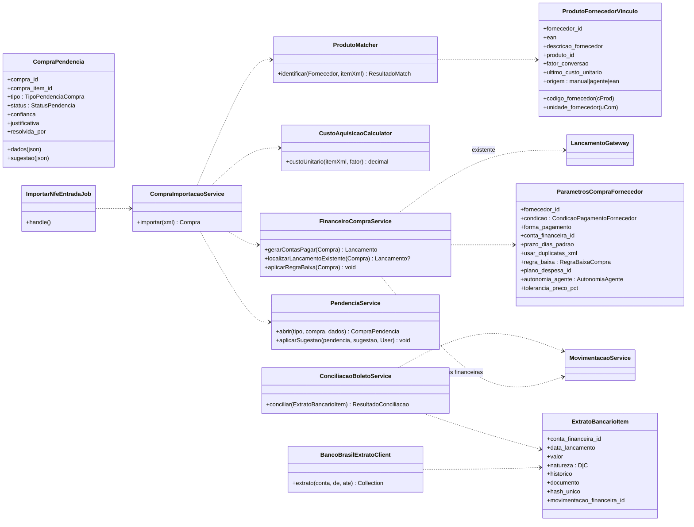
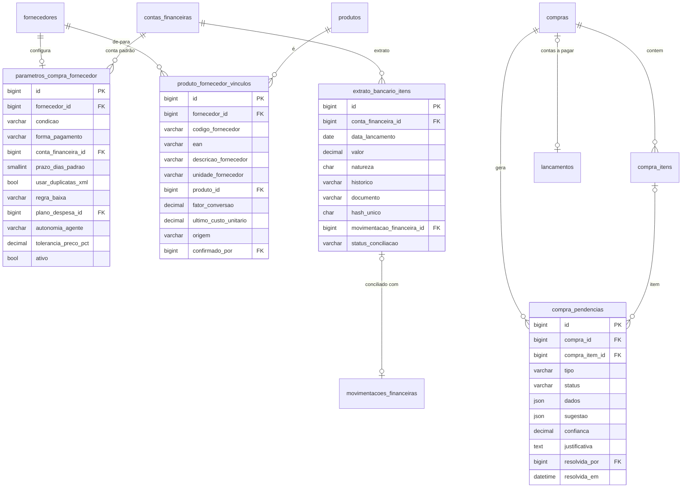
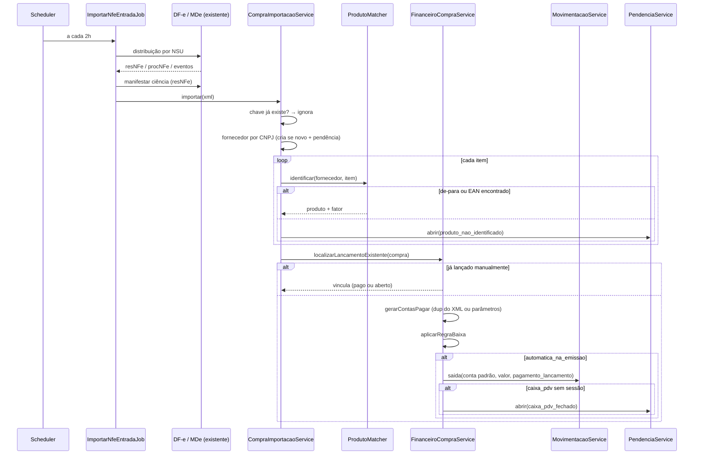
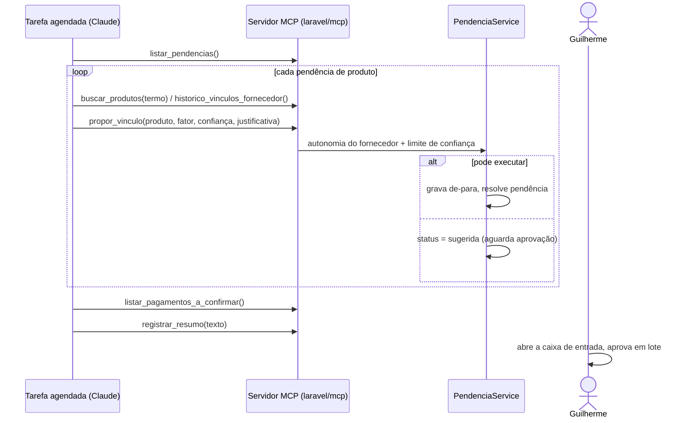
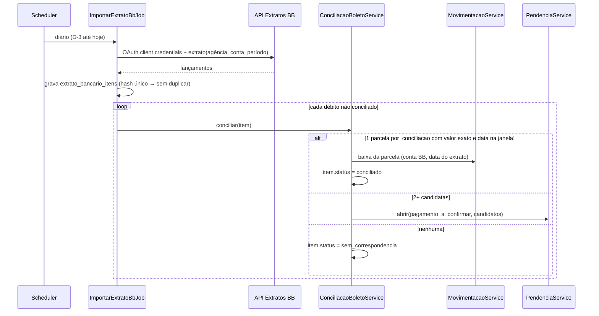

# Plano de implementação — Compras Automatizadas (PizzariaAPP)

> **Para o Claude Code.** Este arquivo é autocontido: a **Parte A** diz como trabalhar e o que entregar em cada fase; a **Parte B** é a especificação completa do módulo. Leia o arquivo inteiro antes de começar.
>
> Salvar no repositório em `docs/planos/compras-automatizadas.md` e iniciar a sessão com:
> *"Leia `docs/planos/compras-automatizadas.md` e execute a Fase 0."*

---

# PARTE A — Instruções de execução

## A.1 Contexto

- Sistema: **PizzariaAPP**, ERP do Empório da Pizza (pizzaria, pastelaria e sanduicheria). Laravel 12 · Filament 4 · Livewire 3 · Blade · Tailwind v4 · MySQL · Pest. Nomes em **português** em todo o código (tabelas, models, services, enums, labels).
- Ambiente: repositório no Ubuntu do WSL2. Produção publicada com HTTPS.
- Objetivo do módulo: notas de compra entram sozinhas via Distribuição DF-e; produtos reconhecidos por de-para; contas a pagar gerado e baixado conforme o perfil de pagamento de cada fornecedor (PIX à vista ou boleto do Banco do Brasil a prazo); um agente (Claude) resolve, via servidor MCP do próprio sistema, só o que for ambíguo.
- Documentos relacionados que podem estar em `docs/`: `modulo-contas-financeiras.md` (pré-requisito: baixa com conta de origem + `MovimentacaoService`). Se não estiverem no repositório, peça ao Guilherme.

## A.2 Regras de trabalho

1. **Use a skill `laravel-dev`** (se disponível na sessão) para padrões de código Laravel/Filament.
2. **Branch**: `feature/compras-automatizadas` a partir da branch principal. Um commit por etapa lógica, mensagens em português.
3. **Pare nos checkpoints** (A.4). Não avance de fase sem aprovação explícita do Guilherme.
4. **Nunca** rode migrations, seeders ou comandos destrutivos contra o banco de produção. Verifique `.env` (`APP_ENV`, `DB_DATABASE`) antes de qualquer `migrate`; use o banco local/de testes. `migrate:fresh`/`db:wipe` só no banco de testes.
5. **Nunca** chame SEFAZ, API do Banco do Brasil ou serviços externos reais em testes — use `Http::fake()` e XMLs de fixture em `tests/Fixtures/NFe/` e `tests/Fixtures/BancoBrasil/`.
6. **Segredos**: certificado digital, credenciais BB e chaves Passport só em `.env`/storage fora do Git. Não leia nem imprima o conteúdo do certificado ou de `.env` além das chaves necessárias para entender a configuração.
7. **Convenções do projeto** (confirmar na Fase 0 e seguir as que existirem): SoftDeletes como padrão, auditoria via Model Observer, enums em `app/Enums/<Modulo>/`, services em `app/Services/<Modulo>/`, regras de dinheiro em `DB::transaction` com `lockForUpdate`.
8. **Não altere comportamento existente** fora do escopo. Alterações em tabelas existentes: apenas colunas **nullable novas**. Se algo da spec conflitar com o código atual, **pare e pergunte** em vez de reescrever.
9. **Qualidade antes de cada checkpoint**: `php artisan test` (ou `./vendor/bin/pest`) verde, `./vendor/bin/pint` aplicado, sem `dd()`/`dump()` esquecidos.
10. Os nomes de tabelas/colunas da Parte B são **propostos**. A Fase 0 produz o mapeamento para os nomes reais e é ele que vale dali em diante.

## A.3 Fases e entregáveis

### Fase 0 — Leitura e diagnóstico (somente leitura, nenhum arquivo de código alterado)

Investigar e responder, citando arquivos e linhas:

| # | Pergunta |
|---|---|
| 0.1 | Como está o módulo de compras hoje? Tabelas, models, resources Filament, importação de XML existente (manual?), itens, vínculo com estoque, como o custo é calculado |
| 0.2 | `fornecedores`: existe? CNPJ único? campos disponíveis |
| 0.3 | `produtos`: tem EAN? unidade de estoque? como a ficha técnica referencia produtos/insumos? |
| 0.4 | MDe / Distribuição DF-e: quais classes/pacotes (ex.: `nfephp-org/sped-nfe`), onde guarda último NSU, como carrega o certificado, se já baixa XML completo e trata eventos de cancelamento |
| 0.5 | Financeiro: estrutura de `lancamentos` e `parcelas_pagamento`, onde/como a baixa é gravada, existe `LancamentoGateway`? enum de tipo e de forma de pagamento (valores reais), plano de despesas |
| 0.6 | **Módulo Contas Financeiras** (`contas_financeiras`, `movimentacoes_financeiras`, `MovimentacaoService`, `CaixaPdvBridge`) já está implementado? Parcial? Não existe? |
| 0.7 | Estoque: tabela de movimentação de estoque, como entra uma compra hoje |
| 0.8 | Autenticação/permissões: guards, Sanctum/Passport instalados?, pacote de papéis (ex.: Filament Shield / Spatie Permission), como `canAccessPanel` está implementado |
| 0.9 | Infra: scheduler (`routes/console.php`), filas (driver, worker em produção?), storage de arquivos (onde guardar XMLs) |
| 0.10 | Convenções observadas (pastas, nomes, Observers, testes existentes) |

**Entregável:** `docs/planos/compras-automatizadas-fase0.md` contendo:
- respostas 0.1–0.10;
- **tabela de mapeamento** "nome na spec → nome real" (tabelas, colunas, classes, enums);
- lacunas e riscos (ex.: contas financeiras não implementado → bloqueia regra 5; sem EAN em produtos; importação atual que conflita);
- plano da Fase 1 **ajustado** à realidade do código (lista de migrations/classes que serão criadas e alteradas);
- perguntas para o Guilherme.

➡️ **CHECKPOINT 0** — pare e peça aprovação.

### Fase 1 — Parâmetros por fornecedor + importação automática (sem IA)

- Migrations, enums e models: `parametros_compra_fornecedor`, `produto_fornecedor_vinculos`, `compra_pendencias`, colunas novas em compras/itens/lançamentos/produtos (B §7).
- `ProdutoMatcher` (B §8.9), `CustoAquisicaoCalculator` (B §8.12), `PendenciaService`, `FinanceiroCompraService` (B §8.1–8.8), `CompraImportacaoService`, `ImportarNfeEntradaJob` (a cada 2h, reaproveitando a integração DF-e existente) e tratamento de cancelamento (B §8.15).
- Comando manual `compras:importar-xml {arquivo}` para importar um XML local (útil para testes e para notas antigas).
- Seção "Parâmetros de compra" no resource de Fornecedor + `ProdutoFornecedorVinculoResource` (B §10).
- Testes Pest de B §11 que se aplicam à Fase 1, com XMLs reais anonimizados como fixtures.

**Critério de aceite:** importar via comando 3 XMLs de fixture (um PIX à vista, um boleto com 3 duplicatas, um com item desconhecido) produz exatamente o resultado descrito em B §8, e reimportar não duplica nada.

➡️ **CHECKPOINT 1** — mostrar resumo das mudanças, testes e um roteiro de teste manual.

### Fase 2 — Pendências e confirmações no Filament

- Página "Caixa de entrada de compras", página "Pagamentos a confirmar" (bulk), revisão de produtos, `ComprasHojeWidget` (B §10).
- Permissões da tabela B §8.

➡️ **CHECKPOINT 2**.

### Fase 3 — Servidor MCP + agente

- `composer require laravel/mcp laravel/passport` (confirmar compatibilidade com o que existir de Sanctum; não quebrar autenticação atual).
- Usuário técnico `Agente Compras` (seeder), gate `agente-compras`, bloqueio de painel.
- `app/Mcp/Servers/ComprasServer.php` + tools de B §9 em `app/Mcp/Tools/Compras/`; `routes/ai.php` com `Mcp::oauthRoutes()` e middleware `auth:api`, `can:agente-compras`, `throttle`.
- `agente_execucoes` + `AgenteExecucaoResource`.
- Testes: 401 sem token, 403 sem papel, cada tool com dados de fixture, nenhuma tool de baixa/estorno/parâmetros.
- Entregar ao Guilherme: URL do conector, passo a passo para cadastrar o conector personalizado no Claude e o prompt final da tarefa agendada (B §9).

➡️ **CHECKPOINT 3**.

### Fase 4 — Extrato Banco do Brasil + conciliação de boletos

- `config/bancos.php` + variáveis `.env` (`BB_CLIENT_ID`, `BB_CLIENT_SECRET`, `BB_DEVELOPER_APP_KEY`, `BB_AMBIENTE`, agência/conta). Antes de codificar o client, **confirmar com o Guilherme** a documentação atual da API Extratos no Portal Developers BB (versão, URL base, escopo, se exige certificado mTLS) — não presumir endpoints.
- `BancoBrasilExtratoClient`, `ImportarExtratoBbJob` (diário, D-3 até hoje), `extrato_bancario_itens`, `ConciliacaoBoletoService` (B §8.17–8.18), `ExtratoBancarioItemResource`.
- Testes com `Http::fake()` (B §11).

➡️ **CHECKPOINT 4** — entregar checklist de ativação em produção (homologação → produção BB, `regra_baixa = por_conciliacao` nos fornecedores de boleto).

## A.4 Formato de cada checkpoint

Ao parar, responder com:
1. O que foi feito (arquivos criados/alterados).
2. Resultado de testes e Pint.
3. Desvios da spec e por quê.
4. Como testar manualmente (passo a passo curto).
5. Perguntas/decisões pendentes.

---

# PARTE B — Especificação

# Módulo Compras Automatizadas (NF-e de entrada + Agente) — PizzariaAPP

> Objetivo: as notas de compra entram sozinhas no sistema, os produtos são reconhecidos, o contas a pagar é gerado e baixado conforme o **perfil de pagamento de cada fornecedor**, e só o que for ambíguo vai para o agente (Claude) ou para o Guilherme.
> Pré-requisitos: **Módulo Contas Financeiras** (baixa com conta de origem + `MovimentacaoService`) e a integração de **Manifestação do Destinatário / Distribuição DF-e** já existente.
> Stack: Laravel 12 · Filament 4 · Livewire 3 · MySQL · `laravel/mcp` + `laravel/passport` · Pest. Mesmas regras de código das specs de ponto e contas financeiras (SoftDeletes, Observers de auditoria, enums em `app/Enums/`, nomes em português).

---

## 1. Conceitos

| Conceito | O que é | Exemplo |
|---|---|---|
| **Parâmetros de compra do fornecedor** | Como aquele fornecedor é pago e o que o sistema/agente pode fazer sozinho com as notas dele | "Distribuidora X: PIX à vista, sai da conta Stone, baixa automática" |
| **De-para de produto** | Ligação entre o código/descrição do produto **na nota do fornecedor** e o **nosso** produto, com fator de conversão | `cProd 4471 "MUSS FAT 4KG PCT"` → Muçarela, 1 PCT = 4 kg |
| **Pendência** | Algo que o sistema não conseguiu decidir com regra | Produto sem de-para, fornecedor sem parâmetros, caixa fechado |
| **Agente** | Claude, rodando como tarefa agendada, que lê e resolve pendências por um conector MCP do sistema | Vincula "MUSS FAT 4KG" à Muçarela com 97% de confiança |
| **Regra de baixa** | Quando o contas a pagar da compra é considerado pago | PIX à vista → pago na emissão; boleto BB → quando aparecer no extrato |
| **Extrato bancário** | Linhas do extrato do Banco do Brasil importadas pela API, usadas para conciliar boletos pagos | "PAGTO COBRANCA – R$ 1.284,50 – 12/11" |

**Princípio central:** o que é regra fica no sistema (determinístico, testável); o que é julgamento fica com o agente; **o agente nunca movimenta dinheiro** — baixa só acontece por regra do fornecedor, por conciliação com o extrato ou por confirmação humana.

---

## 2. Quem faz o quê

| Etapa | Sistema (regra) | Agente (julgamento) | Guilherme |
|---|---|---|---|
| Buscar notas na SEFAZ | ✅ job agendado (DF-e) | — | — |
| Criar compra e itens | ✅ | — | — |
| Reconhecer produto já conhecido (de-para / EAN) | ✅ | — | — |
| Reconhecer produto novo ou com descrição diferente | — | ✅ propõe vínculo / conversão | aprova se abaixo do limite de confiança |
| Cadastrar produto inexistente | — | ✅ propõe (ou cria, se autonomia `completa`) | revisa produtos criados |
| Gerar contas a pagar (parcelas) | ✅ pelas duplicatas do XML ou parâmetros | — | — |
| Detectar compra já lançada/paga manualmente | ✅ | ✅ casos ambíguos | — |
| Importar extrato BB | ✅ job diário (API Extratos) | — | — |
| Dar baixa | ✅ por regra do fornecedor ou conciliação exata | ❌ nunca | ✅ confirma em lote o que sobrar |
| Configurar fornecedor | — | ❌ | ✅ |
| Resumo diário | — | ✅ | lê |

---

## 3. Parâmetros por fornecedor

| Campo | Tipo | Uso |
|---|---|---|
| `condicao` | `a_vista` / `a_prazo` | Define vencimento padrão |
| `forma_pagamento` | enum de forma **existente** (PIX, boleto, dinheiro…) | Preenche a forma na baixa/parcela |
| `conta_financeira_id` | FK `contas_financeiras` | De onde o dinheiro sai (Stone, Banco do Brasil, Cofre, Caixa PDV) |
| `prazo_dias_padrao` | smallint, nullable | Usado se a nota **não** tiver duplicatas (`a_prazo`) |
| `usar_duplicatas_xml` | bool, default `true` | Parcelas e vencimentos vêm do bloco `cobr/dup` |
| `regra_baixa` | `RegraBaixaCompra` | Ver §6 |
| `plano_despesa_id` | FK plano de despesas (nome real a confirmar) | Categoria padrão (Insumos, Bebidas, Embalagens) |
| `autonomia_agente` | `AutonomiaAgente` | O quanto o agente pode fazer sozinho nas notas desse fornecedor |
| `tolerancia_preco_pct` | decimal(5,2), default 15 | Alerta se o custo unitário variar mais que isso |
| `ativo`, `observacoes` | | |

### Perfis típicos

| Perfil | condicao | forma | regra_baixa | conta |
|---|---|---|---|---|
| **PIX à vista na entrega** | `a_vista` | PIX | `automatica_na_emissao` | Conta PJ / Stone |
| **Dinheiro na entrega** | `a_vista` | Dinheiro | `automatica_na_emissao` | Caixa PDV ou Cofre |
| **Boleto a prazo (Banco do Brasil)** | `a_prazo` | Boleto | `manual` até a Fase 4 → `por_conciliacao` | Banco do Brasil |
| **Débito automático / DDA confiável** | `a_prazo` | Boleto | `automatica_no_vencimento` | Banco |
| **Fornecedor novo (sem parâmetros)** | — | — | `manual` | — + pendência `fornecedor_sem_parametros` |

---

## 4. Requisitos

| # | Requisito |
|---|---|
| RF01 | Cadastrar parâmetros de compra por fornecedor (§3) |
| RF02 | Job agendado consulta a Distribuição DF-e, manifesta ciência e baixa o XML completo das NF-e destinadas ao CNPJ |
| RF03 | Cada NF-e vira uma compra **uma única vez** (idempotência por chave de acesso) |
| RF04 | Fornecedor identificado pelo CNPJ do emitente; se não existir, é criado com os dados do XML e gera pendência |
| RF05 | Itens reconhecidos por de-para (fornecedor + `cProd`), depois por EAN; o resto vira pendência |
| RF06 | Toda resolução de item (humana ou do agente) grava o de-para — a mesma linha nunca vira pendência de novo |
| RF07 | Contas a pagar gerado conforme duplicatas do XML ou parâmetros do fornecedor, com plano de despesa padrão |
| RF08 | Antes de criar lançamento, procurar lançamento/compra já registrado manualmente e **vincular** em vez de duplicar (inclusive se já estiver pago) |
| RF09 | Baixa automática conforme `regra_baixa`, sempre pelo fluxo existente (conta de origem + `MovimentacaoService`) |
| RF10 | Caixa de entrada de pendências no Filament, com aprovação em lote de sugestões do agente |
| RF11 | Confirmação de pagamento em lote para compras com regra `manual` |
| RF12 | Servidor MCP autenticado (OAuth 2.1) expõe ao agente apenas as operações da §9 |
| RF13 | Alerta de custo unitário fora da tolerância (insumo para CMV) |
| RF14 | Evento de cancelamento da NF-e cancela a compra se ainda não conferida; senão gera pendência prioritária |
| RF15 | Entrada no estoque só quando todos os itens da compra estiverem resolvidos, com **custo de aquisição completo** (§8.12) |
| RF16 | Importação diária do extrato da conta Banco do Brasil pela API Extratos, idempotente |
| RF17 | Conciliação automática de parcelas `por_conciliacao` com o extrato quando a correspondência for única e exata |

---

## 5. UML

### 5.1 Classes



### 5.2 ER



### 5.3 Sequência — importação automática



### 5.4 Sequência — rodada do agente



### 5.5 Sequência — conciliação de boleto pelo extrato BB (Fase 4)



---

## 6. Enums (`app/Enums/Compras/`)

| Enum | Valores |
|---|---|
| `CondicaoPagamentoFornecedor` | `a_vista`, `a_prazo` |
| `RegraBaixaCompra` | `automatica_na_emissao` (pago no ato — PIX/dinheiro na entrega), `automatica_no_vencimento` (só débito automático/DDA confiável), `por_conciliacao` (Fase 4: baixa quando aparecer no extrato BB), `manual` (vai para confirmação em lote) |
| `AutonomiaAgente` | `sugerir` (tudo aguarda aprovação), `vincular` (**padrão**: vincula a produtos existentes acima do limite; produto novo aguarda aprovação), `completa` (vincula e cria produtos) |
| `TipoPendenciaCompra` | `produto_nao_identificado`, `conversao_unidade`, `fornecedor_novo`, `fornecedor_sem_parametros`, `lancamento_ambiguo`, `divergencia_valor`, `caixa_pdv_fechado`, `pagamento_a_confirmar`, `preco_fora_padrao`, `nfe_cancelada`, `xml_invalido` |
| `StatusPendencia` | `aberta`, `sugerida`, `resolvida`, `descartada` |
| `StatusCompraImportada` | `importada`, `com_pendencias`, `conferida`, `cancelada` |
| `OrigemVinculo` | `manual`, `agente`, `ean` |
| `StatusConciliacaoExtrato` (`app/Enums/Financeiro/`) | `pendente`, `conciliado`, `ambiguo`, `sem_correspondencia`, `ignorado` |

---

## 7. Migrations

**`parametros_compra_fornecedor`** — `fornecedor_id` FK unique (1:1, tabela separada para não mexer em `fornecedores`); campos da §3; `conta_financeira_id` e `plano_despesa_id` `nullOnDelete`; timestamps + softDeletes.

**`produto_fornecedor_vinculos`** — FKs `fornecedor_id`, `produto_id` (restrictOnDelete); `codigo_fornecedor` string(60); `ean` string(14) nullable index; `descricao_fornecedor` string(120); `unidade_fornecedor` string(6); `fator_conversao` decimal(12,4) default 1; `ultimo_custo_unitario` decimal(12,4) nullable; `origem` string(10); `confirmado_por` FK users nullable; timestamps + softDeletes. **Unique** (`fornecedor_id`, `codigo_fornecedor`).

**`compra_pendencias`** — campos do ER; `confianca` decimal(4,3) nullable; `resolucao` json nullable. Índices: (`status`, `tipo`), (`compra_id`).

**`agente_execucoes`** — `iniciada_em`, `finalizada_em`, `pendencias_resolvidas`, `pendencias_sugeridas`, `resumo` text. Só leitura no painel.

**`extrato_bancario_itens`** (Fase 4, `app/Models/Financeiro/`) — FK `conta_financeira_id`; `data_lancamento` date; `data_movimento` date nullable; `valor` decimal(12,2) (>0); `natureza` char(1) `D`/`C`; `historico` string(120); `documento` string(40) nullable; `info_complementar` string(255) nullable; `hash_unico` char(64) **unique** (sha256 de conta + data + valor + natureza + documento + histórico + sequência do dia); `status_conciliacao` string(20) index; `movimentacao_financeira_id` FK nullable; `payload` json; timestamps. **Sem update de valores** — só status/vínculo mudam.

**Passport** — migrations `oauth_*` do `laravel/passport` (Fase 3).

**Alterações em tabelas existentes** (somente colunas nullable novas, nomes reais a confirmar na Fase 0):
- `compras`: `chave_acesso` char(44) **unique** nullable, `status_importacao` string(20), `xml_path` string, `origem` string(10) (`manual`/`dfe`).
- `compra_itens`: `codigo_fornecedor`, `ean`, `descricao_fornecedor`, `unidade_fornecedor`, `quantidade_fornecedor`, `vinculo_id` FK nullable, `custo_aquisicao_total` decimal(12,2), `custo_unitario_aquisicao` decimal(12,4).
- `lancamentos`: `compra_id` FK nullable (se ainda não existir vínculo).
- `produtos`: `ean` (se não existir), `cadastro_pendente_revisao` bool default false, `origem_cadastro` string(10).
- `contas_financeiras`: `integracao` string(20) nullable (`banco_brasil`), `ultimo_extrato_em` date nullable.

**Usuário técnico** `Agente Compras` (seeder), papel `agente`: tudo que o agente fizer fica com `registrado_por`/`resolvida_por` = esse usuário, auditado pelos Observers existentes.

---

## 8. Regras de negócio

1. **Idempotência**: `chave_acesso` única. Reprocessar o mesmo NSU/XML nunca duplica compra, lançamento ou estoque.
2. **Compra já lançada à mão**: se existir compra com a mesma chave ou mesmo fornecedor + número + série, vincula o XML a ela em vez de criar outra.
3. **Já paga?** `localizarLancamentoExistente()` procura lançamento a pagar do mesmo fornecedor, sem compra vinculada, com valor = valor da nota (tolerância de R$ 0,05) e vencimento a até 10 dias da emissão:
   - 1 candidato → vincula (se já estiver pago, a compra já nasce paga e **nenhuma baixa nova é feita**);
   - 2+ candidatos → pendência `lancamento_ambiguo` (o agente pode sugerir, mas a confirmação é humana);
   - nenhum → cria o lançamento.
4. **Parcelas**: se `usar_duplicatas_xml` e houver `cobr/dup`, uma parcela por duplicata (número, vencimento, valor). Se não houver: `a_vista` → 1 parcela vencendo na emissão; `a_prazo` → emissão + `prazo_dias_padrao`. Soma das duplicatas ≠ `vNF` (ou `fat/vLiq`) → pendência `divergencia_valor`, sem baixa automática.
5. **Baixa `automatica_na_emissao`**: usa a action/fluxo de baixa existente, com `conta_financeira_id` e `forma_pagamento` do fornecedor e data = emissão. Conta `caixa_pdv` sem sessão aberta → **não falha a importação**: o lançamento fica aberto e abre pendência `caixa_pdv_fechado`.
6. **Baixa `automatica_no_vencimento`**: comando diário baixa as parcelas vencidas hoje. Use só para débito automático; para boleto pago manualmente, use `manual` ou `por_conciliacao`.
7. **Baixa `manual`**: as parcelas aparecem em "Pagamentos a confirmar"; seleciona-se várias e confirma de uma vez (data e conta preenchidas pelos parâmetros, editáveis).
8. **Fornecedor sem parâmetros**: a compra é importada normalmente, o lançamento é criado com regra `manual` e abre pendência `fornecedor_sem_parametros`. O agente **não** configura fornecedores.
9. **Ordem de reconhecimento de item**: (a) de-para fornecedor + `cProd`; (b) EAN válido (`cEAN` ≠ "SEM GTIN") no de-para ou em `produtos.ean`; (c) pendência. Toda resolução grava o de-para (RF06).
10. **Limite de confiança**: `config('compras.agente.limite_confianca')` = 0,90. Abaixo disso, a sugestão do agente fica `sugerida`, independentemente da autonomia.
11. **Produto novo criado pelo agente** (só com autonomia `completa`): nasce com `cadastro_pendente_revisao = true` e aparece numa lista de revisão; não entra em ficha técnica até ser revisado.
12. **Custo de aquisição (decidido: entra no custo unitário)** — `CustoAquisicaoCalculator`, por item do XML:
    - `custo_aquisicao_total` = `vProd` + `vFrete` + `vSeg` + `vOutro` + `vIPI` + `vICMSST` + `vFCPST` − `vDesc` (campos do próprio `det`; ausentes = 0).
    - Se a nota trouxer frete/seguro/outras despesas/desconto **só no total** (`ICMSTot`) e não nos itens, ratear proporcionalmente ao `vProd` de cada item; a diferença de arredondamento vai para o item de maior valor.
    - ICMS próprio (e PIS/COFINS) já vêm **embutidos** no `vProd` (cálculo "por dentro"), então ficam no custo. Só seriam subtraídos se a empresa aproveitasse crédito desses tributos — `config('compras.custo.deduzir_creditos_icms')`, default `false`.
    - `custo_unitario_aquisicao` = `custo_aquisicao_total` ÷ (`qCom` × `fator_conversao`), 4 casas.
    - Teste obrigatório: soma de `custo_aquisicao_total` dos itens = `vNF` (± R$ 0,01) quando a nota não tiver tributos fora da lista.
13. **Estoque**: entrada só quando a compra passa a `conferida` (todos os itens resolvidos). Quantidade = `qCom × fator_conversao`; custo = `custo_unitario_aquisicao`. Atualiza `ultimo_custo_unitario` do de-para.
14. **Preço fora do padrão**: `custo_unitario_aquisicao` difere de `ultimo_custo_unitario` além de `tolerancia_preco_pct` → pendência informativa `preco_fora_padrao` (não bloqueia a compra).
15. **Cancelamento** (evento 110111 via DF-e): compra `importada`/`com_pendencias` com lançamento aberto → cancela os dois. Compra `conferida` ou paga → pendência `nfe_cancelada`, sem estorno automático.
16. **Limites do agente**: não dá baixa, não estorna, não edita parâmetros nem contas, não exclui nada. Essas operações nem existem no servidor MCP.
17. **Conciliação de boleto (Fase 4)**: para cada débito do extrato BB `pendente`, procurar parcelas abertas com `regra_baixa = por_conciliacao`, conta = Banco do Brasil, **valor exato** e vencimento entre data do débito − 5 e + 3 dias (pagamento antecipado ou com atraso curto):
    - 1 candidata → baixa pelo fluxo existente com data = data do lançamento no extrato e conta BB; item `conciliado` com `movimentacao_financeira_id`;
    - 2+ candidatas → item `ambiguo` + pendência `pagamento_a_confirmar` com as candidatas (o agente pode sugerir por histórico/fornecedor);
    - valor com juros/multa (diferente da parcela) → **nunca** baixa automática; vira `sem_correspondencia` e aparece para confirmação manual, onde se registra o valor pago real.
    - Parcela baixada manualmente antes do extrato chegar: o débito correspondente é marcado `conciliado` pela movimentação já existente, sem nova baixa.
18. **Extrato idempotente**: reimportar o mesmo período nunca duplica linhas (`hash_unico`). O job importa sempre D-3 até hoje para pegar lançamentos que o banco publica com atraso.

### Permissões

| Ação | admin | gerente | agente |
|---|---|---|---|
| Editar parâmetros de fornecedor | ✅ | ❌ | ❌ |
| Ver/resolver pendências | ✅ | ✅ | ✅ (via MCP) |
| Aprovar sugestões do agente | ✅ | ✅ | ❌ |
| Confirmar pagamentos em lote | ✅ | ✅ | ❌ |
| Editar de-para | ✅ | ✅ | só criar (via sugestão) |
| Revisar produtos criados pelo agente | ✅ | ❌ | ❌ |
| Configurar integração BB / ver extrato | ✅ | ❌ | ❌ |

---

## 9. Interface do agente (servidor MCP)

**Hospedagem — confirmado:** o PizzariaAPP já está publicado com HTTPS, então o servidor MCP roda **dentro do próprio sistema**, sem infraestrutura nova.

**Implementação:** pacote oficial `laravel/mcp`, em `app/Mcp/Servers/ComprasServer.php`, registrado em `routes/ai.php`:

```php
Mcp::oauthRoutes();

Mcp::web('/mcp/compras', ComprasServer::class)
    ->middleware(['auth:api', 'can:agente-compras', 'throttle:60,1']);
```

**Autenticação:** OAuth 2.1 com `laravel/passport` (fluxo recomendado pelo Laravel para clientes MCP externos, usado pelo conector personalizado do Claude). Ao conectar, faz-se login no PizzariaAPP **como o usuário `Agente Compras`** e autoriza; daí em diante toda chamada chega autenticada como esse usuário. `Mcp::oauthRoutes()` registra descoberta, metadados e registro dinâmico de cliente.

**Segurança adicional:**
- Gate `agente-compras` só para o papel `agente`; o usuário do agente não acessa o painel Filament (`canAccessPanel` = false).
- Tools somente leitura marcadas com `#[IsReadOnly]`; as de escrita só alteram pendências e de-para.
- Log de toda chamada (tool, argumentos, resultado).
- Revogação imediata: revogar os tokens do usuário `Agente Compras` no Passport desliga o agente.

**Cadastro no Claude:** conector personalizado com a URL `https://<domínio-do-pizzariaapp>/mcp/compras`.

| Tool | O que faz |
|---|---|
| `listar_pendencias(tipo?, limite?)` | Pendências `aberta`, com o contexto da nota (fornecedor, descrição, unidade, qtd, valor) |
| `detalhar_compra(compra_id)` | Cabeçalho, itens, duplicatas, lançamento vinculado |
| `buscar_produtos(termo)` | Busca no cadastro (nome, sinônimos, EAN, unidade de estoque) |
| `historico_vinculos_fornecedor(fornecedor_id)` | De-paras já confirmados desse fornecedor |
| `propor_vinculo(pendencia_id, produto_id, fator_conversao, confianca, justificativa)` | O sistema decide se executa ou deixa `sugerida` (autonomia + limite) |
| `propor_novo_produto(pendencia_id, dados, justificativa)` | Cria (autonomia `completa`) ou sugere produto |
| `sugerir_lancamento(pendencia_id, lancamento_id, justificativa)` | Para `lancamento_ambiguo` e `pagamento_a_confirmar` — sempre fica `sugerida` |
| `listar_pagamentos_a_confirmar()` | Parcelas `manual`/ambíguas vencidas ou vencendo, para o resumo |
| `registrar_resumo(texto)` | Grava em `agente_execucoes` |

### Prompt da tarefa agendada (rascunho)

> Você é o assistente de compras do Empório da Pizza. Use o conector "PizzariaAPP Compras".
> 1. Liste as pendências abertas.
> 2. Para cada `produto_nao_identificado`/`conversao_unidade`: consulte o histórico do fornecedor e o cadastro, e proponha o vínculo com fator de conversão, confiança honesta (0–1) e justificativa curta. Na dúvida entre dois produtos, use confiança baixa. Só proponha produto novo se nenhum existente servir.
> 3. Para `lancamento_ambiguo` e `pagamento_a_confirmar`: sugira o lançamento mais provável e explique.
> 4. Não tente resolver outros tipos; apenas cite-os no resumo.
> 5. Registre o resumo: notas importadas, resolvidas automaticamente, sugestões aguardando aprovação, boletos conciliados, pagamentos a confirmar nos próximos 7 dias e alertas de preço.

Horário sugerido: uma vez por dia antes da rotina de compras (ex.: 9h40), e opcionalmente às 16h40.

---

## 10. Filament (painel admin, grupos **Compras** e **Financeiro**)

| Recurso / Página | Conteúdo |
|---|---|
| **Fornecedor** (existente) | Nova seção/aba "Parâmetros de compra": campos da §3; `prazo_dias_padrao` visível só para `a_prazo` (via `Get`); `ContaFinanceiraSelect::make()` reutilizado; preset "Aplicar perfil" (PIX à vista / Boleto BB a prazo). |
| `ProdutoFornecedorVinculoResource` | De-para: filtro por fornecedor e origem; edição de produto/fator; badge "agente". |
| **Página "Caixa de entrada de compras"** | Abas por tipo de pendência com contador; para `sugerida`: produto sugerido, confiança, justificativa; bulk actions **"Aprovar sugestões"** e "Descartar"; action individual "Resolver" com Select de produto + fator. |
| **Página "Pagamentos a confirmar"** | Parcelas com regra `manual` e débitos ambíguos/sem correspondência; bulk action **"Confirmar pagamento"** (data, conta e forma pré-preenchidas, valor pago editável para juros/multa, chama a baixa existente). |
| **Revisão de produtos** | Produtos com `cadastro_pendente_revisao`; action "Aprovar". |
| `ExtratoBancarioItemResource` (Fase 4, Financeiro, somente leitura) | Extrato importado do BB, filtro por status de conciliação, link para a movimentação; header action "Importar agora". |
| Widget `ComprasHojeWidget` | Notas importadas, % resolvidas sem intervenção, pendências abertas, a pagar nos próximos 7 dias, boletos conciliados hoje. |
| `AgenteExecucaoResource` (somente leitura) | Histórico e resumos das rodadas do agente; action "Revogar acesso do agente" (admin). |

---

## 11. Testes (Pest)

- Mesmo XML importado duas vezes: 1 compra, 1 lançamento, 1 entrada de estoque.
- Fornecedor PIX à vista (conta Stone): compra importada já paga; 1 movimentação na Stone; sessão de caixa intocada.
- Fornecedor à vista com conta Caixa PDV e caixa fechado: compra importada, lançamento aberto, pendência `caixa_pdv_fechado`.
- Boleto com 3 duplicatas: 3 parcelas com vencimentos do XML; nenhuma baixa; aparecem em "Pagamentos a confirmar".
- Nota sem duplicatas, fornecedor `a_prazo` 28 dias: 1 parcela em emissão + 28.
- Lançamento manual pré-existente já pago: compra vinculada, **nenhuma** baixa nova.
- Dois lançamentos candidatos: pendência `lancamento_ambiguo`, nada vinculado.
- Item com de-para: reconhecido com fator; item com EAN: reconhecido e de-para criado com origem `ean`.
- Custo de aquisição: item com frete, IPI, ST e desconto → custo correto; frete só no total → rateio proporcional; soma dos itens = `vNF`.
- Agente com autonomia `vincular`, confiança 0,95 → vínculo executado; 0,80 → `sugerida`; produto novo → sempre `sugerida`.
- Rota `/mcp/compras` sem token → 401; usuário sem papel `agente` → 403; nenhuma tool de baixa/estorno/parâmetros existe no servidor.
- Cancelamento de nota não conferida → compra e lançamento cancelados; nota conferida → pendência.
- Custo 30% acima do último com tolerância 15% → pendência `preco_fora_padrao`, compra não bloqueada.
- Extrato BB (HTTP fake): reimportar o mesmo período não duplica; débito com 1 parcela exata → baixa com data do extrato; 2 parcelas iguais → `ambiguo` + pendência; valor com juros → sem baixa; parcela já baixada à mão → débito marcado conciliado sem nova baixa.

---

## 12. Ordem de implementação

1. **Fase 0 — leitura do código** (sem alterar nada): estrutura atual de compras (tabelas, importação de XML existente, itens, entrada de estoque, custo); `fornecedores` tem CNPJ único?; `produtos` tem EAN e unidade de estoque?; estado da MDe/DF-e (classes, último NSU, certificado); `LancamentoGateway`/action de baixa e `parcelas_pagamento`; **Módulo Contas Financeiras já implementado?**; enum de forma de pagamento; Passport/Sanctum já instalados?; sistema de papéis/permissões; scheduler/queue em produção.
2. **Fase 1 — parâmetros + importação automática (sem IA)**: migrations, enums, parâmetros no Fornecedor, de-para, `ImportarNfeEntradaJob`, `ProdutoMatcher`, `CustoAquisicaoCalculator`, `FinanceiroCompraService` com regras 1–9 e 12–15.
3. **Fase 2 — pendências no Filament**: caixa de entrada, pagamentos a confirmar (lote), revisão de produtos, widget.
4. **Fase 3 — agente**: `laravel/mcp` + `laravel/passport`, usuário técnico, `ComprasServer` e tools, conector personalizado no Claude, tarefa agendada, `agente_execucoes`. Começar com todos os fornecedores em `sugerir` por 2 semanas; subir para `vincular` nos que acertarem.
5. **Fase 4 — extrato Banco do Brasil + conciliação de boletos**: credenciais no Portal Developers BB (client_id, client_secret, developer_application_key — o cadastro deve ser feito pelo responsável pela conta PJ), `BancoBrasilExtratoClient` (API Extratos, OAuth client credentials, homologação → produção), `ImportarExtratoBbJob`, `extrato_bancario_itens`, `ConciliacaoBoletoService`, regra `por_conciliacao` ativada nos fornecedores de boleto. Base reaproveitável para uma futura conciliação bancária completa (hoje toda manual).

---

## 13. Decisões e pontos em aberto

### Decididas
- **Pagamento definido por fornecedor** (PIX à vista ou boleto a prazo) via parâmetros de compra — §3.
- **Hospedagem:** PizzariaAPP publicado com HTTPS → servidor MCP dentro do próprio sistema, OAuth via Passport — §9.
- **Boletos pagos pelo Banco do Brasil**; o BB tem API, ainda não integrada; conciliação bancária hoje é toda manual → Fase 4 integra a API Extratos e concilia boletos — §8.17–18.
- **Custo de aquisição entra no custo unitário** (frete, seguro, outras despesas, IPI, ICMS-ST e FCP-ST; menos desconto) — §8.12.

### Em aberto
- Créditos de ICMS/PIS/COFINS: confirmar com a contabilidade se o regime tributário permite aproveitá-los (no Simples Nacional, em regra, não — e então `deduzir_creditos_icms` fica `false`, como no padrão).
- Compras sem NF-e (mercado, feira) ficam fora deste fluxo — continuam pelo lançamento manual.
