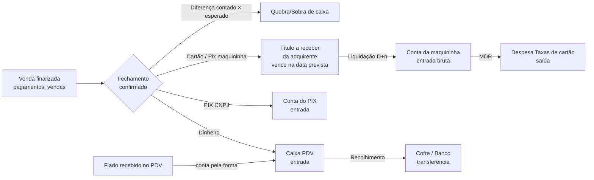

# Contabilização das vendas nas Contas Financeiras (fechamento de caixa → saldo das contas)

> Origem: pedido de 22/10/2026 para verificar se o dinheiro das vendas, vindo dos fechamentos de caixa, chega às contas financeiras cadastradas.
> Diagnóstico feito em 22/10/2026 sobre a `prod-new` (HEAD `ec63487f`) e o banco local.
> Status: **plano aprovado em 22/10/2026. Fases 0 a 6 implementadas em 22/10/2026 (working tree, NÃO commitado, não deployado)**. Decisões D1–D6 aprovadas (seção 3).
> - **Fase 0:** migrations `2026_10_22_153128/129/130/132` (conta em maquininhas/opções; `lancamentos.maquininha_id/taxa_adquirente` + `lancamento_pagamentos.conciliado_em`; troco/recolhimento em `fechamentos_caixa` + `caixas.caixa_troco_padrao`; planos na `empresas` + seed "Quebra de caixa"/"Sobra de caixa"); `ContaFinanceiraSelect::semCaixaPdv()`; forms de Maquininha, Forma de Pagamento (plano obrigatório + conta), Caixa (troco padrão) e planos na `ConfiguracaoSefaz`; `ContabilizacaoFechamentoService::pendenciasDeConfiguracao()`.
> - **Fase 1:** flag `foraDaSessao` (`LancamentoPagamento`, `Lancamento::registrarPagamento`, `BaixaFinanceira`); `MovimentacaoService::saida(validarSaldo, registrarNaSessao, sessaoCaixaId)`, `entrada(sessaoCaixaId)` e `transferir(tocarSessao, validarSaldo)`; `ContabilizacaoFechamentoService::contabilizar()` (substitui `ImportacaoCaixaReceberService`, removido); seção "Troco e recolhimento" no `FechamentoCaixaForm`; `ConfirmarFechamentoAction` bloqueia por pendência e contabiliza na mesma transação; F1.5 em `SessaoCaixaService::conciliarAbertura()`.
> - **Fase 4:** `ContabilizacaoFechamentoService::estornar()`; `ReabrirFechamentoAction` estorna e reabre com motivo; `EstornarImportacaoReceberAction` com motivo. Título que já movimentou conta fica **Cancelado** (movimentação é append-only e a FK é restrict), o que nunca movimentou é apagado.
> - **Fase 2:** `LiquidacaoRecebiveisService`, comando `financeiro:liquidar-recebiveis` (06:00 no `Kernel`), actions "Liquidar agora"/"Liquidar recebíveis"/"Marcar conciliado" em `LancamentosTable`, migration `2026_10_22_160000_add_recebivel_id_to_lancamentos_table` (título de taxa aponta para o recebível).
> - **Fase 3:** `RecebimentoFiadoService` (fiado no PDV), sangria/suprimento por transferência com conta, Blade `/Saidas*` encaminha ao Filament.
> - **Fase 5:** comando `financeiro:contabilizar-fechamentos {--desde=} {--dry-run}`.
> - **Fase 6:** `SaldosContasWidget`, `RecebiveisAdquirentesWidget`, `FechamentoCaixaContabilizacaoWidget`, coluna Origem/Conciliada e filtro no extrato, colunas de troco/recolhimento na lista de fechamentos.
> Spec de referência do módulo: `docs/modulo-contas-financeiras.md`.

---

## 1. Diagnóstico (fatos verificados)

### 1.1 Resposta curta

**Não.** Nenhum real de venda chega a uma conta financeira. As contas só se movem por baixa manual de título com conta escolhida, por transferência e por ajuste. O saldo de "Conta Stone", "Banco do Brasil" etc. **não reflete o faturamento**.

### 1.2 Onde a corrente se quebra

| # | Ponto | Arquivo | O que acontece hoje |
|---|---|---|---|
| P1 | Importação do fechamento para o Contas a Receber | `app/Services/ImportacaoCaixaReceberService.php:99` | Cria 1 título `Receber` por opção de pagamento e dá baixa com `registrarPagamento(...)` **sem `contaFinanceiraId`**. `BaixaFinanceira::preparar()/movimentar()` sai cedo quando a conta é nula, então **não há movimentação**. |
| P2 | Recebimento de fiado no PDV | `app/Filament/Pages/OperarVenda.php:2411` | `registrarPagamento(...)` com `sessaoCaixaId`, mas **sem conta**. O dinheiro entra na gaveta (a conferência soma) e nunca entra no razão. |
| P3 | Sangria / suprimento manual da sessão | `app/Filament/Resources/SessoesCaixa/Support/RegistrarSaidaCaixaAction.php:140`, `RegistrarSuprimentoCaixaAction.php:58`, rotas Blade `mov_saida.*` (`routes/web.php:330-334`) | Grava só `movimentacoes_sessao_caixas`. **Não diz para onde foi o dinheiro** (cofre? banco?) nem de onde veio o suprimento. O dinheiro some do razão. Só a transferência feita pelo `TransferirEntreContasAction` passa pelo `MovimentacaoService`. |
| P4 | Conta Caixa PDV | `app/Models/ContaFinanceira.php:17-23`, `SaldosContasWidget.php:27` | Por desenho, "as vendas não geram movimentação nela". Mas sangrias e despesas pagas pela gaveta **geram saída** nela. Resultado: `saldo_atual` do Caixa PDV só desce (fica negativo). A UI esconde isso mostrando o dinheiro da sessão aberta. O razão não fecha. |
| P5 | Taxa da maquininha (MDR) | `TaxaMaquininhaService`, `pagamentos_vendas.pg_venda_taxa_maquininha_*` | O retrato da taxa existe em cada pagamento, mas **nunca vira despesa** no financeiro. Só aparece no relatório de fechamento. A DRE gerencial superestima o resultado. |
| P6 | Prazo de recebimento | `maquininha_taxas.mt_prazo_recebimento`, `RelatorioFechamentoCaixaService::previsaoRecebimento()` | Existe só como relatório. Não há **agenda de recebíveis**: o título importado já nasce Pago na data do fechamento, mesmo que o dinheiro caia D+1 na Stone. |
| P7 | Classificação da receita | `ImportacaoCaixaReceberService::planoReceitaPadraoId()` | Opção sem `plano_receita_id` cai em "Outras Receitas". No banco local, **R$ 82.389,97 de R$ 115.415,59 (71%)** da receita importada está em "Outras Receitas" (Dinheiro e PIX CNPJ não têm plano). |

### 1.3 Números do banco local (22/10/2026)

| Pagamentos de título | Qtde | Valor | Movimentou conta? |
|---|---|---|---|
| Receber, importados de sessão | 150 | R$ 115.415,59 | Não |
| Receber, fiado/manual | 76 | R$ 4.376,92 | Não |
| Pagar, sem conta (anteriores ao módulo) | 324 | R$ 123.547,90 | Não (esperado: histórico) |
| Pagar, com conta | 2 | R$ 483,13 | Sim |

- Contas: Banco do Brasil, Conta Stone, Caixinha Empório da Pizza, todas com `data_saldo_inicial = 16/10/2026`. **Não existe conta `caixa_pdv`** no banco local (despesa paga pela gaveta falharia com "Cadastre a conta Caixa PDV").
- 52 fechamentos confirmados (18/08 a 17/10/2026).
- 7 maquininhas (Cielo, Stone e uma "PIX CNPJ" cadastrada como maquininha), 50 taxas, **nenhuma marcada como padrão**. Pagamento sem maquininha fica sem taxa.

### 1.4 O que já existe e deve ser reaproveitado (não refazer)

- `MovimentacaoService` (lock, saldo, estorno, transferência, `recalcularSaldo`) e `BaixaFinanceira` (eventos do `LancamentoPagamento`). A baixa com conta **já gera a movimentação sozinha**: basta passar `contaFinanceiraId`.
- `BaixaFinanceira` já trata o recebimento no Caixa PDV com `registrarNaSessao: false`, justamente para não somar duas vezes na conferência.
- `FechamentoCaixaService::calcularReceitaVendas()`: receita sem troco de abertura e sem fiado, base correta da importação.
- `RelatorioFechamentoCaixaService::pagamentos()` (com filtro `sessoes`): já normaliza cada pagamento com maquininha, bandeira, tipo, taxa (retrato ou atual), prazo e `finalizada_em`. É a fonte dos recebíveis.
- `PrazoRecebimentoMaquininhaEnum::dataPrevista()`.
- Plano de despesa "Taxas de cartão" (`PlanoDespesaSeeder`).

---

## 2. Modelo-alvo: para onde vai cada real



Identidade que passa a valer para o Caixa PDV, ao fim de cada fechamento:

```
saldo Caixa PDV = troco deixado na gaveta
               = saldo anterior + vendas em dinheiro + fiado em dinheiro
                 + suprimentos − sangrias − despesas ± quebra − recolhimento
```

---

## 3. Decisões aprovadas (22/10/2026)

Todas aprovadas como propostas. O que o usuário acrescentou ao aprovar:

- **D1:** a "importação" para o Contas a Receber que o fechamento já faz **passa a gerar também as movimentações nas contas financeiras**. Não é um passo separado: título e movimentação nascem juntos na confirmação. O recolhimento é uma transferência entre contas.
- **D2:** **o troco sempre fica na gaveta.** O troco precisa ser modelado no fechamento de caixa e na conta Caixa PDV (ver F1.4). O saldo do Caixa PDV depois do fechamento é o troco que ficou.
- **D3:** a maquininha fica ligada a uma conta financeira. O valor nasce como título no Contas a Receber e a movimentação no extrato da conta é criada **na data de repasse da maquininha**, nunca antes.
- **D4:** aprovada sem ressalvas. Objetivo explícito: manter o controle das taxas de cartão.
- **D5:** igual à D3.
- **D6:** aprovada sem ressalvas.

| # | Decisão | Recomendação | Alternativa descartada e por quê |
|---|---|---|---|
| D1 | **Caixa PDV vira razão de verdade.** Vendas em dinheiro entram nele no fechamento; o que é recolhido sai por transferência. | Sim. Corrige P4 sem mudar a regra de saída (saída do PDV continua validada pelo dinheiro da sessão). | Manter virtual: o saldo continua negativo e o dinheiro em espécie nunca aparece em nenhuma conta. |
| D2 | **Quando contabilizar:** na confirmação do fechamento (gatilho atual da importação). | Sim. É o momento em que o dinheiro foi conferido. Durante a sessão, a UI continua mostrando a gaveta (já é assim). | No fim da sessão: valor ainda não conferido, quebra desconhecida. |
| D3 | **Cartão e Pix de maquininha viram recebível**: título a receber da adquirente, vencimento = data prevista (prazo da taxa), **liquidado automaticamente** por comando diário na data prevista. | Sim, com marca "conciliado" para conferência posterior com o extrato. | Baixa manual de cada título: ninguém faz no dia a dia e o saldo fica sempre atrasado. |
| D4 | **MDR em duas linhas**: entrada do bruto e saída da taxa como despesa "Taxas de cartão", ambas na conta da maquininha. | Sim. DRE mostra receita bruta e despesa financeira; saldo da conta fica líquido, igual ao extrato do dia. Reaproveita `BaixaFinanceira` sem caso especial. | Entrada só do líquido: some a despesa da DRE e a baixa do título não bate com o bruto. |
| D5 | **Conta de destino configurável**: `maquininhas.conta_financeira_id` (onde a adquirente liquida) e `opcoes_pagamentos.conta_financeira_id` (formas sem maquininha: PIX CNPJ, vale etc.). Dinheiro vai sempre para o Caixa PDV. | Sim. | Mapear por nome/operadora: frágil, quebra ao renomear. |
| D6 | **Implantação a partir de `data_saldo_inicial` de cada conta**, sem reprocessar o passado. Comando com `--dry-run` para fechamentos confirmados depois do corte. Recebível só entra se a **data prevista** for ≥ corte da conta de destino. | Sim. O saldo inicial informado em 16/10 já contém o que caiu antes dele. | Reprocessar tudo desde agosto: duplicaria o que já está no saldo inicial. |

---

## 4. Invariantes (não quebrar)

1. Um real de venda gera **no máximo uma** entrada em conta. Fiado recebido na sessão continua fora de `calcularReceitaVendas()` e entra pela própria baixa (P2).
2. `FechamentoCaixaService::calcularEsperado()` **não muda**. Nada criado por este plano pode gravar `lancamento_pagamentos.sessao_caixa_id` em título importado (ver comentário em `ImportacaoCaixaReceberService:103-106`).
3. Movimentação é append-only. Correção sempre por estorno (`MovimentacaoService::reverter`).
4. Toda escrita da contabilização roda numa única `DB::transaction`. Falha em qualquer conta desfaz o fechamento inteiro (a confirmação não fica pela metade).
5. Idempotência: contabilizar duas vezes a mesma sessão não duplica nada (guarda pela existência de títulos com `sessao_caixa_id`, como hoje).
6. Movimentação nunca com `data_movimento` futura. Recebível futuro é **título pendente**, não movimentação.

---

## 5. Fases

### Fase 0: cadastros e configuração (pré-requisito)

**F0.1 Migrations** (só colunas nullable novas):
- `maquininhas.conta_financeira_id` FK `contas_financeiras` nullOnDelete. Label: "Conta onde cai o dinheiro".
- `opcoes_pagamentos.conta_financeira_id` FK nullOnDelete. Ignorada para `cash` (vai para o Caixa PDV).
- `lancamentos.maquininha_id` FK nullOnDelete e `lancamentos.taxa_adquirente` decimal(10,2) nullable: marcam o título como recebível de adquirente e guardam o MDR previsto (retrato).
- `lancamento_pagamentos.conciliado_em` datetime nullable (D3).
- `fechamentos_caixa.valor_troco_gaveta` decimal(12,2) nullable (troco que fica no caixa para o próximo turno, ver F1.4), `fechamentos_caixa.valor_recolhido` decimal(12,2) nullable, `fechamentos_caixa.recolhimento_conta_id` FK nullable, `fechamentos_caixa.recolhimento_transferencia_uuid` char(36) nullable.
- `caixas.caixa_troco_padrao` decimal(12,2) nullable: sugestão de troco por caixa físico (default do campo no fechamento).
- `empresas.empresa_plano_despesa_taxa_cartao_id`, `empresas.empresa_plano_despesa_quebra_caixa_id`, `empresas.empresa_plano_receita_sobra_caixa_id` (FKs nullable). Seed: "Taxas de cartão" já existe; criar "Quebra de caixa" (despesa variável) e "Sobra de caixa" (receita) se não existirem.

**F0.2 Filament**
- Form de Maquininha e de Opção de Pagamento: `ContaFinanceiraSelect` (sem Caixa PDV na lista de maquininha).
- Opção de Pagamento: `plano_receita_id` passa a ser **obrigatório** no form (P7). Aviso na listagem para opções ativas sem plano.
- Página/Resource da Empresa: os três planos do F0.1.

**F0.3 Pré-checagem** `App\Services\Financeiro\ContabilizacaoFechamentoService::pendenciasDeConfiguracao(SessaoCaixa): array` devolve mensagens legíveis: "Maquininha X sem conta", "Opção Y sem conta", "Não existe conta Caixa PDV", "Taxa de cartão sem plano configurado". O `ConfirmarFechamentoAction` mostra isso no modal e **bloqueia** a confirmação enquanto houver pendência que afete a sessão.

**F0.4 Enum** `NaturezaMovimentacao`: não precisa de caso novo (vendas entram como `RecebimentoLancamento`; recolhimento é `Transferencia`; quebra é `PagamentoLancamento`/`RecebimentoLancamento` do título de quebra). Manter assim, para o extrato filtrar por origem via título.

### Fase 1: contabilização do fechamento (corrige P1, P4, P7)

**F1.0 Baixa no Caixa PDV fora da sessão (pré-requisito técnico, armadilha).** Hoje `BaixaFinanceira::preparar()` (`app/Services/Financeiro/BaixaFinanceira.php:51-60`), quando a conta é o Caixa PDV e o pagamento não traz sessão, chama `sessaoParaMovimentar(null)`, que **pega a única sessão aberta** (ou lança erro se não houver) e grava `sessao_caixa_id` no pagamento. Na contabilização do fechamento isso seria um desastre: a entrada "Vendas Dinheiro" da sessão #N ficaria ligada à sessão aberta #N+1, e `calcularEsperado()` da #N+1 somaria esse valor como "recebimento de fiado". Para uma saída (quebra), `garantirSaldo()` validaria pelo dinheiro de outra sessão.
- Acrescentar a `LancamentoPagamento` a propriedade transiente `public bool $foraDaSessao = false` (mesmo padrão de `$motivoEstorno`) e o parâmetro `bool $foraDaSessao = false` em `Lancamento::registrarPagamento()`.
- Com a flag: `preparar()` não resolve sessão e mantém `sessao_caixa_id` nulo; `movimentar()` chama `entrada(..., registrarNaSessao: false)` ou uma saída **sem validação de saldo e sem tocar a sessão**. Expor isso em `MovimentacaoService::saida()` com `bool $validarSaldo = true, bool $registrarNaSessao = true` (hoje só `movimentar()` privado tem essas flags).
- `transferir()` ganha `bool $tocarSessao = true` (usado no recolhimento).
- Teste dedicado: com uma sessão #2 aberta, contabilizar o fechamento da #1 não grava nada na #2 e `calcularEsperado(#2)` não muda.

Renomear o papel de `ImportacaoCaixaReceberService` para **`App\Services\Financeiro\ContabilizacaoFechamentoService`** (manter a classe antiga como fachada fina enquanto as actions forem migradas, ou atualizar as 4 actions de `FechamentosCaixa/Support/` no mesmo PR). Método `contabilizar(SessaoCaixa, array $recolhimento): Collection`, chamado por `ConfirmarFechamentoAction`.

Regras por grupo (fonte: `RelatorioFechamentoCaixaService(['sessoes' => [$id]])->pagamentos()`, só origem venda):

| Grupo | Título gerado | Baixa | Conta |
|---|---|---|---|
| Dinheiro (`cash`) | 1 título "Vendas Dinheiro — Sessão #N", plano da opção | Imediata, data = data do fechamento | Caixa PDV com `foraDaSessao: true` (F1.0): **sem** `sessao_caixa_id` no pagamento |
| Pix/forma com `opcoes_pagamentos.conta_financeira_id` e sem maquininha (PIX CNPJ, vale) | 1 título por opção | Imediata, data = data da venda (último dia da sessão) | Conta da opção |
| Cartão / Pix de maquininha | 1 título por **(maquininha × data prevista)**, `maquininha_id` e `taxa_adquirente` preenchidos, `vencimento` = data prevista | **Não** dá baixa (fica Pendente); Fase 2 liquida | Conta da maquininha |
| Pagamento sem prazo cadastrado | Como o anterior, vencimento = data do fechamento, com aviso no log e na notificação | Idem | Idem |
| "Outros" sem conta configurada | Bloqueado pela F0.3 | | |

Troco devolvido por Pix (`pg_venda_forma_troco = pix`): o valor entra na gaveta e sai do banco. Gerar a saída correspondente na conta da opção PIX CNPJ (título a pagar não; é transferência Conta PIX → Caixa PDV de natureza `Transferencia`, descrição "Troco em Pix — Sessão #N"). Verificar com `calcularEsperado()` que a soma fecha.

**Quebra de caixa** (diferença de dinheiro `FechamentoCaixa::diferencaDinheiro`, se ≠ 0):
- Falta: título Pagar no plano de quebra, Pago pelo Caixa PDV com `foraDaSessao: true` (F1.0): sem validar saldo e sem tocar a sessão, que já está fechada.
- Sobra: título Receber no plano de sobra, Pago no Caixa PDV.
- Diferença de cartão/Pix **não** gera movimentação: a liquidação real (Fase 2) é que corrige. Mostrar a diferença no modal como aviso.

**F1.4 Troco e recolhimento (D1, D2).** O troco sempre fica na gaveta, e o resto do dinheiro contado é recolhido.

- Seção nova "Troco e recolhimento" no form do fechamento (`FechamentoCaixaForm`), editável enquanto Rascunho:
  - "Troco que fica no caixa" → `valor_troco_gaveta`. Default: `caixas.caixa_troco_padrao` ou, sem ele, o `sessaocaixa_saldo_inicial` da sessão. Obrigatório, ≥ 0 e ≤ dinheiro contado.
  - "Valor recolhido" → `valor_recolhido`, **calculado e só leitura**: dinheiro contado − troco. Nunca é digitado, para a conta sempre fechar.
  - "Recolher para" → `recolhimento_conta_id` (`ContaFinanceiraSelect`, sem Caixa PDV). Obrigatório quando o valor recolhido > 0.
  - Opcional: contagem de notas do troco reaproveitando o componente de contagem da abertura (`ContagemNotasSchema`). Se usada, ela define o valor do troco. Útil porque a abertura seguinte conta as mesmas notas.
- Na confirmação: `MovimentacaoService::transferir(CaixaPdv → recolhimento_conta, valor_recolhido, tocarSessao: false)`. A sessão está fechada e não pode ganhar linha nova. Guardar o uuid em `recolhimento_transferencia_uuid`.
- Resultado no razão (com a quebra já lançada): **saldo do Caixa PDV ganha exatamente o troco deixado por este caixa**. Conferir isso no próprio `contabilizar()` e abortar a transação se não bater (diferença > R$ 0,01). É a asserção que garante a identidade da seção 2.
- O Relatório de Sessão de Caixa e o PDF do fechamento mostram troco deixado, valor recolhido e conta de destino.

**F1.5 Abertura seguinte.** Em `SessaoCaixaService` (abertura), o "troco esperado" é o `valor_troco_gaveta` do **último fechamento confirmado do mesmo caixa físico** (`sessaocaixa_caixa_id`). Comparar por caixa, e não pelo saldo consolidado do Caixa PDV, funciona com vários caixas abertos em paralelo.
- Saldo inicial contado = troco esperado: nada a lançar (é o mesmo dinheiro, que já está no Caixa PDV).
- Diferente: aviso na tela de abertura com o valor; ao confirmar, título de quebra/sobra pago no Caixa PDV com `foraDaSessao: true` e descrição "Diferença na abertura — Caixa X".
- Caixa sem fechamento anterior contabilizado (implantação): o saldo inicial contado entra como suprimento vindo da conta escolhida pelo operador, ou como ajuste de implantação (só Admin).
- Integra com a regra de abertura existente (`caixa_fechamento_obrigatorio`, memória "Regra de abertura de caixa"): não mudar a regra de bloqueio, só acrescentar a comparação.

### Fase 2: liquidação de recebíveis e MDR (corrige P5, P6)

- `App\Services\Financeiro\LiquidacaoRecebiveisService::liquidar(Lancamento $titulo, ?Carbon $data = null)`: dá baixa do bruto na conta da maquininha (`registrarPagamento(..., contaFinanceiraId: maquininha->conta_financeira_id)`) e cria título Pagar "Taxa {maquininha} — {data}" no plano de taxa de cartão, valor = `taxa_adquirente`, Pago na mesma conta e mesma data. Tudo numa transação. Taxa nula/zero: não cria o título de taxa.
- Comando `financeiro:liquidar-recebiveis` (diário, 06h, no `app/Console/Kernel.php`): liquida títulos com `maquininha_id` não nulo, Pendente, `vencimento <= hoje`. Idempotente.
- Action "Liquidar agora" e bulk action na `LancamentosTable` (visível só para título com `maquininha_id`), com data editável e campo opcional "Valor líquido recebido" → se informado e diferente do previsto, ajusta o título de taxa e anota a diferença.
- Action "Marcar conciliado" (grava `conciliado_em`) no extrato de movimentações e no título, para quem confere com o extrato da Stone/Cielo.
- Estorno de liquidação: `estornarPagamento()` do título + exclusão do título de taxa (com estorno da movimentação dele).

### Fase 3: furos fora do fechamento (corrige P2, P3)

- **Fiado no PDV** (`OperarVenda::confirmarRecebimento`): resolver a conta pela forma. Dinheiro → Caixa PDV (com `sessaoCaixaId`, que o `BaixaFinanceira` já trata com `registrarNaSessao: false`). Cartão/Pix de maquininha → baixa direto na conta da maquininha (`maquininhaRecebimentoId` ou a padrão), na data do recebimento, e título de taxa (plano de taxa de cartão) pelo `taxa_valor` que o `TaxaMaquininhaService` já grava no pagamento. Isso adianta a entrada em D+n dias, mas é o caminho sem receita em dobro: o título do fiado já é a receita, e criar um título de adquirente para ele somaria a receita duas vezes na DRE. Volume baixo (R$ 4.376,92 em todo o histórico local), então a diferença de data é aceitável. PIX CNPJ → conta da opção. Documentar a regra no docblock de `confirmarRecebimento`.
- **Sangria** (`RegistrarSaidaCaixaAction`, motivo Sangria): exigir "Para qual conta" e chamar `MovimentacaoService::transferir(CaixaPdv → destino, sessão)`; o `CaixaPdvBridge` já grava a sangria ligada na sessão. Remover o caminho que chama `MovimentacaoCaixaService::registrarSaida` direto para sangria. Motivo "Outros": exigir conta de destino ou transformar em despesa (decidir na implementação; recomendação: remover "Outros" e deixar só Sangria e Despesa).
- **Suprimento** (`RegistrarSuprimentoCaixaAction`): exigir "Vem de qual conta" e chamar `transferir(origem → CaixaPdv, sessão)`.
- **Blade legado** `MovimentacoesSessaoCaixaController@store/update/destroy`: redirecionar para o fluxo Filament ou chamar os mesmos serviços. Saídas sem conta deixam de ser possíveis.

### Fase 4: reabrir e estornar com segurança

- `Lancamento::deleting` bloqueia exclusão com movimentação, então `estornarImportacao()` hoje quebraria depois da Fase 1. Novo `ContabilizacaoFechamentoService::estornar(SessaoCaixa, string $motivo)`: para cada título da sessão, `estornarPagamento($motivo)` e depois excluir; estornar a transferência de recolhimento pelo uuid; estornar quebra/sobra.
- Bloquear o estorno se algum recebível da sessão já foi **liquidado** (a liquidação tem de ser estornada antes, na Fase 2) ou **conciliado**.
- `ReabrirFechamentoAction` passa a oferecer "Estornar contabilização e reabrir" numa ação só, com motivo obrigatório (mín. 5 caracteres, igual ao `MovimentacaoService`).

### Fase 5: implantação e backfill

- Comando `financeiro:contabilizar-fechamentos {--desde=} {--dry-run}`:
  1. Para cada fechamento confirmado com `confirmado_em >= --desde` (default: menor `data_saldo_inicial` entre as contas de destino), cuja importação antiga não movimentou conta: estorna a importação antiga (títulos sem movimentação podem ser excluídos) e roda `contabilizar()` sem recolhimento.
  2. Recebível com data prevista **antes** do `data_saldo_inicial` da conta da maquininha: não gera título (já está no saldo inicial).
  3. Dry-run imprime tabela por sessão: dinheiro, PIX, recebíveis, taxa, quebra, e o saldo projetado de cada conta.
- Antes de rodar em produção: cadastrar a conta Caixa PDV com saldo inicial = dinheiro físico na gaveta + cofre na data do corte (ou separar cofre), preencher conta de cada maquininha e opção, marcar uma maquininha padrão, e rodar `financeiro:recalcular-saldos` no fim.
- Passo a passo de deploy no fim deste arquivo (seção 9).

### Fase 6: visão (telas)

- `SaldosContasWidget`: Caixa PDV passa a mostrar `saldo_atual` (razão) e, com sessão aberta, "na gaveta agora" na descrição.
- Novo widget "A receber das adquirentes": títulos com `maquininha_id` pendentes, agrupados por conta e data (próximos 7 dias).
- Extrato (`MovimentacoesFinanceirasTable`): coluna "Origem" (sessão #, título, transferência) com link, filtro "não conciliadas".
- Relatório de Fechamento de Caixa: bloco "Contabilização" com os títulos/movimentações gerados pela sessão.

---

## 6. Testes (PHPUnit, banco isolado; ver memória de testes)

Novos em `tests/Feature/ContabilizacaoFechamentoServiceTest.php`, `LiquidacaoRecebiveisServiceTest.php`, e ajuste de `ImportacaoCaixaReceberServiceTest.php`, `FechamentoCaixaImportacaoActionsTest.php`, `RegistrarSaidaCaixaActionTest.php`:

0. F1.0: com a sessão #2 aberta, contabilizar a #1 não grava `sessao_caixa_id` nem linha de sessão na #2, e `calcularEsperado(#2)` não muda.
1. Sessão com dinheiro + PIX CNPJ + débito Stone + crédito Cielo: Caixa PDV recebe só o dinheiro; conta do PIX recebe o PIX; 2 títulos pendentes de adquirente com vencimento pela taxa; nenhuma movimentação futura.
2. `calcularEsperado()` idêntico antes e depois da contabilização (invariante 2).
3. Fiado recebido em dinheiro na sessão: 1 entrada no Caixa PDV, não entra de novo no título "Vendas Dinheiro".
4. Quebra: contado 10,00 a menos gera título de quebra Pago e saída de 10,00 no Caixa PDV; sobra gera receita.
5. Recolhimento: transferência Caixa PDV → Cofre de (contado − troco) com o uuid gravado; sessão fechada não ganha linha nova em `movimentacoes_sessao_caixas`; troco maior que o contado é recusado.
6. Identidade do Caixa PDV (seção 2): depois de cada fechamento, o saldo cresce exatamente o troco deixado; bate em duas sessões seguidas do mesmo caixa.
6b. Abertura: saldo inicial igual ao troco do último fechamento do mesmo caixa não lança nada; diferente lança quebra/sobra; dois caixas físicos comparam cada um com o próprio fechamento.
7. Configuração faltando (maquininha sem conta) bloqueia a confirmação com mensagem e não grava nada.
8. Contabilizar duas vezes não duplica.
9. Liquidação: título Pago, entrada bruta + saída de taxa na conta da maquininha, saldo líquido correto; comando é idempotente; título com vencimento futuro não é liquidado.
10. Estorno/reabertura: devolve todos os saldos; bloqueia com recebível liquidado.
11. Sangria sem conta de destino é recusada; com conta, gera 2 movimentações e a linha na sessão ligada.
12. Backfill dry-run não grava; backfill real respeita `data_saldo_inicial`.

---

## 7. Critérios de aceitação

- Depois de confirmar um fechamento, o extrato de cada conta mostra exatamente o que a sessão vendeu naquela forma (dinheiro no Caixa PDV, PIX na conta do PIX) e os recebíveis aparecem como títulos pendentes com a data prevista.
- No dia seguinte (após o comando), a conta Stone/Cielo mostra a entrada bruta e a taxa, e o saldo líquido bate com o extrato da adquirente (diferença só por arredondamento ou taxa desatualizada).
- `financeiro:recalcular-saldos` não aponta divergência.
- Saldo do Caixa PDV após o fechamento = soma do troco deixado em cada caixa físico; o resto do dinheiro contado aparece como transferência para a conta de recolhimento.
- Recebível de maquininha só aparece no extrato da conta na data de repasse; até lá está só no Contas a Receber.
- Nenhuma receita nova cai em "Outras Receitas" por falta de plano.

---

## 8. Melhorias gerais do financeiro (backlog, fora deste plano)

Comparando com ERPs de mercado (Omie, Conta Azul, Bling, Odoo, SAP Business One), em ordem de retorno:

| # | Melhoria | Por quê | Esforço |
|---|---|---|---|
| M1 | **Conciliação bancária por extrato (OFX/CSV)**: importar o extrato e casar com as movimentações por valor/data, marcando `conciliado_em`. Na Stone, usar a API de recebíveis/extrato. | Hoje não há como provar que o saldo do sistema é o do banco. É a base de qualquer financeiro confiável. | M |
| M2 | **Fluxo de caixa projetado por conta**: saldo atual + títulos a receber/pagar + recebíveis de adquirente, por dia, 30/60/90 dias. | Decisão de compra e de pagamento de fornecedor. Os dados passam a existir depois deste plano. | M |
| M3 | **DRE gerencial única por competência**: hoje a DRE do relatório de fechamento só olha vendas e a despesa vive nos lançamentos. Estrutura padrão: Receita bruta → Deduções (impostos, cancelamentos) → Receita líquida → CMV → Margem → Despesas operacionais (fixas/variáveis, já existe o `comportamento`) → Resultado financeiro (MDR, juros) → Resultado. Adicionar `grupo_dre` nos planos de receita/despesa. | Hoje não dá para ver o lucro do mês num lugar só. | M |
| M4 | **Fechamento mensal com trava de período** (`SaldoFinanceiroMes`, já previsto na memória do módulo): depois de fechado, nenhuma movimentação/baixa com data no mês fechado. | Evita que alguém mude o passado depois do contador fechar. | P |
| M5 | **Receita por canal, não por forma de pagamento**: os planos "Balcão", "Delivery", "iFood", "Salão" já existem, mas a receita é classificada pela forma de pagamento. Classificar pela origem da venda (mesa, balcão, delivery, iFood). | A pergunta de negócio é "quanto vende o delivery", não "quanto entrou no crédito". | M |
| M6 | **Marketplaces (iFood) como recebível**: mesmo padrão da Fase 2 (título da plataforma, comissão como despesa, repasse na data). | Hoje a venda iFood não tem rastreio de repasse. | M |
| M7 | **Provisão de impostos (Simples Nacional/NFC-e)**: gerar título a pagar mensal a partir do `empresa_percentual_imposto_nfe` sobre a receita. | O caixa parece maior do que é até o DAS vencer. | P |
| M8 | **Unificar vocabulário de forma de pagamento**: hoje `OpcoesPagamento` (vendas) e o enum `FormaPagamento` (financeiro) convivem, ligados por `opcaopag_desc_nfe`. Adicionar `opcoes_pagamentos.forma_financeira` explícita. | O `match` por código fiscal está espalhado em 4+ lugares e quebra com forma nova. | P |
| M9 | **Anexos e aprovação**: comprovante obrigatório em pagamento acima de X; aprovação de um segundo usuário para pagamento/transferência acima de Y. | Controle interno básico (segregação de funções). | P |
| M10 | **Quebra de caixa por operador**: relatório de quebras por usuário da sessão. | Responsabilização; os dados passam a existir com a Fase 1. | P |
| M11 | **Indicadores**: PMR/PMP, ciclo financeiro, ponto de equilíbrio (já há `comportamento` fixo/variável), inadimplência do fiado. | Gestão. Parte já existe em `RelatorioContasPagarReceberService`. | P |

---

## 9. Deploy (checklist)

1. `vendor/bin/sail artisan migrate`: 5 migrations de 22/10/2026 (`add_conta_financeira_to_maquininhas_e_opcoes_pagamentos`, `add_recebivel_adquirente_to_lancamentos_e_pagamentos`, `add_troco_recolhimento_to_fechamentos_caixa`, `add_planos_contabilizacao_caixa_to_empresas` (cria os planos "Quebra de caixa"/"Sobra de caixa" e preenche a Empresa), `add_recebivel_id_to_lancamentos_table`) e a de permissions `seed_liquidacao_recebiveis_permissions` (`liquidar_recebivel:lancamento`, `conciliar:lancamento`, `view:recebiveis_adquirentes_widget`, `view:fechamento_caixa_contabilizacao_widget` para o Gerente). Prod não tem npm/composer: `public/build/` e `vendor/` seguem a regra do commit; recarregar OPcache.
2. Cadastros (todos obrigatórios, senão a confirmação do fechamento é bloqueada com a lista do que falta):
   - conta **Caixa PDV** com saldo inicial = dinheiro físico da gaveta (e cofre, se o mesmo) na data do corte;
   - **conta de cada maquininha** (Maquininhas) e **conta das formas sem maquininha** (PIX CNPJ, vales) em Formas de Pagamento;
   - **plano de receita em toda forma de pagamento ativa** (a lista marca em vermelho as que faltam);
   - marcar uma **maquininha padrão** (pagamento sem maquininha não acha conta);
   - em Configurações › Certificado SEFAZ, conferir os 3 planos (taxa de cartão, quebra, sobra);
   - **Troco padrão** em cada Caixa (sugestão do troco no fechamento).
3. `financeiro:contabilizar-fechamentos --dry-run` e conferir com o usuário a tabela por sessão e os saldos projetados.
4. Rodar sem `--dry-run`, depois `financeiro:liquidar-recebiveis` e `financeiro:recalcular-saldos`.
5. Confirmar o cron do `schedule:run` em produção (pendência já conhecida da integração Stone): o `financeiro:liquidar-recebiveis` depende dele.
6. Atribuir as permissions novas a outras roles, se quiserem (a migration só dá ao Gerente; Admin passa pelo Gate).

### Lista para decisão / backlog desta entrega

Implementados depois da entrega principal (22/10/2026), com testes em `tests/Feature/TrocoInicialEContagemTrocoTest.php`:

- **Contagem de notas do troco:** botão "Contar notas" no campo do troco do fechamento (`FechamentoCaixaForm::acaoContarTroco`); a contagem só preenche o valor, não é persistida.
- **Implantação na abertura (F1.5):** caixa sem fechamento anterior com troco pede "Troco inicial veio de qual conta?" (transferência para o Caixa PDV) ou, só para Admin, "ajuste de implantação" (`AjusteSaldo`, fora do DRE). `SessaoCaixaService::lancarTrocoInicial()`. A abertura pelo Blade legado não pede origem.
- **Relatórios:** bloco "Troco e recolhimento" no Relatório de Sessão de Caixa e no de Fechamento (impressão), via `RelatorioFechamentoCaixaService::trocoERecolhimento()`.

Continuam fora:

- **Fiado em cartão** entra na data do recebimento, não em D+n (decisão do plano, para não duplicar receita).
- **Conciliação** é marcação manual; por extrato (OFX/CSV) segue como M1 do backlog.
- Troco entre formas (Pix × dinheiro) só é tratado para dinheiro e PIX CNPJ; troco em maquininha é ignorado.
- **QA visual** feito em 22/10/2026 (Playwright + Chromium, banco isolado): fechamento (troco/recolhimento e bloqueio por pendência), confirmação contabilizando (Caixa PDV 100, Cofre +100, PIX +50, recebíveis pendentes), extrato, painel financeiro com o widget de recebíveis e "Liquidar agora" (Stone +78,80 com a taxa de 1,20). Sem erro de JS. Não cobertos no navegador: reabertura/estorno, abertura com troco inicial e a contagem de notas.
- Suíte completa (22/10/2026): 1970 passam e 21 falham, todas em `Auth/*` (factory de usuário sem `name_first`, cadastro) e `ExampleTest` (`/` redireciona), sem relação com esta entrega.
