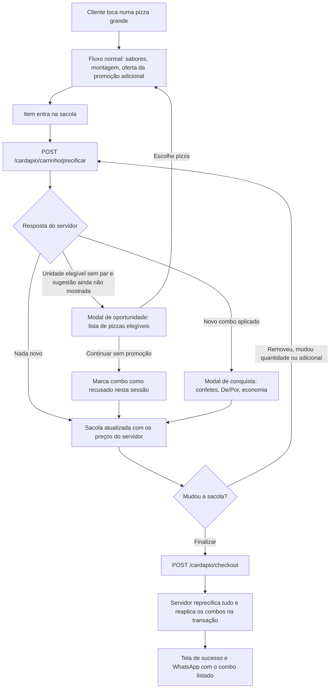
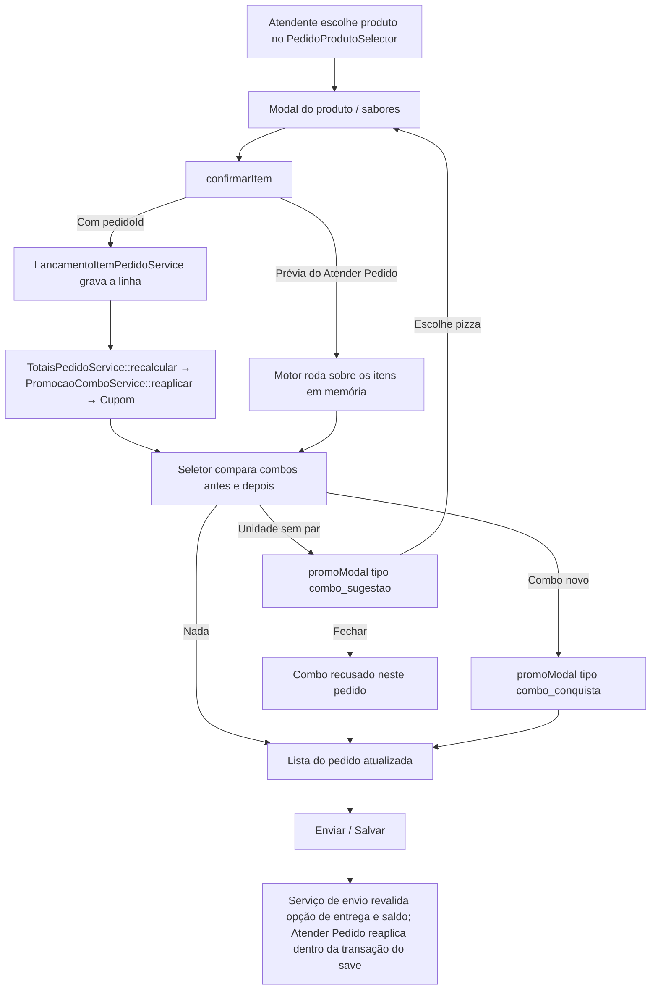

# Promoções Combo Inteligentes ("2 pizzas grandes por R$ 87,99")

> Origem: pedido do usuário em 19/11/2026. A promoção deve reconhecer sozinha quando o carrinho tem itens participantes, sugerir o item que falta e aplicar o preço promocional com uma tela de comemoração, no Cardápio Web e no atendimento (Filament).
> Status: **aprovado em 19/11/2026 (decisões na seção 2). Fases 1 (`f0b105fd`) e 2 implementadas; Fases 3–4 pendentes.**
> Execução: por fases (seção 10). **Cada fase é uma entrega independente**, com testes e commit próprios. Não comece a fase seguinte sem que a anterior esteja verde e homologada.

---

## 1. Auditoria da implementação atual (fatos verificados no código)

### 1.1 Como o cardápio modela "pizza grande"

O sistema não tem uma entidade de tamanho. **O tamanho é a categoria.**

| Categoria (banco local) | Pai | Sabores | Observação |
|---|---|---|---|
| `Pizza Grande` (id 1) | `Pizzas` (42) | sim (1 ou 2) | Cada produto é um sabor nesse tamanho (38 produtos) |
| `Pizza Média` (18), `Pizza Quadrada` (2) | `Pizzas` | sim | `Quadrada` aceita 3 sabores |
| `Pizza Brotinho` (19) | `Pizzas` | não | |
| `Pizza Grande Promocional` (120) | `Pizzas` | não | Vazia |

- Uma pizza meia a meia é **uma linha** de `itens_pedidos`, com os sabores congelados em `item_pedido_sabores` (JSON, trait `App\Models\Concerns\TemSabores`). As opções de sabores ficam em `quantidades_sabores`, e a regra de preço por categoria (`MEDIA`/`MAIOR`) em `categoria_regra_preco_sabores`.
- Bordas e adicionais entram em `adicionais_item_pedidos`. Perguntas pagas entram em `item_pedido_respostas`. Os dois somam em `item_pedido_valor_adicionais` (`LancamentoItemPedidoService.php:79-80`).
- **Consequência para a promoção:** "participante = pizza grande" significa "linha da categoria `Pizza Grande` ou de uma subcategoria dela". `Categoria::idsComSubcategorias()` já resolve a árvore.

### 1.2 Promoções que já existem

| Peça | Onde | O que faz | Serve para "2 por R$ X"? |
|---|---|---|---|
| **Promoção Relâmpago** | `PromocaoRelampago`, `PromocaoRelampagoProduto`, `PromocaoRelampagoService` | Preço promocional **por unidade** de um produto, com saldo (`promocao_qtd_total`/`_vendida`), limite por pedido, recorrência dia/hora, opções de entrega e ledger `promocao_consumos` | Não. O preço vale por unidade, não por conjunto. |
| **Promoção Adicional** | `PromocaoAdicional`, `PromocaoAdicionalRegra`, `PromocaoAdicionalOferta`, `PromocaoAdicionalService` | "Leve outro produto por +R$ X": gatilho → oferta numa **linha nova**, com categoria exigida (`promoad_categoria_exigida_id`), teto da campanha, opções de entrega e pagamento, e sugestão de gatilho | **Parecida, mas insuficiente.** A oferta é um produto fixo com valor fixo. Não dá para "escolher qualquer pizza grande, com sabores, e o par custar R$ 87,99". |
| **Preço promocional do produto** | `produto_preco_promocional` + janela de datas | Preço por unidade | Não |
| **Combo como produto** | Categorias `Pizza Combo` (22) e `Combo Solteirão` (25), ex.: produto "X-burguer tudo + Coca-cola Lata" a R$ 26,90 | Um produto com preço próprio | Não. Não reconhece itens soltos e não permite escolher sabores. |
| **Cupom** | `CupomService`, `CupomPedidoService` | Desconto sobre o pedido, **rateado em centavos entre as linhas** (`item_pedido_desconto_cupom`) | Não é promoção de produto, mas é **o padrão de integridade a copiar** (seção 7) |

**Conclusão: não existe nada que reconheça um conjunto de linhas e aplique um preço ao conjunto.** Toda a precificação de hoje é por linha. A novidade é a primeira promoção que olha **o carrinho inteiro**.

### 1.3 Precificação e gravação (onde a nova regra se encaixa)

| Peça | Onde | Papel |
|---|---|---|
| `PrecificadorService` | `app/Services/PrecificadorService.php:18-35` | Fonte única do preço **de uma unidade** (override da promoção adicional → relâmpago → preço promocional → preço de venda). Singleton por requisição, com contexto de mesa. |
| `LancamentoItemPedidoService::precificar()` | `LancamentoItemPedidoService.php:57` | Monta a `LinhaPrecificada` a partir do `ItemSolicitado` (o navegador nunca envia preço) |
| Gravação de linha | `gravar` `:282`, `gravarOferta` `:308`, `trocarAdicionais` `:372`, `atualizarQuantidade` `:415`, `remover` `:466` | **Todas** abrem transação, travam o pedido e terminam em `TotaisPedidoService::recalcular()`. É o ponto único de gancho. |
| `TotaisPedidoService::recalcular()` | `TotaisPedidoService.php:34` | Chama `CupomPedidoService::reaplicar()` e soma as linhas. **Retorna cedo para pedido `INICIADO`** (rascunho do garçom e checkout) na linha 38. |
| `ItensPedido::recalcularValores()` / `descontoTotal()` | `ItensPedido.php:247`, `:308` | `item_pedido_valor` já é **líquido** do desconto comercial e da parte do cupom. `descontoTotal()` vai para a venda e para a NFC-e. |
| `TotaisPedido::paraItens()` | `app/Support/TotaisPedido.php` | Regra única de subtotal, desconto, frete e total a partir das linhas |
| Venda e NFC-e | `LancamentoItensVendaService.php:112-131` | Copia `item_pedido_valor` e `descontoTotal()`. **Um desconto que já esteja na linha chega sozinho ao caixa, à NFC-e e à Stone.** |
| Rateio | `App\Support\RateioCentavos::ratearProporcional()` | Divide centavos sem perder nem sobrar |

### 1.4 Canais e telas

| Canal | Fluxo | Onde o carrinho vive |
|---|---|---|
| **Cardápio Web** | Store Alpine em `resources/views/cardapio/script.blade.php` (carrinho no `localStorage`) → `POST /cardapio/checkout` (`CardapioCheckoutController.php:159`) reprecifica tudo no servidor | No navegador até o checkout. O cupom já tem um **endpoint de prévia** (`POST /cardapio/cupom/validar`) que precifica o carrinho no servidor. |
| **Painel do Garçom** (mesa, retirada, entrega) | `PedidoProdutoSelector` com `pedidoId` (rascunho `INICIADO` gravado a cada item) → `RetiradaService::enviar`/`enviarEntrega` | No banco, linha a linha |
| **Atender Pedido** (admin), pedido novo | `PedidoProdutoSelector` **sem** `pedidoId` (modo prévia) → `AtenderPedido::save()` → `sincronizarItens()` (`AtenderPedido.php:936`) | Na memória do Livewire até o save |
| **Atender Pedido**, edição | Seletor com `pedidoId` | No banco |
| **Mesa pelo QR** | `PedidoMesaClienteService` (canal `MESA_QR`) | No banco |
| **Telas legadas** | `ItensPedidoController.php:38` cria item direto | Fora do serviço de lançamento: **não recebe a promoção** (seção 12) |

**Modais de promoção que já existem e devem ser reaproveitados:**
- **Cardápio:** `sheet-sugestao-promocao.blade.php` (sugestão de gatilho), `sheet-oferta.blade.php` (oferta), `verificarExigencias()` (`script.blade.php:316`), que só sugere quando as unidades **sobem** (`_unidadesExigidas`), para não insistir a cada mudança.
- **Seletor:** `$promoModal` com `tipo` `sugestao`/`oferta` (`PedidoProdutoSelector.php:150`), `escolherGatilhoSugerido()` (`:705`) e `ofertasRecusadasItens` (não pergunta de novo).

### 1.5 Multi-tenant

**Este app é single-tenant:** não há `tenant_id`, e o `spatie/permission` está com `teams => false`. O multi-tenant é do sucessor "RazelFood Menu Manager", que ainda não existe. Por isso:
- não criar colunas de tenant agora (seria estrutura sem uso);
- **desenhar o motor como serviço puro** (recebe linhas e promoções e devolve um plano), sem estado global além do que é injetado. No SaaS ele passa a receber promoções já filtradas pelo tenant, sem reescrita.

---

## 2. Decisões aprovadas (19/11/2026)

| # | Pergunta | Decisão |
|---|---|---|
| Q1 | Pizza em **promoção relâmpago** entra no combo? | **Sim.** A base da unidade é o preço já com a relâmpago (e o saldo da relâmpago continua sendo debitado). Parâmetro `promocombo_cumula_relampago`, ligado por padrão. |
| Q2 | Com 3 pizzas elegíveis, quais entram? | **Ordem de inclusão:** as 2 primeiras formam o combo e a 3ª sai pelo preço normal. Com unidade sobrando, o cliente é **avisado de que mais uma fecha outro combo** (4ª, 6ª…). |
| Q3 | Bordas, adicionais e perguntas pagas | **Sempre cobrados à parte**, por cima do preço do combo |
| Q4 | Meia a meia conta? | **Parâmetro no formulário** (`promocombo_aplica_fracionado`) |
| Q5 | Combo junto com o brinde da Promoção Adicional | **Parâmetro no formulário** (`promocombo_cumula_promo_adicional`) |
| Q6 | Tipo de entrega / mesa | **Parâmetro no formulário** (`promocombo_opcoes_entrega`), mesmo comportamento da relâmpago: sem restrição vale em tudo, inclusive mesa (por pedido/rodada); com restrição, a mesa fica fora |
| Q7 | Quantidade limitada | **Parâmetro no formulário** (`promocombo_qtd_total`, nulo = sem limite) |
| Q8 | Aplicar se as pizzas somarem menos que o preço do combo? | **Não.** O combo nunca encarece. |
| Q9 | Nome no menu | **Promoção Combo** |

---

## 3. Fluxograma: cliente no Cardápio Web



## 4. Fluxograma: atendente (Painel do Garçom e Atender Pedido)



---

## 5. Arquitetura proposta

### 5.1 Princípio

**Uma regra, três camadas.** As telas só exibem o resultado.

```
                  ┌──────────────────────────────────────────┐
                  │ PromocaoComboMotor (puro, sem banco)      │
 linhas + promos →│ identificar(unidades, promoções): Plano   │→ Plano (aplicações + pendências)
                  └──────────────────────────────────────────┘
                                      ▲
            ┌─────────────────────────┴──────────────────────────┐
            │ PromocaoComboService (aplica e persiste)            │
            │ • reaplicar(Pedido)        — pedido gravado         │
            │ • simular(Collection<ItensPedido>) — prévia/checkout│
            │ • sugestoes(Plano)         — o que falta            │
            └─────────────────────────────────────────────────────┘
               ▲                  ▲                    ▲
   TotaisPedidoService   CardapioCheckout / endpoint   PedidoProdutoSelector
   (todo item gravado)   /cardapio/carrinho/precificar  (prévia + modais)
```

### 5.2 Peças novas

| Peça | Tipo | Responsabilidade |
|---|---|---|
| `PromocaoCombo` (+ `PromocaoComboParticipante`) | Models | Cadastro. Vigência (`vigente()` no mesmo formato de relâmpago e adicional), `participa(ItensPedido)`, `entregaPermitida()` |
| `PromocaoComboMotor` | Service puro | Explode as linhas em **unidades** (linha qty 3 = 3 unidades), filtra as elegíveis por promoção, escolhe os grupos e calcula o desconto. Determinístico: mesma entrada, mesma saída. |
| `UnidadeCombo`, `AplicacaoCombo`, `PlanoCombo`, `PendenciaCombo` | DTOs `final readonly` | Entrada e saída do motor, sem Eloquent |
| `PromocaoComboService` | Service | Carrega as promoções vigentes (memoizadas como no `PrecificadorService`), roda o motor, grava `item_pedido_desconto_combo`, o ledger e o histórico. Respeita linhas congeladas (já vendidas). |
| `CardapioCarrinhoController@precificar` | Endpoint | Prévia do carrinho do cardápio calculada no servidor (linhas, combos, pendências). Reaproveita `precificar()` e o motor. **Substitui qualquer cálculo de combo em JS.** |
| `PromocoesCombo` Resource | Filament | Cadastro, tabela e relatório simples de uso |

### 5.3 Peças existentes que mudam (mínimo necessário)

| Peça | Mudança |
|---|---|
| `TotaisPedidoService::recalcular()` | Chama `PromocaoComboService::reaplicar()` **antes** do retorno antecipado do `INICIADO`, porque o rascunho do garçom precisa mostrar o preço certo, e **antes** do cupom (o cupom incide sobre o líquido do combo) |
| `ItensPedido::recalcularValores()` / `descontoTotal()` | `item_pedido_valor` passa a descontar também `item_pedido_desconto_combo`, e `descontoTotal()` o inclui |
| `TotaisPedido::paraItens()` | O desconto inclui `item_pedido_desconto_combo` (do mesmo jeito que já inclui o do cupom) |
| `CardapioCheckoutController::checkout()` | Roda `simular()` nas prévias antes de validar o cupom (o cupom vê o líquido certo). Depois de gravar, o total vem **sempre** das linhas, e a resposta inclui os combos. |
| `AtenderPedido::sincronizarItens()` | Reaplica os combos na transação do save (passa por `TotaisPedidoService`) |
| `PedidoProdutoSelector` | Novos tipos de `promoModal` (`combo_sugestao`, `combo_conquista`) e preço da prévia vindo de `simular()` |
| Store Alpine do cardápio | Chama o endpoint de prévia (com debounce) e mostra o resultado. Reaproveita o modal de sugestão no visual do combo e ganha o modal de conquista. |

**Por que não estender a Promoção Adicional:** ela é "gatilho → uma linha nova de oferta com valor fixo". O combo é "N linhas que já existem → desconto rateado nelas". Forçar o combo nesse modelo exigiria oferta com sabores, preço variável e reescrever o gatilho, quebrando campanhas que já estão rodando (o Kuat). **Reaproveita-se o que é comum:** formato de vigência e recorrência, opções de entrega, ledger com estorno, padrões do Filament (Repeater recolhível, adicionar por categoria) e os modais.

**Por que não colocar no `PrecificadorService`:** ele precifica **uma unidade** e é chamado antes de a linha existir. O combo depende do conjunto, então roda **depois**, sobre as linhas. Misturar os dois quebraria a premissa "preço de uma linha = função só dela".

---

## 6. Modelagem de dados recomendada

Todas as migrations são **aditivas** (tabelas novas + colunas nullable/default 0). Nenhum dado existente é reescrito.

### 6.1 `promocoes_combo`

| Coluna | Tipo | Nota |
|---|---|---|
| `id` | bigint | |
| `promocombo_nome` | string | "2 Pizzas Grandes por R$ 87,99" |
| `promocombo_descricao` | string nullable | Texto do modal |
| `promocombo_ativa` | bool | |
| `promocombo_tipo_beneficio` | enum `PRECO_FIXO` | Enum já preparado para `PERCENTUAL` e `LEVE_N_PAGUE_M`, mas **só `PRECO_FIXO` é implementado** |
| `promocombo_quantidade` | tinyint unsigned | 2 |
| `promocombo_preco` | decimal(10,2) | 87,99 (preço do conjunto) |
| `promocombo_inicio` / `_fim` | datetime nullable | |
| `promocombo_recorrente`, `_dias_semana` (json), `_hora_inicio`, `_hora_fim`, `_data_final_recorrencia` | | Mesmo formato de `promocoes_relampago` |
| `promocombo_opcoes_entrega` | json nullable | null = todas. Mesmo comportamento de `promocao_opcoes_entrega`: na mesa não vale quando restrita. |
| `promocombo_aplica_fracionado` | bool default true | Q4 |
| `promocombo_cumula_relampago` | bool default false | Q1 |
| `promocombo_cumula_promo_adicional` | bool default true | Q5 |
| `promocombo_sugerir` | bool default true | Liga o modal de oportunidade |
| `promocombo_limite_por_pedido` | int unsigned nullable | Máximo de combos num pedido |
| `promocombo_prioridade` | int unsigned default 0 | Desempate entre promoções que disputam a mesma unidade |
| `promocombo_qtd_total` / `_qtd_vendida` | int nullable / decimal default 0 | Fase 4 (Q7) |
| timestamps + softDeletes | | |

### 6.2 `promocao_combo_participantes`

| Coluna | Tipo | Nota |
|---|---|---|
| `pcp_promocao_combo_id` | FK cascade | |
| `pcp_categoria_id` | FK nullable | Inclui subcategorias |
| `pcp_produto_id` | FK nullable | Produto específico |
| `pcp_excluir` | bool default false | "Todas as grandes, **menos** a Pizza de Camarão" |

CHECK: exatamente um de `pcp_categoria_id`/`pcp_produto_id`. Os nomes de índice ficam curtos (gotcha do MySQL com limite de 64 caracteres).

### 6.3 `itens_pedidos` (coluna nova)

| Coluna | Tipo | Nota |
|---|---|---|
| `item_pedido_desconto_combo` | decimal(10,2) default 0 | Parte do combo nesta linha. **`item_pedido_valor` já é líquido dela**, como no cupom. |

Por que uma coluna própria, e não `item_pedido_desconto`: `recalcularValores()` reescreve `item_pedido_desconto` a partir do preço unitário, então o combo seria apagado a cada troca de adicional. Além disso, separar mantém o relatório "quanto o combo custou" sem adivinhação.

### 6.4 Histórico (ledger): `pedido_combo_aplicacoes` + `pedido_combo_itens`

| `pedido_combo_aplicacoes` | Nota |
|---|---|
| `pca_pedido_id`, `pca_promocao_combo_id` | |
| `pca_nome`, `pca_preco`, `pca_quantidade` | **Retrato** da promoção no momento: editar a promoção depois não muda pedido antigo |
| `pca_valor_cheio`, `pca_valor_promocional`, `pca_desconto` | "De R$ 110,00 por R$ 87,99, economia de R$ 22,01" |
| `pca_status` | `ATIVA` / `DESFEITA` (o carrinho mudou e o grupo deixou de existir; fica para auditoria) |
| timestamps | |

| `pedido_combo_itens` | Nota |
|---|---|
| `pci_aplicacao_id`, `pci_item_pedido_id` | Uma linha qty 4 pode estar em 2 aplicações |
| `pci_unidades` | decimal(8,2) |
| `pci_valor_cheio`, `pci_desconto` | Parte desta linha |

Em `itens_vendas` não é preciso nada: `item_venda_desconto` já recebe `descontoTotal()`. Coluna própria de combo na venda só se o relatório pedir (Fase 4).

---

## 7. Regras de cálculo e integridade financeira

### 7.1 Unidade elegível

Uma linha gera `item_pedido_quantidade` unidades elegíveis para a promoção P quando:
1. está `INSERIDO`, não é cortesia e não é linha de oferta da Promoção Adicional (`item_pedido_origem_id` nulo);
2. o produto (ou, na meia a meia, **todos** os sabores) está nos participantes de P, com P aceitando fracionado;
3. não está em relâmpago, a menos que P seja cumulativa (Q1, padrão), não tem override de preço de gatilho e, se for gatilho de Promoção Adicional com brinde, P aceita brinde (Q5);
4. P está vigente, o canal e a opção de entrega são aceitos (na mesa, a restrição tira P) e há saldo (Fase 4).

### 7.2 Valor de referência da unidade

`base = item_pedido_valor_unitario − item_pedido_desconto_unitario`, ou seja, o preço que seria cobrado **sem** o combo, **sem** adicionais (Q3).

### 7.3 Escolha dos grupos (determinística)

```
para cada promoção P em ordem (prioridade desc, id asc):
    U = unidades livres elegíveis a P, na ordem de inclusão (item id asc)   # Q2
    k = floor(|U| / P.quantidade), limitado por limite_por_pedido e saldo
    para i em 0..k-1:
        grupo = U[i*q .. i*q+q-1]
        se soma(base do grupo) − P.preco <= 0: pular grupo   # Q8: nunca encarece
        registrar aplicação; marcar unidades como usadas
pendências = promoções com unidades elegíveis sobrando (|U| mod q > 0) e sugerir = true
```

- **Uma unidade nunca entra em duas aplicações** (é marcada como usada). Isso garante "nunca aplicar duas vezes aos mesmos itens".
- A ordem de inclusão realiza a Q2: a 3ª pizza sai cheia e gera a pendência "mais 1 fecha outro combo".
- A ordem estável (id da linha) impede que o desconto "pule" de linha entre duas recargas sem mudança no carrinho.

### 7.4 Distribuição do desconto

- `desconto_grupo = soma(base) − preço`, em centavos.
- `RateioCentavos::ratearProporcional(desconto_grupo, base de cada unidade)` divide o desconto entre as unidades, depois soma por linha e grava em `item_pedido_desconto_combo`.
- Exemplo: Calabresa R$ 59,90 + Frango R$ 50,10 = R$ 110,00 → desconto R$ 22,01 → Calabresa −R$ 11,99, Frango −R$ 10,02. Soma exata.

### 7.5 Ordem dos descontos na linha

`valor = valor_unitario × qtd − desconto comercial + adicionais − desconto_combo − desconto_cupom`

O combo vem antes do cupom. O cupom continua incidindo sobre o líquido (`CupomPedidoService::baseEmCentavos` já usa `item_pedido_valor`).

### 7.6 Recalcular e congelar

- Toda mudança de item gravado (incluir, remover, quantidade, adicional) passa por `TotaisPedidoService::recalcular()`, que **reaplica o combo do zero** na mesma transação, com o pedido travado (`lockForUpdate`, ordem pedido → itens, a mesma do `PedidoStatusService`).
- **Linha com `item_pedido_venda_id`** (já foi para o caixa, inclusive na venda parcial por item ou pessoa) fica **congelada**: a aplicação que a contém também, e o motor só agrupa as unidades livres. É a mesma regra do cupom.
- Pedido `FINALIZADO`/`CANCELADO` nunca é reprocessado. O histórico guarda o retrato.
- Cancelamento: sem saldo (Fases 1–3), não há o que estornar, e a aplicação vira `DESFEITA`. Com saldo (Fase 4), o estorno entra nos mesmos 6 pontos de cancelamento da relâmpago.

### 7.7 Anti-manipulação

- O navegador **nunca** envia preço, desconto nem id de promoção. Envia o que já envia hoje (produto, quantidade, sabores, adicionais).
- O endpoint de prévia é só informativo. O checkout recalcula tudo, e se a prévia e o checkout divergirem (a promoção acabou no meio), vale o checkout, que avisa como já faz com o brinde ("SEM BRINDE").
- O endpoint de prévia tem throttle próprio (como `cardapio-cupom`).

---

## 8. Identificação automática e controle dos modais

### 8.1 Quando cada modal aparece

| Situação | Modal |
|---|---|
| Entrou unidade elegível e ficou **sem par** (`pendências` cresceu), e a sugestão dessa promoção ainda não foi mostrada nem recusada | **Oportunidade** |
| O número de aplicações **subiu** em relação à resposta anterior | **Conquista** (uma vez por aplicação nova) |
| Removeu ou reduziu e uma aplicação sumiu | Nenhum modal. Aviso discreto "A promoção X saiu do pedido". |
| Carrinho restaurado do `localStorage` ou pedido aberto para edição | Nenhum modal (o estado "antes" nasce igual ao "depois") |

### 8.2 Não ser inconveniente

- **Cardápio:** `sessionStorage` guarda `{promoçãoId: 'mostrada' | 'recusada'}`. No máximo **uma** oportunidade por promoção por sessão. Depois disso, fica só um selo persistente na sacola, "Falta 1 pizza grande para levar 2 por R$ 87,99", que reabre o modal quando o cliente toca.
- **Seletor:** propriedade Livewire `combosRecusados` por pedido (mesmo padrão de `ofertasRecusadasItens`).
- O combo nunca abre por cima de outro modal (sabores, montagem, oferta, troco). Ele entra na fila e aparece quando a tela fica livre, como já faz `verificarExigencias()`.
- A comparação "antes/depois" é por **chave estável da aplicação** (promoção + ids das linhas), não pelo total. Assim, trocar só um adicional não dispara a conquista de novo.

---

## 9. Componentes de interface

### 9.1 Cardápio Web

| Componente | Arquivo | Conteúdo |
|---|---|---|
| Modal de oportunidade | `partials/sheet-oportunidade-combo.blade.php` (novo, com o mesmo visual de `sheet-sugestao-promocao`) | "QUE TAL APROVEITAR NOSSA PROMOÇÃO? 🍕", texto com o preço configurado, lista das pizzas elegíveis (foto, nome, descrição e "a partir de"), botão por pizza que **abre o fluxo normal** (sabores, montagem e adicionais com os valores), botão "Montar meia a meia" quando aceita, e "Continuar sem a promoção" |
| Modal de conquista | `partials/sheet-conquista-combo.blade.php` (novo) | "PARABÉNS! VOCÊ GANHOU UMA PROMOÇÃO! 🎉", nome do combo, as pizzas contempladas, "De R$ 110,00 por R$ 87,99", "VOCÊ ECONOMIZOU R$ 22,01!" e o botão "Continuar comprando" |
| Confetes | Alpine + CSS no próprio partial | **Sem dependência nova** (a regra do projeto pede aprovação para isso). Cerca de 40 partículas CSS animadas, desligadas com `prefers-reduced-motion`. |
| Sacola | `sacola-itens`, `sacola-resumo` | Selo "COMBO" nas linhas, linha "Promoção 2 por R$ 87,99 −R$ 22,01" no resumo e selo de "falta 1" |
| Sucesso e WhatsApp | `sucesso.blade.php`, mensagem | Combos aplicados e economia |

Celular primeiro: bottom-sheet como os modais atuais, botões de 48 px, lista com rolagem própria e safe-area.

### 9.2 Painel do Atendente (Filament / seletor)

| Componente | Onde |
|---|---|
| `promoModal` tipo `combo_sugestao` | `pedido-produto-selector.blade.php`: lista compacta das elegíveis (foto, nome e preço). O clique chama `selecionarProduto()` ou abre o modal de sabores da categoria. |
| `promoModal` tipo `combo_conquista` | Mesmo blade: cartão com De/Por/Economia e confete leve (o mesmo partial de animação, com as cores do painel) |
| Selo nas linhas | Lista do pedido: selo "COMBO" e desconto da linha |
| Totais | `AtenderPedido`, `AtenderRetirada`, entrega e mesa já somam por `TotaisPedido::paraItens`. Basta a coluna nova entrar no desconto. |
| Cadastro | `app/Filament/Resources/PromocoesCombo/*`: dados, preço, quantidade, vigência e recorrência (copiando o form da relâmpago), participantes num Repeater recolhível com "adicionar categoria" e exclusões, opções de entrega, cumulatividade e prioridade |
| Tabela | Nome, preço, vigente agora, aplicações e desconto concedido (do ledger) |

---

## 10. Plano de implementação (fases)

### Fase 1: motor e dados (sem tela para o cliente)
1. Migrations (6.1 a 6.4), models, factories e o enum `TipoBeneficioComboEnum`.
2. `PromocaoComboMotor` + DTOs, com testes unitários extensos (seção 12.1).
3. `PromocaoComboService::reaplicar()`/`simular()` + ganchos em `TotaisPedidoService`, `ItensPedido`, `TotaisPedido`.
4. Resource Filament de cadastro (sem relatório).
5. **Saída:** cadastrada a promoção, um pedido editado no admin já sai com o desconto certo na linha, no total, na venda e na NFC-e.
6. **Implementada em 19/11/2026.** Ganchos: `TotaisPedidoService::recalcular()` (antes do retorno do `INICIADO` e antes do cupom), `ItensPedido::recalcularValores()`/`descontoTotal()`, `TotaisPedido::paraItens()`, `atualizarQuantidade()` (zera a parte para o reaplicar refazer), `DivisaoItemPedidoService`, `ItemPedidoProducaoObserver` (campo ignorado pela cozinha) e `pedidos:auditar-totais`.
   **Não ativar nenhuma promoção combo em produção antes das Fases 2 e 3:** o checkout do cardápio ainda calcula o total do pedido antes de gravar as linhas, a tela do garçom só relê as linhas ao recarregar e a prévia do Atender Pedido não conhece o combo. Esses ganchos ficam nas fases em que essas telas são mexidas.

### Fase 2: Cardápio Web
1. `POST /cardapio/carrinho/precificar` + throttle.
2. Store Alpine: chamada com debounce no `save()`, preços do servidor na sacola, modais de oportunidade e conquista, `sessionStorage`.
3. Checkout: `simular()` antes do cupom, total vindo das linhas e resposta com os combos. Tela de sucesso e WhatsApp.
4. `npm run build` + `public/build/` no commit (o servidor não tem npm).
5. **Implementada em 19/11/2026.** Endpoint `cardapio.carrinho.precificar` (throttle `cardapio-carrinho`, 120/min por IP), `PromocaoComboService::paraCardapio()` no payload (`_promocoesCombo`), checkout com o combo na base do cupom e do frete e total sempre das linhas gravadas, `validarCupom` idem, resposta com `combos`. Convite só quando entra item participante (nunca ao remover), recusa vale até o cliente fechar outro combo (`sessionStorage`), selo "falta N" na sacola, comemoração quando o número de combos da promoção sobe.

### Fase 3: atendimento
1. `PedidoProdutoSelector`: prévia via `simular()`, `combo_sugestao`, `combo_conquista` e `combosRecusados`.
2. `AtenderPedido::save()`/`sincronizarItens()`, `RetiradaService::enviar`/`enviarEntrega` (validação de entrega) e mesa (por rodada, se Q6 aprovar).
3. Auditoria dos caminhos que mexem em linhas fora do `LancamentoItemPedidoService`: `DivisaoItemPedidoService`, `PedidosSessaoMesaService`, `CortesiaService`, `ItensPedidoController` (legado).

### Fase 4: saldo (Q7) e relatório
- Quantidade limitada com UPDATE condicional + estorno nos pontos de cancelamento, limite por pedido no checkout, relatório de combos por período e reset da recorrência no `promocoes:resetar-recorrentes`.

Estimativa grosseira: F1 1–1,5 dia, F2 1 dia, F3 1 dia, F4 0,5–1 dia.

---

## 11. Arquivos

### Criar
- `database/migrations/xxxx_create_promocoes_combo_table.php`
- `database/migrations/xxxx_create_promocao_combo_participantes_table.php`
- `database/migrations/xxxx_add_desconto_combo_to_itens_pedidos.php`
- `database/migrations/xxxx_create_pedido_combo_aplicacoes_tables.php`
- `app/Models/PromocaoCombo.php`, `PromocaoComboParticipante.php`, `PedidoComboAplicacao.php`, `PedidoComboItem.php` (+ factories)
- `app/Enums/TipoBeneficioComboEnum.php`
- `app/Services/PromocaoCombo/PromocaoComboMotor.php`, `PromocaoComboService.php`, `UnidadeCombo.php`, `AplicacaoCombo.php`, `PlanoCombo.php`, `PendenciaCombo.php`
- `app/Http/Controllers/CardapioCarrinhoController.php`
- `app/Filament/Resources/PromocoesCombo/{PromocaoComboResource, Schemas/PromocaoComboForm, Tables/PromocoesComboTable, Pages/*}.php`
- `resources/views/cardapio/partials/sheet-oportunidade-combo.blade.php`, `sheet-conquista-combo.blade.php`
- `resources/views/components/confete.blade.php` (animação compartilhada)

### Modificar
- `app/Services/TotaisPedidoService.php`, `app/Models/ItensPedido.php`, `app/Support/TotaisPedido.php`
- `app/Http/Controllers/CardapioCheckoutController.php`, `routes/web.php`, `app/Providers/RouteServiceProvider.php` (throttle)
- `app/Services/CardapioService.php` (payload: promoções combo vigentes e ids elegíveis)
- `resources/views/cardapio/script.blade.php`, `partials/sacola-itens.blade.php`, `sacola-resumo.blade.php`, `sucesso.blade.php`, `cardapio.blade.php` (incluir os sheets)
- `app/Livewire/PedidoProdutoSelector.php`, `resources/views/livewire/pedido-produto-selector.blade.php`
- `app/Filament/Pages/AtenderPedido.php`, `app/Services/Garcom/RetiradaService.php`
- Fase 3: `DivisaoItemPedidoService`, `PedidosSessaoMesaService`, conforme a auditoria

---

## 12. Testes e homologação

### 12.1 Unitários do motor (`PromocaoComboMotorTest`), um por linha da tabela pedida

| Cenário | Esperado |
|---|---|
| 1 pizza elegível | 0 aplicações, 1 pendência |
| 2 elegíveis, sabores diferentes | 1 aplicação, desconto = soma − preço, rateio exato |
| 2 numa linha só (qty 2) | 1 aplicação sobre a mesma linha |
| 3 elegíveis | 1 aplicação com as 2 mais caras, a 3ª cheia, 1 pendência |
| 4 elegíveis | 2 aplicações |
| Meia a meia com todos os sabores elegíveis / um sabor fora / promoção sem fracionado | conta / não conta / não conta |
| Unidade relâmpago | fora (e dentro com `cumula_relampago`) |
| Duas promoções disputando a mesma pizza | vence a prioridade e a unidade não é usada duas vezes |
| Soma menor que o preço | não aplica |
| Linha congelada (vendida) | aplicação preservada, só as livres reagrupam |
| Mesma entrada duas vezes | plano idêntico (determinismo) |

### 12.2 Feature

- `PromocaoComboPedidoTest`: incluir, remover, mudar quantidade e trocar adicional num pedido gravado recalcula linhas e total. Cupom depois do combo. Venda e NFC-e recebem `descontoTotal()`.
- `CardapioComboCheckoutTest`: o checkout aplica o combo, payload adulterado (preço ou desconto) é ignorado, prévia e checkout coincidem, opção de entrega fora da lista não aplica, e a mesa não aplica.
- `CardapioCarrinhoPrecificarTest`: a resposta traz aplicações e pendências, e o throttle funciona.
- `PedidoProdutoSelectorComboTest`: sugestão ao lançar a 1ª, conquista ao lançar a 2ª, recusa não volta, e a prévia do Atender Pedido grava com desconto no save.
- `PromocaoComboFilamentSmokeTest`: criar, editar, participante por categoria e exclusão.
- Regressão: as suítes de relâmpago, adicional, cupom, fiado e `TotaisPedido` continuam verdes.

### 12.3 Homologação manual (você)

1. Cadastrar "2 Pizzas Grandes por R$ 87,99", vigente agora, delivery e retirada.
2. **Cardápio no celular:** 1 grande → modal de oportunidade → escolher meia a meia no modal → conquista com confete e valores certos → sacola com selo e desconto.
3. Repetir sem usar o modal (2 grandes separadas) → conquista. Adicionar a 3ª → cobrada cheia. A 4ª → 2 combos.
4. Remover uma → combo sai e o total volta. Trocar borda → o combo se mantém e a borda é cobrada.
5. Finalizar → o pedido no painel tem o mesmo total da sacola. Nova Venda e NFC-e com o desconto.
6. **Garçom (retirada/entrega) e Atender Pedido (novo e edição):** os mesmos passos 2 a 4.
7. Mesa: o combo não aplica (Q6).
8. Junto com o Kuat da Promoção Adicional: o brinde continua saindo (Q5).

---

## 13. Riscos e cuidados

| Risco | Mitigação |
|---|---|
| O combo mexe no total de **todo** pedido gravado (gancho no `recalcular`) | Sem promoção combo vigente, `reaplicar()` sai na primeira linha (uma consulta memoizada). Sem combo, o comportamento atual fica byte a byte igual, com teste de regressão. |
| Rascunho `INICIADO` passa a ser reprocessado | Só o combo. Os totais do rascunho continuam fora, como hoje. |
| Desconto "pulando" de linha a cada recálculo confunde o garçom | Ordenação estável. Na tela, o selo fica na aplicação e não na linha. |
| Venda parcial (itens por pessoa) com metade do combo | Linhas vendidas congeladas (7.6). Teste específico. |
| Prévia do cardápio divergindo do checkout | O checkout é a verdade. Divergência vira aviso na tela de sucesso, igual ao brinde. |
| Performance do endpoint de prévia | Promoções memoizadas, payload pequeno, debounce de 300 ms e throttle |
| Telas legadas (`ItensPedidoController`) sem combo | Documentado. Pedido legado fica sem combo até a migração para o Filament. |
| Front exige build | `npm run build` + `public/build/` no commit, e OPcache no servidor |

---

## 14. Deploy (por fase)

1. `git pull` no servidor → `php artisan migrate` (Fase 1 e Fase 4) → reset do OPcache.
2. Fase 2 em diante: assets já vêm compilados no commit.
3. Cadastrar a promoção **desativada**, conferir os participantes e ativar.
